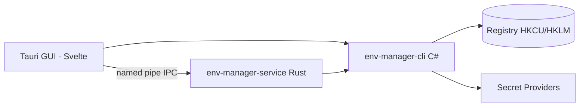

<div align="center">

<picture>
  <source media="(prefers-color-scheme: dark)" srcset="docs/assets/logo-dark-theme.png">
  <source media="(prefers-color-scheme: light)" srcset="docs/assets/logo-light-theme.png">
  
</picture>

# Env Manager

A Windows environment-variable manager with two front ends: a C# command-line tool built for scripts and AI agents, and a Tauri desktop app for interactive editing. Both front ends use the same registry rules.

**"Adapts seamlessly to every environment."**

[](https://github.com/Xxx91n/env-manager/releases)
[](LICENSE)
[](#install)
[](#prerequisites)
[](#architecture)

[Install](#install) · [Features](#features) · [CLI Reference](docs/cli-commands.md) · [Architecture](#architecture) · [Changelog](CHANGELOG.md)

<!-- README-I18N:START -->
**Languages:** **English** · [简体中文](docs/i18n/README.zh_CN.md) · [日本語](docs/i18n/README.ja.md) · [한국어](docs/i18n/README.ko.md) · [Deutsch](docs/i18n/README.de.md) · [Français](docs/i18n/README.fr.md) · [Español](docs/i18n/README.es.md) · [Português](docs/i18n/README.pt.md) · [Русский](docs/i18n/README.ru.md) · [العربية](docs/i18n/README.ar.md)
<!-- README-I18N:END -->

</div>

## Showcase

https://github.com/user-attachments/assets/7657b508-42bb-45a8-94b7-7c1fa052a4d0

## Features

- **Two front ends** — `env-manager-cli` for scripting and CI, `env-manager.exe` (Tauri 2 + Svelte) for interactive editing. Both go through the same registry rules.
- **Protected by default** — system variables and PATH entries cannot be deleted or renamed. A rename or scope change writes and checks the new value before deleting the old one. Every write holds all three locks: a Windows mutex in the CLI, a read/write lock in the Rust shell, and a write queue in the GUI.
- **Profiles** — a Global profile writes its values into the registry; a Launch profile puts its values into the environment of one child process and never writes the registry. Profiles can inherit from other profiles, and the app previews conflicts before applying.
- **Nine secret providers** — DPAPI, Credential Manager, SecretStore, HashiCorp Vault, SOPS, Azure Key Vault, 1Password, AWS Secrets Manager, AWS IAM Roles Anywhere. Secret values are kept as encrypted envelopes or `mount:<id>` references. The generic `add-var` and `edit-var` commands can still write plaintext to the registry; the full boundary is in [Security](#security) and [docs/plaintext-sinks.md](docs/plaintext-sinks.md).
- **PATH health** — `path health` finds duplicate and dead entries; `--fix` rewrites the list, `--dry-run` only reports.
- **Audit ledger** — append-only, SHA256 hash-chained history with rollback and a disaster-recovery export.

## For AI agents

```bash
env-manager-cli agents            # print the embedded agent manual
env-manager-cli agents --path     # file path of the manual (AGENTS.cli.md)
env-manager-cli agents --summary  # one-line machine-readable spec
env-manager-cli agents --json     # full command table as structured JSON
```

- [AGENTS.md](AGENTS.md) — repository-level agent instructions (architecture, hard boundaries, testing).
- [AGENTS.cli.md](AGENTS.cli.md) — ships inside the CLI binary, so an agent can read the contract at runtime.

## Security

> [!WARNING]
> Current builds are **not code-signed**. Windows SmartScreen may show an "unrecognized app" warning on first launch — click "More info" then "Run anyway". We have applied for free open-source code signing via the SignPath Foundation; once approved, all release artifacts (MSI and EXE) will be signed. See [Code signing policy](docs/code-signing-policy.md).

Protected variables and PATH entries are disabled before deletion, and the exact registry value kind is checked on restore. Values are validated before they reach the registry, and the named pipe refuses a second creator and caps a request at 65536 bytes. See [SECURITY.md](SECURITY.md) for vulnerability reporting.

**Threat model.** The project does not defend against a process running inside your own Windows user session. Such a process can already call `profile reveal-secret`, read a launched child's environment block, or catch the short-lived temp files the providers write. The design does limit the damage: DPAPI CurrentUser ciphertext cannot be decrypted by another user or on another machine, the secret commands cannot land a secret in the registry (the generic-command gap above aside), and the only places meant to carry a secret value are listed in the plaintext table linked below.

**Plaintext boundary.** The full table — where plaintext can exist, for how long, and what removes it — is in [docs/plaintext-sinks.md](docs/plaintext-sinks.md). The Plaintext lifecycle section of `docs/architecture.md` is the authoritative per-surface list. Memory zeroing and log scrubbing are best-effort, not guarantees: `tests/canary-redaction.Tests.ps1` scans 7 output surfaces for a planted canary, and the contract suite plus the offline suite assert `plaintext-never-in-envelope` on all nine providers (the `aws-roles-anywhere` mount has no emulator, so that assertion lives in its offline suite).

## Install

### MSI Installer

Download the MSI from [GitHub Releases](https://github.com/Xxx91n/env-manager/releases) and run it. Start Menu shortcuts are created automatically. Available in x64, x86, and ARM64.

### Portable

Download the portable ZIP from [GitHub Releases](https://github.com/Xxx91n/env-manager/releases). Extract it and run `env-manager.exe`. No installation needed.

### CLI-Only

Download the CLI-only ZIP for headless or scripting use: `env-manager-cli.exe` plus its `.dll` files. No GUI and no WebView2 dependency.

### Prerequisites

> [!IMPORTANT]
> **Portable** and **CLI-Only** builds are framework-dependent: they need the **.NET 10 Desktop Runtime** on the target machine — download it from the official [.NET download page](https://dotnet.microsoft.com/download/dotnet/10.0). The **MSI installer** does not check for or install .NET; install the runtime yourself before first launch.
>
> **WebView2 Runtime** (for the GUI) is preinstalled on Windows 11 and available for Windows 10 21H2 and later from [Microsoft](https://developer.microsoft.com/microsoft-edge/webview/).

For optional external secret-provider tools (SOPS, 1Password CLI, Vault CLI, AWS CLI, Azure CLI, PowerShell 7), see the [Secret Providers Guide](docs/secret-providers-guide.md).

### winget

> [!NOTE]
> winget distribution is planned but not yet available. Track progress in GitHub Issues.

### From Source

```bash
git clone https://github.com/Xxx91n/env-manager.git
cd env-manager
cd frontend && npm ci && cd ..
node scripts/build.mjs --arch x64
```

Requires .NET 10 SDK, Node.js 18+, and Rust stable with the MSVC or GNU target. See [docs/build-and-release.md](docs/build-and-release.md) for details.

## Usage

### CLI

```bash
# List / get / set
env-manager-cli.exe list
env-manager-cli.exe get PATH
env-manager-cli.exe set JAVA_HOME "D:\jdk17" --scope system

# Create a Launch profile and launch with an isolated environment
env-manager-cli.exe profile create dev --type launch --target python.exe
env-manager-cli.exe profile add-secret dev API_KEY "sk-xxx"
env-manager-cli.exe profile launch dev

# PATH health
env-manager-cli.exe path health

# Backup / restore
env-manager-cli.exe backup --output backup.json
env-manager-cli.exe restore backup.json

# Disaster recovery and tamper-evident audit
env-manager-cli.exe export-state --output state.dpapi
env-manager-cli.exe audit verify --strict

# Service control
env-manager-cli.exe service status
```

See [docs/cli-commands.md](docs/cli-commands.md) for the full command reference.

### GUI

Run `env-manager.exe`. The GUI shows a live variable list with search, scope filtering, inline edit, a PATH editor with drag-and-drop reordering, profile management, secret provider selection, service control, the audit ledger, and 10 languages.

## Architecture



- **CLI**: a C# .NET 10 executable that coordinates the work and is the only writer of the registry.
- **Service**: a standalone Rust binary that keeps secret mounts fresh over a named pipe.
- **GUI**: a Tauri 2 + Svelte 5 front end that uses the same IPC contracts.

## Secret providers

Nine secret providers, each checked when you switch to it. A failed check appears as an inline amber banner in the profile editor:

| Provider | Auth Method | Timer Refresh | Docs |
|---|---|---|---|
| DPAPI CurrentUser | Windows DPAPI | No (per user) | [Guide](docs/secret-providers-guide.md) |
| Windows Credential Manager | Credential Manager + DPAPI | No (per user) | [Guide](docs/secret-providers-guide.md) |
| PowerShell SecretManagement | SecretStore vault | No (`CreatedOnly`) | [Guide](docs/secret-providers-guide.md) |
| HashiCorp Vault KV v2 | VAULT_TOKEN / AppRole cert | Yes | [Guide](docs/secret-providers-guide.md) |
| SOPS | Age / PGP / KMS | No (`CreatedOnly`) | [Guide](docs/secret-providers-guide.md) |
| Azure Key Vault | Service principal cert / managed identity | Yes | [Guide](docs/secret-providers-guide.md) |
| 1Password CLI | OP_SERVICE_ACCOUNT_TOKEN | Yes | [Guide](docs/secret-providers-guide.md) |
| AWS Secrets Manager | SigV4 + access keys | Yes | [Guide](docs/secret-providers-guide.md) |
| AWS IAM Roles Anywhere | Certificate from the machine store exchanged for temporary credentials | Yes (`Periodic`; the service-side gap is tracked in [this issue](https://github.com/Xxx91n/env-manager/issues/276)) | [Guide](docs/secret-providers-guide.md) |

See [docs/secret-providers-guide.md](docs/secret-providers-guide.md) for per-provider prerequisites, one-time setup, and error fix steps.

## Service mode

`env-manager-service.exe` is a standalone Rust binary that keeps secret mounts fresh and answers over a named pipe:

- **ServiceMode**: Service (SCM-managed, machine boot), Background (user-launched), Cli (one-shot gateway)
- **Reconcile loop**: 300s periodic full-scan, idempotent per-item handler, 30s first-tick delay
- **Audit ledger**: append-only hash-chained `audit-ledger.jsonl` with 100MB rotation and tamper detection
- **IPC**: anti-squatting pipe flag, 65536-byte request cap, newline-delimited JSON protocol
- **Watchdog**: two-layer recovery — SCM auto-restart (Service mode) + GUI 30s ping watchdog (Background mode)

## Documentation

| Document | Content |
|---|---|
| [CHANGELOG.md](CHANGELOG.md) | Version history (keepachangelog format) |
| [docs/cli-commands.md](docs/cli-commands.md) | Full CLI command reference |
| [docs/architecture.md](docs/architecture.md) | Deep architecture |
| [docs/plaintext-sinks.md](docs/plaintext-sinks.md) | Where secret plaintext can exist |
| [docs/backup-and-profiles.md](docs/backup-and-profiles.md) | Backup, restore, profile semantics |
| [docs/secret-providers-guide.md](docs/secret-providers-guide.md) | Secret provider setup |
| [docs/build-and-release.md](docs/build-and-release.md) | Build and release process |
| [AGENTS.md](AGENTS.md) / [AGENTS.cli.md](AGENTS.cli.md) | Agent-facing guides |

## Maintainers

[@Xxx91n](https://github.com/Xxx91n)

## Contributing

Issues and PRs are welcome. Read [AGENTS.md](AGENTS.md) first for the architecture boundaries and the test policy.

## License

Apache-2.0 © 2026 Env Manager Contributors. See [LICENSE](LICENSE).
