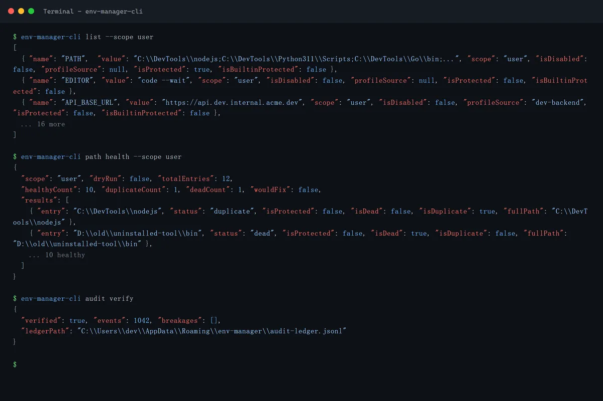
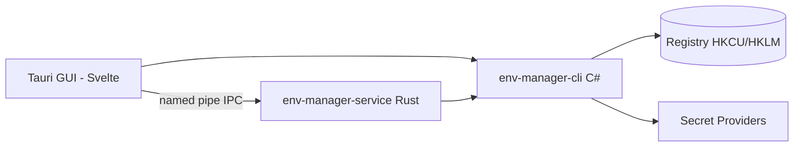

<!-- canonical: ../../README.md -->
<!-- sync: ef2a485dfffb -->

<div align="center">

<picture>
  <source media="(prefers-color-scheme: dark)" srcset="../../docs/assets/logo-dark-theme.png">
  <source media="(prefers-color-scheme: light)" srcset="../../docs/assets/logo-light-theme.png">
  
</picture>

<p align="center">
  
</p>

# Env Manager

مدير متغيرات بيئة Windows بواجهتين — CLI بلغة C# مصمم للنصوص البرمجية ووكلاء الذكاء الاصطناعي، وGUI بتقنية Tauri للتحرير التفاعلي — فوق مجموعة واحدة من عقود السجل.

**«يتكيف بسلاسة مع كل بيئة.»**

[](https://github.com/Xxx91n/env-manager/releases)
[](../../LICENSE)
[](#التثبيت)
[](#المتطلبات-المسبقة)
[](#البنية)

[التثبيت](#التثبيت) · [الميزات](#الميزات) · [مرجع CLI](../../docs/cli-commands.md) · [البنية](#البنية) · [سجل التغييرات](../../CHANGELOG.md)

<!-- README-I18N:START -->
**اللغات:** [English](../../README.md) · [简体中文](README.zh_CN.md) · [日本語](README.ja.md) · [한국어](README.ko.md) · [Deutsch](README.de.md) · [Français](README.fr.md) · [Español](README.es.md) · [Português](README.pt.md) · [Русский](README.ru.md) · **العربية**
<!-- README-I18N:END -->

</div>

## العروض التوضيحية

### GUI

<div dir="rtl">

| | | |
|:-:|:-:|:-:|
| <br>**المتغيرات** — بحث، تصفية حسب النطاق، إجراءات لكل صف | <br>**نطاق النظام** — العناصر المحمية مقفلة | <br>**محرر PATH** — كشف الإدخالات الميتة والمكررة |
| <br>**الملفات الشخصية** — تطبيق / تشغيل / وراثة | <br>**سجل التدقيق** — متسلسل بالهاش وقابل للتحقق | <br>**مدير الخدمة** — تركيب الأسرار |

</div>

### CLI

<p align="center">
  
</p>

| | |
|:-:|:-:|
| <br>**مخرجات JSON أولًا** — يصدر `agents --json` مواصفة الأوامر كاملة | CLI سطح من الدرجة الأولى: أكثر من 18 أمرًا، كلها قابلة للبرمجة وقابلة للاستهلاك بصيغة JSON. دليل الوكيل مضمّن داخل الملف التنفيذي — نفّذ `env-manager-cli agents` لطباعته. أوامر القراءة فقط أعلاه تستخدم مخرجات طرفية محاكاة؛ أعد إنشاءها بـ `node scripts/demo/capture.mjs`. |

## الميزات

- **واجهتان** — `env-manager-cli` للنصوص البرمجية وCI، و`env-manager.exe` (Tauri 2 + Svelte) للتحرير التفاعلي. كلاهما يمر عبر عقدي السجل نفسيهما.
- **محمي افتراضيًا** — لا يمكن حذف متغيرات النظام وإدخالات PATH أو إعادة تسميتها؛ كل كتابة متسلسلة عبر ثلاث طبقات (mutex + قفل كتابة + تحقق قبل الاستبدال).
- **الملفات الشخصية** — تُطبَّق الملفات الشخصية العامة على السجل؛ بينما تحقن ملفات التشغيل كتلة بيئة معزولة في عملية واحدة دون لمس السجل. وراثة، ومعاينة التعارضات، وتراجع بترتيب عكسي.
- **8 موفّري أسرار** — DPAPI وCredential Manager وSecretStore وHashiCorp Vault وSOPS وAzure Key Vault و1Password وAWS Secrets Manager. أوامر الأسرار لا تحفظ إلا أغلفة مشفّرة أو مراجع `mount:<id>` — وفجوة الأوامر العامة `add-var`/`edit-var` قد تكتب نصًّا صريحًا في السجل؛ وحدود تعرّض النص الصريح مبيّنة في [الأمان](#الأمان) و[docs/plaintext-sinks.md](../../docs/plaintext-sinks.md).
- **صحة PATH** — يكتشف `path health` الإدخالات المكررة والميتة؛ `--fix` يعيد الكتابة، و`--dry-run` يكتفي بالتقرير.
- **سجل التدقيق** — تاريخ للإضافة فقط (append-only) مربوط بسلسلة تجزئة SHA256، مع تراجع وتصدير للاسترداد من الكوارث.

## لوكلاء الذكاء الاصطناعي

```bash
env-manager-cli agents            # print the embedded agent manual
env-manager-cli agents --path     # file path of the manual (AGENTS.cli.md)
env-manager-cli agents --summary  # one-line machine-readable spec
env-manager-cli agents --json     # full command table as structured JSON
```

- [AGENTS.md](../../AGENTS.md) — تعليمات على مستوى المستودع للوكلاء (البنية، الحدود الصارمة، الاختبار).
- [AGENTS.cli.md](../../AGENTS.cli.md) — يُوزَّع مع الملف التنفيذي للـCLI حتى يتمكن أي وكيل من اكتشاف العقد وقت التشغيل.
- **سطح وكيل محدد النطاق بالقدرات** — القائمة البيضاء الاختيارية `agentCapabilities` في `secret-providers.json` تتيح للبيئات المنتشرة رفض استدعاءات set/delete المتوازية القادمة من الوكلاء.

## الأمان

> [!WARNING]
> الإصدارات الحالية **غير موقعة برمجيًا**. قد يعرض Windows SmartScreen تحذير «تطبيق غير معروف» عند التشغيل الأول — انقر «مزيد من المعلومات» ثم «التشغيل على أي حال». تقدمنا بطلب للحصول على توقيع كود مجاني للمشاريع مفتوحة المصدر عبر SignPath Foundation؛ وبمجرد الموافقة، ستُوقَّع جميع نواتج الإصدار (MSI + EXE). راجع [سياسة توقيع الكود](../../docs/code-signing-policy.md).

تُعطَّل المتغيرات المحمية وإدخالات PATH قبل حذفها، مع تحقق دقيق من نوع القيمة في السجل عند الاستعادة. تستخدم IPC عبر named pipe أعلامًا مضادة للاستحواذ (anti-squatting) والتحقق من المدخلات (حد أقصى 64 وسيطًا، وسقف 32767 حرفًا، ورفض البايتات الفارغة). راجع [SECURITY.md](../../SECURITY.md) للإبلاغ عن الثغرات.

**نموذج التهديد.** الخصم الذي *لا* ندافع ضده هو أي عملية تعمل داخل جلسة مستخدم Windows الخاصة بك — فهي تستطيع أصلًا استدعاء `profile reveal-secret`، أو قراءة كتلة بيئة العملية الفرعية المُطلَقة، أو اعتراض الملفات المؤقتة العابرة التي تنتجها الموفّرات. ما *يقيّده* التصميم فعلًا: نص DPAPI-CurrentUser المشفّر غير قابل للفك لمستخدم آخر أو جهاز آخر، وأوامر الأسرار لا يمكن أن توصل سرًّا إلى السجل (باستثناء فجوة الأوامر العامة المذكورة)، والمصابّ الوحيدة *المقصودة* لحمل قيمة سرية هي المصمَّمة الموثّقة في مصفوفة حدود النص الصريح أدناه.

**حدود النص الصريح.** المصفوفة الكاملة لكل مصبّ — أين يمكن أن يوجد النص الصريح، ولأي مدة، ومن ينظفه — موجودة في [docs/plaintext-sinks.md](../../docs/plaintext-sinks.md)؛ وقسم Plaintext lifecycle في `docs/architecture.md` هو قائمة السماح المرجعية لكل سطح. تصفير الذاكرة وتنقية السجلات إجراءات نظافة بأفضل جهد لا ضمانات؛ ويفحص `tests/canary-redaction.Tests.ps1` سبعة مواضع إخراج بحثًا عن canary مزروع، وتؤكد مجموعة العقود المشتركة `plaintext-never-in-envelope` على الموفّرين الثمانية جميعًا.

## التثبيت

### مثبّت MSI

نزّل ملف MSI من [GitHub Releases](https://github.com/Xxx91n/env-manager/releases) وشغّله. ينشئ اختصارات قائمة ابدأ تلقائيًا. متاح بإصدارات x64 وx86 وARM64.

### Portable

نزّل ملف ZIP المحمول من [GitHub Releases](https://github.com/Xxx91n/env-manager/releases). فك الضغط وشغّل `env-manager.exe` مباشرة. لا حاجة للتثبيت.

### CLI فقط

نزّل ZIP الخاص بـCLI فقط للاستخدام بدون واجهة أو عبر النصوص البرمجية: `env-manager-cli.exe` بالإضافة إلى ملفات `.dll`. بدون GUI وبدون اعتماد على WebView2.

### المتطلبات المسبقة

> [!IMPORTANT]
> إصدارات **Portable** و**CLI-Only** تعتمد على framework: تتطلب **.NET 10 Desktop Runtime** على الجهاز المستهدف — نزّله من [صفحة تنزيل .NET الرسمية](https://dotnet.microsoft.com/download/dotnet/10.0). **مثبّت MSI** لا يتحقق من .NET ولا يثبّته — ثبّت وقت التشغيل بنفسك قبل التشغيل الأول.
>
> **بيئة WebView2 Runtime** (للواجهة GUI) مثبتة مسبقًا على Windows 11 ومتاحة لنظام Windows 10 21H2+ من [Microsoft](https://developer.microsoft.com/microsoft-edge/webview/).

بالنسبة للأدوات الخارجية الاختيارية لموفّري الأسرار (SOPS و1Password CLI وVault CLI وAWS CLI وAzure CLI وPowerShell 7)، راجع [دليل موفّري الأسرار](../../docs/secret-providers-guide.md).

### winget

> [!NOTE]
> توزيع عبر winget مخطط له لكنه غير متاح بعد. تابع المستجدات عبر GitHub Issues.

### من المصدر

```bash
git clone https://github.com/Xxx91n/env-manager.git
cd env-manager
cd frontend && npm ci && cd ..
node scripts/build.mjs --arch x64
```

يتطلب .NET 10 SDK وNode.js 18+ وRust مستقرًا مع هدف MSVC أو GNU. راجع [docs/build-and-release.md](../../docs/build-and-release.md) للتفاصيل.

## الاستخدام

### CLI

```bash
# List / get / set
env-manager-cli.exe list
env-manager-cli.exe get PATH
env-manager-cli.exe set JAVA_HOME "D:\jdk17" --scope system

# Create a Launch profile and launch with isolated env
env-manager-cli.exe profile create dev --type launch --target python.exe
env-manager-cli.exe profile add-secret dev API_KEY "sk-xxx"
env-manager-cli.exe profile launch dev

# PATH health
env-manager-cli.exe path health

# Backup / restore
env-manager-cli.exe backup --output backup.json
env-manager-cli.exe restore backup.json

# Disaster recovery + tamper-evident audit
env-manager-cli.exe export-state --output state.dpapi
env-manager-cli.exe audit verify --strict

# Service control
env-manager-cli.exe service status
```

راجع [docs/cli-commands.md](../../docs/cli-commands.md) للحصول على المرجع الكامل للأوامر.

### GUI

شغّل `env-manager.exe`. توفر الواجهة GUI قائمة متغيرات في الوقت الفعلي مع بحث وتصفية حسب النطاق وتحرير مضمّن ومحرر PATH لإعادة الترتيب بالسحب والإفلات وإدارة الملفات الشخصية واختيار موفّر الأسرار ولوحة التحكم في الخدمة وسجل التدقيق ودعم i18n بعشر لغات.

## البنية



- **CLI**: ملف تنفيذي أحادي الملف بلغة C# .NET 10 — طبقة التنسيق وبوابة السجل.
- **الخدمة**: ملف تنفيذي مستقل بلغة Rust يدير دورة حياة تركيب الأسرار عبر IPC باستخدام named pipe.
- **GUI**: واجهة أمامية Tauri 2 + Svelte 4 تستخدم عقدي IPC نفسيهما.

## موفّرو الأسرار

8 خلفيات (backends) لموفّري الأسرار مع فحص مسبق للتفعيل — تظهر حالات الفشل كلافتات كهرمانية مضمّنة مباشرة في محرر الملفات الشخصية:

| الموفّر | طريقة المصادقة | التحديث الدوري | التوثيق |
|---|---|---|---|
| DPAPI CurrentUser | Windows DPAPI | لا (لكل مستخدم) | [دليل](../../docs/secret-providers-guide.md) |
| Windows Credential Manager | CredMan + DPAPI | لا (لكل مستخدم) | [دليل](../../docs/secret-providers-guide.md) |
| PowerShell SecretManagement | SecretStore vault | لا (CreatedOnly) | [دليل](../../docs/secret-providers-guide.md) |
| HashiCorp Vault KV v2 | VAULT_TOKEN / AppRole cert | نعم | [دليل](../../docs/secret-providers-guide.md) |
| SOPS | Age / PGP / KMS | لا (CreatedOnly) | [دليل](../../docs/secret-providers-guide.md) |
| Azure Key Vault | SP cert / managed identity | نعم | [دليل](../../docs/secret-providers-guide.md) |
| 1Password CLI | OP_SERVICE_ACCOUNT_TOKEN | نعم | [دليل](../../docs/secret-providers-guide.md) |
| AWS Secrets Manager | SigV4 + access keys | نعم | [دليل](../../docs/secret-providers-guide.md) |

راجع [docs/secret-providers-guide.md](../../docs/secret-providers-guide.md) لمعرفة المتطلبات الخاصة بكل موفّر والإعداد لمرة واحدة وخطوات إصلاح أخطاء التفعيل.

## وضع الخدمة

`env-manager-service.exe` هو ملف تنفيذي مستقل بلغة Rust يدير دورة حياة تركيب الأسرار عبر IPC باستخدام named pipe:

- **RuntimeMode**: Service (تديره SCM، عند إقلاع الجهاز)، Background (يُشغَّل بواسطة المستخدم)، Cli (بوابة لمرة واحدة)
- **حلقة المطابقة**: فحص كامل دوري كل 300 ثانية، معالج لكل عنصر بسلوك idempotent، وتأخير 30 ثانية قبل أول دورة
- **سجل التدقيق**: `audit-ledger.jsonl` للإضافة فقط بسلسلة تجزئة، مع تدوير عند 100 ميجابايت واكتشاف العبث
- **IPC**: علم named pipe مضاد للاستحواذ، سقف 65536 بايت للطلب، بروتوكول JSON مفصول بفواصل الأسطر
- **Watchdog**: استرداد من طبقتين — إعادة تشغيل تلقائي عبر SCM (وضع Service) + مراقب ping كل 30 ثانية في GUI (وضع Background)

## Limitations

- الإصدارات الحالية غير موقعة برمجيًا — قد يظهر تحذير SmartScreen عند التشغيل الأول (راجع قسم «الأمان»).
- التوزيع عبر winget مخطط له لكنه غير متاح بعد.
- تتطلب واجهة GUI وقت تشغيل WebView2، وتتطلب نسختا Portable وCLI فقط .NET 10 Desktop Runtime (راجع المتطلبات المسبقة).
- Windows فقط.

## التوثيق

| المستند | المحتوى |
|---|---|
| [CHANGELOG.md](../../CHANGELOG.md) | سجل الإصدارات (بصيغة keepachangelog) |
| [docs/cli-commands.md](../../docs/cli-commands.md) | المرجع الكامل لأوامر CLI |
| [docs/architecture.md](../../docs/architecture.md) | البنية بعمق |
| [docs/plaintext-sinks.md](../../docs/plaintext-sinks.md) | أين يمكن أن يوجد نص الأسرار الصريح |
| [docs/backup-and-profiles.md](../../docs/backup-and-profiles.md) | النسخ الاحتياطي والاستعادة ودلالات الملفات الشخصية |
| [docs/secret-providers-guide.md](../../docs/secret-providers-guide.md) | إعداد موفّري الأسرار |
| [docs/build-and-release.md](../../docs/build-and-release.md) | عملية البناء والإصدار |
| [AGENTS.md](../../AGENTS.md) / [AGENTS.cli.md](../../AGENTS.cli.md) | أدلة موجّهة للوكلاء |

## القائمون على الصيانة

[@Xxx91n](https://github.com/Xxx91n)

## المساهمة

نرحب بالمساهمات عبر Issues وPR. اقرأ [AGENTS.md](../../AGENTS.md) أولاً لفهم حدود البنية وسياسة الاختبار.

## الترخيص

Apache-2.0 © 2026 Env Manager Contributors. راجع [LICENSE](../../LICENSE).
