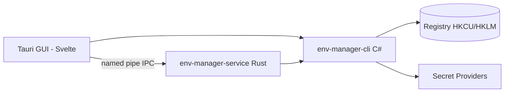

<!-- canonical: ../../README.md -->
<!-- sync: 7ef28678ebbb -->

<div align="center">

<picture>
  <source media="(prefers-color-scheme: dark)" srcset="../../docs/assets/logo-dark-theme.png">
  <source media="(prefers-color-scheme: light)" srcset="../../docs/assets/logo-light-theme.png">
  
</picture>

# Env Manager

أداة لإدارة متغيرات بيئة Windows بواجهتين: أداة سطر أوامر مكتوبة بلغة C# مخصصة للسكربتات ووكلاء الذكاء الاصطناعي، وتطبيق مكتبي مبني بـ Tauri للتحرير والتعديل السهل. كلتا الواجهتين تلتزمان بقواعد السجل (Registry) نفسها تماماً.

**"يتكيف بسلاسة مع كل بيئة."**

[](https://github.com/Xxx91n/env-manager/releases)
[](../../LICENSE)
[](#التثبيت)
[](#المتطلبات-المسبقة)
[](#البنية)

[التثبيت](#التثبيت) · [الميزات](#الميزات) · [مرجع CLI](../../docs/cli-commands.md) · [البنية](#البنية) · [سجل التغييرات](../../CHANGELOG.md)

<!-- README-I18N:START -->
**اللغات:** [English](../../README.md) · [简体中文](README.zh_CN.md) · [日本語](README.ja.md) · [한국어](README.ko.md) · [Deutsch](README.de.md) · [Français](README.fr.md) · [Español](README.es.md) · [Português](README.pt.md) · [Русский](README.ru.md) · **العربية**
<!-- README-I18N:END -->

</div>

## العروض التوضيحية

https://github.com/user-attachments/assets/7657b508-42bb-45a8-94b7-7c1fa052a4d0

## الميزات

- **واجهتان للاستخدام** — `env-manager-cli` للسكربتات وخطوط البناء الآلي (CI)، وتطبيق `env-manager.exe` (مبني بـ Tauri 2 + Svelte) لتعديل المتغيرات بيسر عبر واجهة رسومية. كلاهما يعمل وفق نفس ضوابط وقواعد السجل.
- **حماية مفعّلة تلقائياً** — لا يمكن حذف أو تغيير اسم متغيرات النظام أو مسارات PATH الأساسية. وعند تعديل الاسم أو تغيير النطاق، يتم التحقق من كتابة القيمة الجديدة بنجاح أولاً قبل إزالة القيمة القديمة. وكل عملية كتابة تخضع لثلاثة أقفال حماية: قفل Windows mutex في أداة سطر الأوامر، وقفل قراءة/كتابة في طبقة Rust، وطابور كتابة في الواجهة الرسومية.
- **ملفات التعريف** — الملف العام (Global profile) يكتب قيمه مباشرة في سجل الويندوز، بينما ملف التشغيل (Launch profile) يضع قيمه داخل بيئة عملية فرعية واحدة فقط ولا يكتب في السجل إطلاقاً. يمكن للملفات أن ترث القيم من ملفات أخرى، ويعرض لك التطبيق أي تعارضات محتملة قبل التطبيق.
- **تسعة مزودات للأسرار** — يدعم التطبيق DPAPI، وCredential Manager، وSecretStore، وHashiCorp Vault، وSOPS، وAzure Key Vault، و1Password، وAWS Secrets Manager، وAWS IAM Roles Anywhere. تُحفظ القيم السرية في صورة أغلفة مشفرة أو عبر مراجع `mount:<id>`. تبقى الأوامر العامة `add-var` و`edit-var` قادرة على كتابة النصوص العادية في السجل؛ وتفاصيل الحدود الآمنة موضحة في قسم [الأمان](#الأمان) ومستند [docs/plaintext-sinks.md](../../docs/plaintext-sinks.md).
- **سلامة مسارات PATH** — يكتشف الأمر `path health` المسارات المكررة وغير الموجودة؛ والخيار `--fix` يصلح القائمة تلقائياً، بينما يكتفي `--dry-run` بعرض تقرير دون تعديل فعلي.
- **سجل التدقيق** — سجل إلحاقي فقط (append-only) محمي بسلسلة تجزئة SHA256، يدعم التراجع والتصدير للتعافي من الكوارث.

## لوكلاء الذكاء الاصطناعي

```bash
env-manager-cli agents            # print the embedded agent manual
env-manager-cli agents --path     # file path of the manual (AGENTS.cli.md)
env-manager-cli agents --summary  # one-line machine-readable spec
env-manager-cli agents --json     # full command table as structured JSON
```

- [AGENTS.md](../../AGENTS.md) — إرشادات الوكلاء على مستوى المستودع (البنية المعمارية، الحدود الصارمة، الاختبارات).
- [AGENTS.cli.md](../../AGENTS.cli.md) — مدمج مباشرة داخل أداة سطر الأوامر، مما يتيح للوكيل قراءة قواعد العمل وقت التشغيل.

## الأمان

> [!WARNING]
> الإصدارات الحالية **غير موقعة بشهادة رقمية بعد**. قد يظهر لك تحذير Windows SmartScreen بأن التطبيق غير معروف عند أول تشغيل — انقر على "مزيد من المعلومات" (More info) ثم "التشغيل على أي حال" (Run anyway). لقد تقدمنا بطلب للحصول على توقيع مجاني للمشاريع مفتوحة المصدر عبر مؤسسة SignPath؛ وبمجرد اعتماده، ستكون جميع ملفات التثبيت والتشغيل موقعة رقمياً. راجع [سياسة التوقيع الرقمي](../../docs/code-signing-policy.md).

يتم تعطيل المتغيرات المحمية ومسارات PATH قبل حذفها، كما يتم فحص نوع القيمة في السجل بدقة عند الاستعادة. وتخضع القيم للتحقق قبل وصولها إلى السجل، وترفض القناة المسماة (named pipe) إنشاء طرف ثانٍ وتضع حداً أقصى لحجم الطلب قدره 65536 بايت. راجع [SECURITY.md](../../SECURITY.md) للإبلاغ عن الثغرات الأمنية.

**نموذج التهديد.** لا يحمي التطبيق من البرامج التي تعمل داخل نفس جلسة مستخدم Windows الخاصة بك؛ إذ بإمكان مثل تلك البرامج قراءة متغيرات البيئة للعمليات الفرعية أو استدعاء `profile reveal-secret` أو الوصول للملفات المؤقتة اللحظية للمزودات. ولكن التصميم يقلل الأضرار بشكل فعال: فنصوص DPAPI CurrentUser المشفرة لا يمكن فكها من قِبل مستخدم آخر أو على جهاز مختلف، كما تمنع أوامر الأسرار وصول أي سر إلى السجل (باستثناء ما ذُكر أعلاه حول الأوامر العامة)، وتقتصر المواضع التي يمكن أن يظهر فيها النص الصريح على الأماكن المحددة في جدول النصوص الصريحة المشار إليه أدناه.

**حدود النص الصريح.** الجدول الكامل — الذي يوضح أين يمكن أن يوجد النص الصريح، ولأي مدة، وما الذي يزيله — متاح في [docs/plaintext-sinks.md](../../docs/plaintext-sinks.md). ويعد قسم دورة حياة النص الصريح (Plaintext lifecycle) في `docs/architecture.md` هو المرجع الأساسي لكل سطح. ويعد تصفير الذاكرة وتنقية السجلات جهوداً وقائية حثيثة لا ضمانات مطلقة: يقوم اختبار `tests/canary-redaction.Tests.ps1` بفحص 7 أسطح إخراج للتأكد من عدم تسرب أي بيانات اختبارية، وتؤكد اختبارات العقود المشتركة `plaintext-never-in-envelope` عبر كافة المزودات التسعة.

## التثبيت

### مثبت MSI

نزّل ملف MSI من صفحة [إصدارات GitHub](https://github.com/Xxx91n/env-manager/releases) ثم شغله. سيتم إنشاء اختصارات قائمة ابدأ تلقائياً. متوفر لأنظمة x64 وx86 وARM64.

### النسخة المحمولة (Portable)

نزّل ملف ZIP المحمول من صفحة [إصدارات GitHub](https://github.com/Xxx91n/env-manager/releases). فك الضغط وشغل `env-manager.exe` مباشرة بدون الحاجة لأي تثبيت.

### نسخة سطر الأوامر فقط (CLI-Only)

نزّل ملف ZIP الخاص بسطر الأوامر للاستخدام مع السكربتات أو في بيئات العمل المؤتمتة: يحتوي على `env-manager-cli.exe` وملفات `.dll` التابعة له، بدون واجهة رسومية ودون الحاجة لـ WebView2.

### المتطلبات المسبقة

> [!IMPORTANT]
> نسختي **Portable** و**CLI-Only** تعتمدان على بيئة التشغيل المشتركة: تحتاجان إلى تثبيت **.NET 10 Desktop Runtime** على الجهاز المستهدف — يمكنك تنزيله من [صفحة تنزيل .NET الرسمية](https://dotnet.microsoft.com/download/dotnet/10.0). علماً بأن **مثبت MSI** لا يفحص وجود .NET ولا يقوم بتثبيته تلقائياً؛ لذا يُرجى تثبيت بيئة التشغيل بنفسك قبل التشغيل لأول مرة.
>
> بيئة **WebView2 Runtime** (المطلوبة للواجهة الرسومية) مثبتة مسبقاً في Windows 11 ومتاحة لنظام Windows 10 الإصدار 21H2 والإصدارات الأحدث من موقع [Microsoft](https://developer.microsoft.com/microsoft-edge/webview/).

للاطلاع على أدوات مزودات الأسرار الخارجية الاختيارية (SOPS و1Password CLI وVault CLI وAWS CLI وAzure CLI وPowerShell 7)، يرجى مراجعة [دليل مزودات الأسرار](../../docs/secret-providers-guide.md).

### winget

> [!NOTE]
> التوزيع عبر winget قيد التخطيط وسيتوفر قريباً. يمكنك متابعة تقدمه عبر مشكلات GitHub (Issues).

### البناء من المصدر

```bash
git clone https://github.com/Xxx91n/env-manager.git
cd env-manager
cd frontend && npm ci && cd ..
node scripts/build.mjs --arch x64
```

يتطلب ذلك .NET 10 SDK وNode.js 18 فما فوق، وإصدار Rust المستقر مع هدف MSVC أو GNU. راجع [docs/build-and-release.md](../../docs/build-and-release.md) للمزيد من التفاصيل.

## الاستخدام

### سطر الأوامر (CLI)

```bash
# عرض / جلب / تعيين
env-manager-cli.exe list
env-manager-cli.exe get PATH
env-manager-cli.exe set JAVA_HOME "D:\jdk17" --scope system

# إنشاء ملف تشغيل والتشغيل في بيئة معزولة
env-manager-cli.exe profile create dev --type launch --target python.exe
env-manager-cli.exe profile add-secret dev API_KEY "sk-xxx"
env-manager-cli.exe profile launch dev

# التحقق من سلامة مسارات PATH
env-manager-cli.exe path health

# النسخ الاحتياطي / الاستعادة
env-manager-cli.exe backup --output backup.json
env-manager-cli.exe restore backup.json

# التعافي من الكوارث والتدقيق الموثق ضد التلاعب
env-manager-cli.exe export-state --output state.dpapi
env-manager-cli.exe audit verify --strict

# التحكم في الخدمة
env-manager-cli.exe service status
```

راجع [docs/cli-commands.md](../../docs/cli-commands.md) للحصول على المرجع الكامل لجميع الأوامر.

### الواجهة الرسومية (GUI)

شغل `env-manager.exe`. تقدم لك الواجهة عرضاً مباشراً لقائمة المتغيرات مع خاصية البحث، والتصفية حسب النطاق، والتحرير السريع، ومحرر لمسارات PATH يدعم السحب والإفلات، وإدارة ملفات التعريف، واختيار مزود الأسرار، والتحكم في الخدمة، وسجل التدقيق، مع دعم كامل لعشر لغات.

## البنية



- **CLI**: ملف تنفيذي بلغة C# .NET 10 يتولى تنسيق العمليات وهو المسؤول الوحيد عن الكتابة في السجل.
- **الخدمة (Service)**: برنامج مستقل بلغة Rust يحافظ على تحديث نقاط ربط الأسرار ويتواصل عبر القناة المسماة (named pipe).
- **الواجهة (GUI)**: واجهة أمامية مبنية بـ Tauri 2 + Svelte 5 تستخدم نفس عقود IPC.

## مزودات الأسرار

تسعة مزودات للأسرار، يتم فحص جاهزية كل منها عند التبديل إليه. وتظهر أي مشكلة تمنع الاستخدام في صورة شريط تنبيه برتقالي داخل محرر ملفات التعريف:

| المزود | طريقة المصادقة | التحديث الدوري بمؤقت | التوثيق |
|---|---|---|---|
| DPAPI CurrentUser | Windows DPAPI | لا (لكل مستخدم) | [الدليل](../../docs/secret-providers-guide.md) |
| Windows Credential Manager | Credential Manager + DPAPI | لا (لكل مستخدم) | [الدليل](../../docs/secret-providers-guide.md) |
| PowerShell SecretManagement | مستودع SecretStore | لا (`CreatedOnly`) | [الدليل](../../docs/secret-providers-guide.md) |
| HashiCorp Vault KV v2 | رمز VAULT_TOKEN / شهادة AppRole | نعم | [الدليل](../../docs/secret-providers-guide.md) |
| SOPS | Age / PGP / KMS | لا (`CreatedOnly`) | [الدليل](../../docs/secret-providers-guide.md) |
| Azure Key Vault | شهادة كائن الخدمة / الهوية المدارة | نعم | [الدليل](../../docs/secret-providers-guide.md) |
| 1Password CLI | رمز OP_SERVICE_ACCOUNT_TOKEN | نعم | [الدليل](../../docs/secret-providers-guide.md) |
| AWS Secrets Manager | توقيع SigV4 + مفاتيح الوصول | نعم | [الدليل](../../docs/secret-providers-guide.md) |
| AWS IAM Roles Anywhere | شهادة من مخزن شهادات الجهاز تُبدَّل ببيانات اعتماد مؤقتة | نعم | [الدليل](../../docs/secret-providers-guide.md) |

راجع [docs/secret-providers-guide.md](../../docs/secret-providers-guide.md) لمعرفة المتطلبات المسبقة لكل مزود، وخطوات الإعداد لأول مرة، وطرق معالجة أخطاء التفعيل.

## وضع الخدمة

`env-manager-service.exe` هو برنامج مستقل بلغة Rust يضمن بقاء نقاط ربط الأسرار حديثة ويستقبل الطلبات عبر قناة مسماة (named pipe):

- **أوضاع الخدمة (ServiceMode)**: وضع الخدمة (تتحكم به إدارة خدمات الويندوز SCM عند إقلاع النظام)، والوضع الخلفي Background (يشغله المستخدم)، ووضع Cli (بوابة سريعة للأوامر الفردية).
- **حلقة المطابقة (Reconcile loop)**: فحص دوري شامل كل 300 ثانية، معالجة آمنة غير مكررة لكل عنصر، مع تأخير مدته 30 ثانية عند أول تشغيل.
- **سجل التدقيق**: ملف `audit-ledger.jsonl` إلحاقي محمي بسلسلة تجزئة، مع تدوير تلقائي عند بلوغ 100 ميجابايت وميزة كشف أي محاولة تلاعب.
- **الاتصال الداخلي (IPC)**: استخدام علم الحماية من الاستحواذ على القناة، حد أقصى للطلب 65536 بايت، وبروتوكول أسطر JSON.
- **آلية المراقبة (Watchdog)**: حماية واستعادة من مستويين — إعادة تشغيل تلقائية من SCM (في وضع الخدمة) + فحص دوري كل 30 ثانية من الواجهة الرسومية (في الوضع الخلفي).

## التوثيق

| المستند | المحتوى |
|---|---|
| [CHANGELOG.md](../../CHANGELOG.md) | سجل الإصدارات (بصيغة keepachangelog) |
| [docs/cli-commands.md](../../docs/cli-commands.md) | الدليل الكامل لأوامر سطر الأوامر |
| [docs/architecture.md](../../docs/architecture.md) | البنية المعمارية بتفصيل عميق |
| [docs/plaintext-sinks.md](../../docs/plaintext-sinks.md) | أين يمكن أن تتواجد النصوص السرية الصريحة |
| [docs/backup-and-profiles.md](../../docs/backup-and-profiles.md) | النسخ الاحتياطي، الاستعادة، ودلالات ملفات التعريف |
| [docs/secret-providers-guide.md](../../docs/secret-providers-guide.md) | إعداد وتهيئة مزودات الأسرار |
| [docs/build-and-release.md](../../docs/build-and-release.md) | دورة البناء والتحضير للإصدار |
| [AGENTS.md](../../AGENTS.md) / [AGENTS.cli.md](../../AGENTS.cli.md) | أدلة مخصصة لوكلاء الذكاء الاصطناعي |

## القائمون على الصيانة

[@Xxx91n](https://github.com/Xxx91n)

## المساهمة

نرحب بجميع المساهمات والاقتراحات عبر مشكلات GitHub وطلبات السحب (PRs). يرجى قراءة [AGENTS.md](../../AGENTS.md) أولاً للتعرف على الحدود المعمارية وسياسة الاختبارات.

## الترخيص

مرخص تحت رخصة Apache-2.0 © عام 2026 لمساهمي Env Manager. راجع [LICENSE](../../LICENSE).
