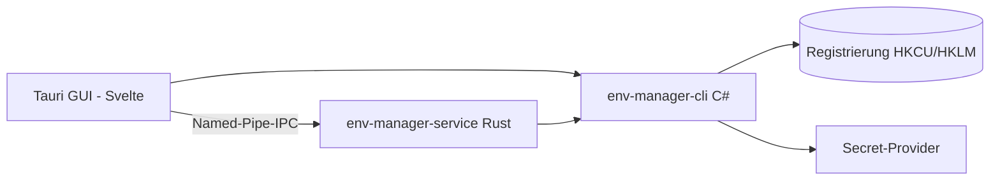

<!-- canonical: ../../README.md -->
<!-- sync: 123a8b720480c6ee2acc9f9144445644152881bd -->

<div align="center">

<picture>
  <source media="(prefers-color-scheme: dark)" srcset="../../docs/assets/logo-dark-theme.png">
  <source media="(prefers-color-scheme: light)" srcset="../../docs/assets/logo-light-theme.png">
  
</picture>

# Env Manager

Ein Manager für Windows-Umgebungsvariablen mit zwei Oberflächen: ein C#-Kommandozeilenprogramm für Skripte und KI-Agenten und eine Tauri-Desktop-App zum direkten Bearbeiten. Beide Oberflächen halten sich an dieselben Registrierungsregeln.

**"Passt sich nahtlos an jede Umgebung an."**

[](https://github.com/Xxx91n/env-manager/releases)
[](../../LICENSE)
[](#installation)
[](#voraussetzungen)
[](#architektur)

[Installation](#installation) · [Funktionen](#funktionen) · [CLI-Befehle](../../docs/cli-commands.md) · [Architektur](#architektur) · [Changelog](../../CHANGELOG.md)

<!-- README-I18N:START -->
**Sprachen:** [English](../../README.md) · [简体中文](README.zh_CN.md) · [日本語](README.ja.md) · [한국어](README.ko.md) · **Deutsch** · [Français](README.fr.md) · [Español](README.es.md) · [Português](README.pt.md) · [Русский](README.ru.md) · [العربية](README.ar.md)
<!-- README-I18N:END -->

</div>

## Showcase

https://github.com/user-attachments/assets/7657b508-42bb-45a8-94b7-7c1fa052a4d0

## Features

- **Zwei Oberflächen** — `env-manager-cli` für Skripte und CI, `env-manager.exe` (Tauri 2 + Svelte) zum bequemen Klicken und Bearbeiten. Beide greifen auf dieselben Registrierungsregeln zu.
- **Von Haus aus geschützt** — Systemvariablen und PATH-Einträge lassen sich weder versehentlich löschen noch umbenennen. Beim Umbenennen oder Wechseln des Bereichs wird der neue Wert zuerst geschrieben und geprüft, bevor der alte gelöscht wird. Jeder Schreibzugriff nutzt drei Sicherheitsstufen: ein Windows-Mutex im CLI, eine Lese-/Schreibsperre in der Rust-Schale und eine Warteschlange in der GUI.
- **Profile** — ein globales Profil schreibt seine Werte direkt in die Registrierung; ein Launch-Profil gibt seine Werte nur an einen einzelnen Kindprozess weiter und rührt die Registrierung gar nicht an. Profile können Werte von anderen Profilen erben, und Konflikte werden vor dem Anwenden angezeigt.
- **Neun Secret-Provider** — DPAPI, Anmeldeinformationsverwaltung, SecretStore, HashiCorp Vault, SOPS, Azure Key Vault, 1Password, AWS Secrets Manager und AWS IAM Roles Anywhere. Secrets werden nur verschlüsselt als Envelopes oder über `mount:<id>`-Verweise abgelegt. Die normalen Befehle `add-var` und `edit-var` können weiterhin Klartext in die Registrierung schreiben; genaue Details dazu stehen unter [Sicherheit](#sicherheit) und in [docs/plaintext-sinks.md](../../docs/plaintext-sinks.md).
- **PATH prüfen und aufräumen** — `path health` spürt doppelte und ungültige Pfade auf; mit `--fix` wird die Liste bereinigt, mit `--dry-run` wird nur ein Bericht ausgegeben.
- **Audit Ledger** — fälschungssicheres Protokoll mit SHA256-Hash-Kette, aus dem sich Änderungen rückgängig machen oder als Notfall-Backup exportieren lassen.

## For AI agents

```bash
env-manager-cli agents            # eingebettetes Agenten-Handbuch anzeigen
env-manager-cli agents --path     # Dateipfad zum Handbuch (AGENTS.cli.md)
env-manager-cli agents --summary  # maschinenlesbare Einzeilen-Zusammenfassung
env-manager-cli agents --json     # komplette Befehlstabelle als strukturiertes JSON
```

- [AGENTS.md](../../AGENTS.md) — zentrale Vorgaben für Agenten im Repository (Architektur, harte Grenzen, Tests).
- [AGENTS.cli.md](../../AGENTS.cli.md) — direkt im CLI-Programm enthalten, damit Agenten die Schnittstelle jederzeit zur Laufzeit abfragen können.

## Security

> [!WARNING]
> Aktuelle Testversionen sind **noch nicht digital signiert**. Windows SmartScreen zeigt beim ersten Öffnen eventuell einen Warnhinweis ("Unbekannte App") an — klicken Sie einfach auf "Weitere Informationen" und dann auf "Trotzdem ausführen". Wir haben uns über die SignPath Foundation für eine kostenlose Open-Source-Zertifizierung beworben; sobald diese durch ist, werden alle Installationspakete (MSI und EXE) signiert. Siehe [Code-Signing-Richtlinie](../../docs/code-signing-policy.md).

Geschützte Variablen und PATH-Einträge werden vor dem Löschen gesichert, und beim Wiederherstellen wird der genaue Typ des Registrierungswerts abgeglichen. Werte werden geprüft, bevor sie in die Registrierung gelangen, und die Named Pipe lehnt einen zweiten Dienst ab und begrenzt jede Anfrage auf 65536 Bytes. Hinweise zum Melden von Sicherheitslücken finden Sie in [SECURITY.md](../../SECURITY.md).

**Bedrohungsmodell.** Das Programm schützt nicht vor Programmen, die bereits in Ihrer eigenen Windows-Benutzersitzung laufen. Solche Programme könnten ohnehin `profile reveal-secret` ausführen, die Umgebungsvariablen eines gestarteten Kindprozesses auslesen oder temporäre Dateien abfangen. Das Design grenzt den Schaden aber klar ein: Mit DPAPI verschlüsselte Werte des aktuellen Nutzers können von keinem anderen Benutzer und auf keinem fremden Computer entschlüsselt werden. Die Secret-Befehle schreiben niemals Klartext in die Registrierung (außer den oben genannten Standard-Befehlen), und Klartext taucht nur an den wenigen, dafür vorgesehenen Stellen auf, die in der unten verlinkten Übersicht aufgelistet sind.

**Umgang mit Klartext.** Die komplette Tabelle — wo Klartext vorkommen kann, wie lange er bleibt und wie er gelöscht wird — steht in [docs/plaintext-sinks.md](../../docs/plaintext-sinks.md). Der Abschnitt zum Lebenszyklus von Klartext in `docs/architecture.md` ist die verbindliche Liste für alle Komponenten. Das Überschreiben von Arbeitsspeicher und das Bereinigen von Logs geschehen nach bestem Bemühen: `tests/canary-redaction.Tests.ps1` sucht in 7 Ausgabekanälen nach gezielt platzierten Testwerten, und unsere Testsuite prüft für acht Provider, dass niemals Klartext im Envelope landet; `aws-roles-anywhere` deckt die Offline-Suite separat ab.

## Install

### MSI Installer

Laden Sie die MSI-Datei von [GitHub Releases](https://github.com/Xxx91n/env-manager/releases) herunter und starten Sie sie. Startmenü-Einträge werden automatisch angelegt. Verfügbar für x64, x86 und ARM64.

### Portable

Laden Sie das portable ZIP-Archiv von [GitHub Releases](https://github.com/Xxx91n/env-manager/releases) herunter. Entpacken Sie die Dateien und starten Sie `env-manager.exe` direkt. Keine Installation erforderlich.

### CLI-Only

Laden Sie das reine CLI-ZIP-Paket für Server oder Skripte herunter: enthält `env-manager-cli.exe` und die zugehörigen `.dll`-Dateien. Läuft ohne grafische Oberfläche und braucht kein WebView2.

### Prerequisites

> [!IMPORTANT]
> **Portable**- und **CLI-Only**-Pakete setzen die installierte **.NET 10 Desktop Runtime** voraus — laden Sie diese von der offiziellen [.NET-Downloadseite](https://dotnet.microsoft.com/download/dotnet/10.0) herunter. Das **MSI-Installationsprogramm** prüft oder installiert .NET nicht selbstständig; installieren Sie die Runtime bitte vor dem ersten Start.
>
> Die **WebView2-Runtime** (für die Oberfläche) ist in Windows 11 bereits eingebaut und kann für Windows 10 ab Version 21H2 direkt bei [Microsoft](https://developer.microsoft.com/microsoft-edge/webview/) bezogen werden.

Falls Sie externe Secret-Tools wie SOPS, 1Password CLI, Vault CLI, AWS CLI, Azure CLI oder PowerShell 7 einbinden möchten, finden Sie alle Details im [Secret Providers Guide](../../docs/secret-providers-guide.md).

### winget

> [!NOTE]
> Die Bereitstellung über winget ist in Vorbereitung. Den aktuellen Stand dazu finden Sie in den GitHub Issues.

### From Source

```bash
git clone https://github.com/Xxx91n/env-manager.git
cd env-manager
cd frontend && npm ci && cd ..
node scripts/build.mjs --arch x64
```

Voraussetzungen: .NET 10 SDK, Node.js ab Version 18 und stabiles Rust mit MSVC- oder GNU-Build-Target. Weitere Hinweise gibt es in [docs/build-and-release.md](../../docs/build-and-release.md).

## Usage

### CLI

```bash
# Variablen anzeigen, abfragen und setzen
env-manager-cli.exe list
env-manager-cli.exe get PATH
env-manager-cli.exe set JAVA_HOME "D:\jdk17" --scope system

# Launch-Profil anlegen und isoliert starten
env-manager-cli.exe profile create dev --type launch --target python.exe
env-manager-cli.exe profile add-secret dev API_KEY "sk-xxx"
env-manager-cli.exe profile launch dev

# PATH-Einträge überprüfen
env-manager-cli.exe path health

# Backup erstellen und wieder einspielen
env-manager-cli.exe backup --output backup.json
env-manager-cli.exe restore backup.json

# Notfallwiederherstellung und Prüfung des Audit-Protokolls
env-manager-cli.exe export-state --output state.dpapi
env-manager-cli.exe audit verify --strict

# Hintergrunddienst abfragen
env-manager-cli.exe service status
```

Eine ausführliche Übersicht aller Parameter finden Sie in [docs/cli-commands.md](../../docs/cli-commands.md).

### GUI

Starten Sie einfach `env-manager.exe`. Die Oberfläche zeigt alle Variablen mit schneller Suchfunktion, Filterung nach Bereich und direkter Bearbeitung. Dazu gibt es einen praktischen PATH-Editor mit Drag-and-Drop, Profilverwaltung, Auswahl des Secret-Providers, Dienstverwaltung, das Audit Ledger und Unterstützung für 10 Sprachen.

## Architecture



- **CLI**: Ein kompaktes C#-.NET-10-Programm, das die Schreibvorgänge bündelt und als Einziges Werte in die Registrierung schreibt.
- **Service**: Ein eigenständiger Rust-Dienst, der Secret-Mounts über eine Named Pipe aktuell hält.
- **GUI**: Die Benutzeroberfläche auf Basis von Tauri 2 und Svelte 5, die über dieselbe IPC-Schnittstelle kommuniziert.

## Secret providers

Neun Provider stehen bereit und werden beim Auswählen direkt überprüft. Falls etwas nicht eingerichtet ist, erscheint ein gut sichtbarer Hinweis im Profileditor:

| Provider | Anmeldung | Automatisches Auffrischen | Dokumentation |
|---|---|---|---|
| DPAPI CurrentUser | Windows-DPAPI | Nein (pro Benutzer) | [Anleitung](../../docs/secret-providers-guide.md) |
| Windows Credential Manager | Credential Manager + DPAPI | Nein (pro Benutzer) | [Anleitung](../../docs/secret-providers-guide.md) |
| PowerShell SecretManagement | SecretStore Vault | Nein (`CreatedOnly`) | [Anleitung](../../docs/secret-providers-guide.md) |
| HashiCorp Vault KV v2 | VAULT_TOKEN / AppRole-Zertifikat | Ja | [Anleitung](../../docs/secret-providers-guide.md) |
| SOPS | Age / PGP / KMS | Nein (`CreatedOnly`) | [Anleitung](../../docs/secret-providers-guide.md) |
| Azure Key Vault | Zertifikat / Managed Identity | Ja | [Anleitung](../../docs/secret-providers-guide.md) |
| 1Password CLI | OP_SERVICE_ACCOUNT_TOKEN | Ja | [Anleitung](../../docs/secret-providers-guide.md) |
| AWS Secrets Manager | SigV4 + Zugriffsschlüssel | Ja | [Anleitung](../../docs/secret-providers-guide.md) |
| AWS IAM Roles Anywhere | Zertifikat aus dem Maschinenspeicher gegen temporäre Zugangsdaten getauscht | Nein, noch nicht: `Periodic` ist wählbar, aber der Dienst liest den Wert nicht neu | [Anleitung](../../docs/secret-providers-guide.md) |

In [docs/secret-providers-guide.md](../../docs/secret-providers-guide.md) erfahren Sie alles über die jeweiligen Voraussetzungen, die Ersteinrichtung und was bei Fehlern zu tun ist.

## Service mode

`env-manager-service.exe` ist ein schlankes Rust-Programm, das Secret-Mounts im Hintergrund frisch hält und Anfragen über eine Named Pipe beantwortet:

- **ServiceMode**: Service (vom Windows-Dienstmanager beim Booten gestartet), Background (vom Nutzer gestartet), Cli (einmaliger Durchlauf).
- **Reconcile-Schleife**: Läuft alle 300 Sekunden durch, verarbeitet jeden Eintrag sauber und wartet beim Start 30 Sekunden bis zum ersten Durchlauf.
- **Audit Ledger**: Fälschungssichere Log-Datei `audit-ledger.jsonl` mit SHA256-Kette und automatischer Rotation ab 100 MB.
- **IPC**: Geschützte Named Pipe gegen Squatting, Begrenzung auf 65536 Bytes pro Anfrage, einfaches zeilenbasiertes JSON-Format.
- **Watchdog**: Doppelte Ausfallsicherung — automatischer Neustart über Windows (Service-Modus) oder Ping-Watchdog der Oberfläche alle 30 Sekunden (Background-Modus).

## Documentation

| Dokument | Inhalt |
|---|---|
| [CHANGELOG.md](../../CHANGELOG.md) | Versionsgeschichte im keepachangelog-Format |
| [docs/cli-commands.md](../../docs/cli-commands.md) | Vollständige Befehlsreferenz für die Konsole |
| [docs/architecture.md](../../docs/architecture.md) | Technische Architektur im Detail |
| [docs/plaintext-sinks.md](../../docs/plaintext-sinks.md) | Übersicht aller Orte, an denen Klartext vorkommen kann |
| [docs/backup-and-profiles.md](../../docs/backup-and-profiles.md) | Backups, Wiederherstellung und Funktionsweise der Profile |
| [docs/secret-providers-guide.md](../../docs/secret-providers-guide.md) | Anleitung zur Einrichtung der Secret-Provider |
| [docs/build-and-release.md](../../docs/build-and-release.md) | Ablauf von Bau und Veröffentlichung |
| [AGENTS.md](../../AGENTS.md) / [AGENTS.cli.md](../../AGENTS.cli.md) | Handbücher und Richtlinien für KI-Agenten |

## Maintainers

[@Xxx91n](https://github.com/Xxx91n)

## Contributing

Vorschläge, Fehlerberichte und Pull Requests sind jederzeit willkommen! Bitte werfen Sie zuerst einen Blick in [AGENTS.md](../../AGENTS.md), um sich mit den architektonischen Grenzen und unseren Testvorgaben vertraut zu machen.

## License

Apache-2.0 © 2026 Env Manager Contributors. Siehe [LICENSE](../../LICENSE).
