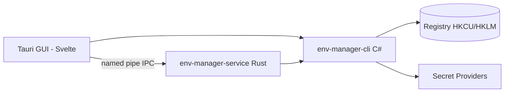

<!-- canonical: ../../README.md -->
<!-- sync: ef2a485dfffb -->

<div align="center">

<picture>
  <source media="(prefers-color-scheme: dark)" srcset="../../docs/assets/logo-dark-theme.png">
  <source media="(prefers-color-scheme: light)" srcset="../../docs/assets/logo-light-theme.png">
  
</picture>


# Env Manager

Ein Manager für Windows-Umgebungsvariablen mit zwei Frontends — einer für Skripte und KI-Agenten gebauten C#-CLI und einer Tauri-GUI für interaktives Bearbeiten — über einem gemeinsamen Satz von Registrierungsverträgen.

**"Passt sich nahtlos an jede Umgebung an."**

[](https://github.com/Xxx91n/env-manager/releases)
[](../../LICENSE)
[](#install)
[](#prerequisites)
[](#architecture)

[Install](#install) · [Features](#features) · [CLI Reference](../../docs/cli-commands.md) · [Architecture](#architecture) · [Changelog](../../CHANGELOG.md)

<!-- README-I18N:START -->
**Sprachen:** [English](../../README.md) · [简体中文](README.zh_CN.md) · [日本語](README.ja.md) · [한국어](README.ko.md) · **Deutsch** · [Français](README.fr.md) · [Español](README.es.md) · [Português](README.pt.md) · [Русский](README.ru.md) · [العربية](README.ar.md)
<!-- README-I18N:END -->

</div>

## Showcase

### GUI

| | | |
|:-:|:-:|:-:|
| <br>**Variablen** — Suche, Bereichsfilter, Aktionen pro Zeile | <br>**System-Geltungsbereich** — geschützte Einträge gesperrt | <br>**PATH-Editor** — Erkennung toter & doppelter Einträge |
| <br>**Profile** — anwenden / starten / vererben | <br>**Audit-Ledger** — hash-verkettet, verifizierbar | <br>**Dienst-Manager** — Secret-Mounts |

## Features

- **Zwei Frontends** — `env-manager-cli` für Skripting und CI, `env-manager.exe` (Tauri 2 + Svelte) für interaktives Bearbeiten. Beide laufen über dieselben Registrierungsverträge.
- **Standardmäßig geschützt** — Systemvariablen und PATH-Einträge können nicht gelöscht oder umbenannt werden; jeder Schreibvorgang ist über drei Schichten serialisiert (Mutex + Write Lock + Verifizieren vor dem Austausch).
- **Profile** — globale Profile werden auf die Registrierung angewendet; Launch-Profile injizieren einen isolierten env-Block in einen einzelnen Prozess, ohne die Registrierung zu berühren. Vererbung, Konfliktvorschau, Rollback in umgekehrter Reihenfolge.
- **8 Secret-Anbieter** — DPAPI, Credential Manager, SecretStore, HashiCorp Vault, SOPS, Azure Key Vault, 1Password, AWS Secrets Manager. Die Secret-Verben persistieren nur Chiffretext-Umschläge oder `mount:<id>`-Referenzen — die Lücke der generischen `add-var`/`edit-var`-Verben kann Klartext in die Registrierung schreiben; die Klartext-Expositionsgrenze steht unter [Security](#security) und [docs/plaintext-sinks.md](../../docs/plaintext-sinks.md).
- **PATH-Health** — `path health` erkennt Duplikate und tote Einträge; `--fix` schreibt neu, `--dry-run` berichtet.
- **Audit-Ledger** — append-only, SHA256-hashverkettete Historie mit Rollback und Export zur Notfallwiederherstellung.

## For AI agents

```bash
env-manager-cli agents            # print the embedded agent manual
env-manager-cli agents --path     # file path of the manual (AGENTS.cli.md)
env-manager-cli agents --summary  # one-line machine-readable spec
env-manager-cli agents --json     # full command table as structured JSON
```

- [AGENTS.md](../../AGENTS.md) — agentenorientierte Anweisungen auf Repository-Ebene (Architektur, harte Grenzen, Tests).
- [AGENTS.cli.md](../../AGENTS.cli.md) — wird mit der CLI-Binärdatei ausgeliefert, sodass ein Agent den Vertrag zur Laufzeit entdecken kann.
- **Auf Fähigkeiten ausgerichtete Oberfläche** — eine Opt-in-`agentCapabilities`-Whitelist in `secret-providers.json` erlaubt es Bereitstellungen, parallele set/delete-Aufrufe von Agenten abzulehnen.

## Security

> [!WARNING]
> Aktuelle Builds sind **nicht codesigniert**. Windows SmartScreen zeigt beim ersten Start möglicherweise eine Warnung vor einer "nicht erkannten App" an — klicken Sie auf "Weitere Informationen" und dann auf "Trotzdem ausführen". Wir haben eine kostenlose Open-Source-Codesignierung über die SignPath Foundation beantragt; sobald diese genehmigt ist, werden alle Release-Artefakte (MSI + EXE) signiert. Siehe [Code-Signing-Richtlinie](../../docs/code-signing-policy.md).

Geschützte Variablen und PATH-Einträge werden vor dem Löschen deaktiviert, mit exakter Prüfung des Registrierungswerttyps bei der Wiederherstellung. Named-Pipe-IPC verwendet Anti-Squatting-Flags und Eingabevalidierung (max. 64 Argumente, 32767-Zeichen-Obergrenze, Ablehnung von Null-Bytes). Informationen zum Melden von Sicherheitslücken finden Sie in [SECURITY.md](../../SECURITY.md).

**Bedrohungsmodell.** Der Angreifer, gegen den wir *nicht* verteidigen, ist jeder Prozess, der innerhalb Ihrer eigenen Windows-Benutzersitzung läuft — er kann bereits `profile reveal-secret` aufrufen, den Umgebungsblock eines gestarteten Kindprozesses lesen oder die flüchtigen Temp-Dateien abfangen, die die Anbieter erzeugen. Was das Design *tatsächlich* begrenzt: DPAPI-CurrentUser-Chiffretext ist für einen anderen Benutzer oder ein anderes Gerät unentschlüsselbar, die Secret-Verben können kein Secret in der Registrierung landen lassen (abgesehen von der oben genannten Lücke der generischen Verben), und die einzigen Senken, die *dazu bestimmt* sind, einen Secret-Wert zu tragen, sind die in der unten verlinkten Klartext-Matrix dokumentierten, vorgesehenen.

**Klartextgrenze.** Die vollständige Senke-für-Senke-Matrix — wo Klartext existieren kann, für wie lange und wer ihn bereinigt — steht in [docs/plaintext-sinks.md](../../docs/plaintext-sinks.md); der Abschnitt Plaintext lifecycle in `docs/architecture.md` ist die maßgebliche Allow-List je Oberfläche. Speichernullung und Log-Bereinigung sind Hygiene nach bestem Bemühen, keine Garantien; `tests/canary-redaction.Tests.ps1` durchsucht 7 Ausgabesenken nach einem platzierten Canary, und die gemeinsame Vertragssuite prüft `plaintext-never-in-envelope` für alle 8 Anbieter.

## Install

### MSI Installer

Laden Sie das MSI aus [GitHub Releases](https://github.com/Xxx91n/env-manager/releases) herunter und führen Sie es aus. Startmenü-Verknüpfungen werden automatisch erstellt. Verfügbar für x64, x86 und ARM64.

### Portable

Laden Sie das portable ZIP aus [GitHub Releases](https://github.com/Xxx91n/env-manager/releases) herunter. Entpacken und `env-manager.exe` direkt ausführen. Keine Installation erforderlich.

### CLI-Only

Laden Sie das CLI-only-ZIP für den Headless- oder Skripteinsatz herunter: `env-manager-cli.exe` plus `.dll`-Dateien. Keine GUI, keine WebView2-Abhängigkeit.

### Prerequisites

> [!IMPORTANT]
> **Portable**- und **CLI-Only**-Builds sind frameworkabhängig: Sie erfordern die **.NET 10 Desktop Runtime** auf dem Zielrechner — erhältlich auf der offiziellen [.NET-Downloadseite](https://dotnet.microsoft.com/download/dotnet/10.0). Der **MSI-Installer** prüft .NET nicht und installiert es nicht — installieren Sie die Runtime vor dem ersten Start selbst.
>
> Die **WebView2-Runtime** (für die GUI) ist unter Windows 11 vorinstalliert und für Windows 10 21H2+ bei [Microsoft](https://developer.microsoft.com/microsoft-edge/webview/) erhältlich.

Für optionale externe Secret-Anbieter-Tools (SOPS, 1Password CLI, Vault CLI, AWS CLI, Azure CLI, PowerShell 7) siehe den [Secret Providers Guide](../../docs/secret-providers-guide.md).

### winget

> [!NOTE]
> Die winget-Verteilung ist geplant, aber noch nicht verfügbar. Updates werden über GitHub Issues verfolgt.

### From Source

```bash
git clone https://github.com/Xxx91n/env-manager.git
cd env-manager
cd frontend && npm ci && cd ..
node scripts/build.mjs --arch x64
```

Erfordert .NET 10 SDK, Node.js 18+, Rust stable mit MSVC- oder GNU-Target. Details siehe [docs/build-and-release.md](../../docs/build-and-release.md).

## Usage

### CLI

```bash
# List / get / set
env-manager-cli.exe list
env-manager-cli.exe get PATH
env-manager-cli.exe set JAVA_HOME "D:\jdk17" --scope system

# Create a Launch profile and launch with isolated env
env-manager-cli.exe profile create dev --type launch --target python.exe
env-manager-cli.exe profile add-secret dev API_KEY "sk-xxx"
env-manager-cli.exe profile launch dev

# PATH health
env-manager-cli.exe path health

# Backup / restore
env-manager-cli.exe backup --output backup.json
env-manager-cli.exe restore backup.json

# Disaster recovery + tamper-evident audit
env-manager-cli.exe export-state --output state.dpapi
env-manager-cli.exe audit verify --strict

# Service control
env-manager-cli.exe service status
```

Die vollständige Befehlsreferenz finden Sie in [docs/cli-commands.md](../../docs/cli-commands.md).

### GUI

Führen Sie `env-manager.exe` aus. Die GUI bietet eine Echtzeit-Variablenliste mit Suche, Bereichsfilterung und Inline-Bearbeitung, einen PATH-Editor mit Drag-and-Drop-Umsortierung, Profilverwaltung, Secret-Anbieter-Auswahl, Service-Kontrollpanel, Audit-Historie und i18n in 10 Sprachen.

## Architecture



- **CLI**: C#-.NET-10-Einzeldatei-Executable — die Koordinationsschicht und das Registrierungs-Gateway.
- **Service**: eigenständige Rust-Binärdatei, die den Lebenszyklus von Secret-Mounts über Named-Pipe-IPC verwaltet.
- **GUI**: Tauri-2- + Svelte-5-Frontend, das dieselben IPC-Verträge verwendet.

## Secret providers

8 Anbieter-Backends mit Aktivierungs-Preflight — Fehler erscheinen direkt als Inline-Amber-Banner im Profileditor:

| Provider | Auth Method | Periodic Refresh | Docs |
|---|---|---|---|
| DPAPI CurrentUser | Windows DPAPI | No (per-user) | [Guide](../../docs/secret-providers-guide.md) |
| Windows Credential Manager | CredMan + DPAPI | No (per-user) | [Guide](../../docs/secret-providers-guide.md) |
| PowerShell SecretManagement | SecretStore vault | No (CreatedOnly) | [Guide](../../docs/secret-providers-guide.md) |
| HashiCorp Vault KV v2 | VAULT_TOKEN / AppRole cert | Yes | [Guide](../../docs/secret-providers-guide.md) |
| SOPS | Age / PGP / KMS | No (CreatedOnly) | [Guide](../../docs/secret-providers-guide.md) |
| Azure Key Vault | SP cert / managed identity | Yes | [Guide](../../docs/secret-providers-guide.md) |
| 1Password CLI | OP_SERVICE_ACCOUNT_TOKEN | Yes | [Guide](../../docs/secret-providers-guide.md) |
| AWS Secrets Manager | SigV4 + access keys | Yes | [Guide](../../docs/secret-providers-guide.md) |

Siehe [docs/secret-providers-guide.md](../../docs/secret-providers-guide.md) für die Voraussetzungen pro Anbieter, die einmalige Einrichtung und die Schritte zur Behebung von Aktivierungsfehlern.

## Service mode

`env-manager-service.exe` ist eine eigenständige Rust-Binärdatei, die den Lebenszyklus von Secret-Mounts über Named-Pipe-IPC verwaltet:

- **RuntimeMode**: Service (SCM-verwaltet, Systemstart), Background (vom Benutzer gestartet), Cli (Einmal-Gateway)
- **Reconcile-Schleife**: 300s periodischer Vollscan, idempotenter Handler pro Eintrag, 30-Sekunden-Verzögerung des ersten Ticks
- **Audit-Ledger**: append-only hashverkettetes `audit-ledger.jsonl` mit 100MB-Rotation und Manipulationserkennung
- **IPC**: Anti-Squatting-Pipe-Flag, 65536-Byte-Anfrageobergrenze, zeilengetrenntes JSON-Protokoll
- **Watchdog**: zweischichtige Wiederherstellung — SCM-Autoneustart (Service-Modus) + GUI-30-Sekunden-Ping-Watchdog (Background-Modus)

## Documentation

| Dokument | Inhalt |
|---|---|
| [CHANGELOG.md](../../CHANGELOG.md) | Versionshistorie (keepachangelog-Format) |
| [docs/cli-commands.md](../../docs/cli-commands.md) | Vollständige CLI-Befehlsreferenz |
| [docs/architecture.md](../../docs/architecture.md) | Architektur im Detail |
| [docs/plaintext-sinks.md](../../docs/plaintext-sinks.md) | Wo Secret-Klartext existieren kann |
| [docs/backup-and-profiles.md](../../docs/backup-and-profiles.md) | Backup, Wiederherstellung, Profilsemantik |
| [docs/secret-providers-guide.md](../../docs/secret-providers-guide.md) | Einrichtung der Secret-Anbieter |
| [docs/build-and-release.md](../../docs/build-and-release.md) | Build- und Release-Prozess |
| [AGENTS.md](../../AGENTS.md) / [AGENTS.cli.md](../../AGENTS.cli.md) | Anleitungen für Agenten |

## Maintainers

[@Xxx91n](https://github.com/Xxx91n)

## Contributing

Issues und PRs sind willkommen. Lesen Sie zuerst [AGENTS.md](../../AGENTS.md) für die Architekturgrenzen und die Testrichtlinie.

## License

Apache-2.0 © 2026 Env Manager Contributors. Siehe [LICENSE](../../LICENSE).
