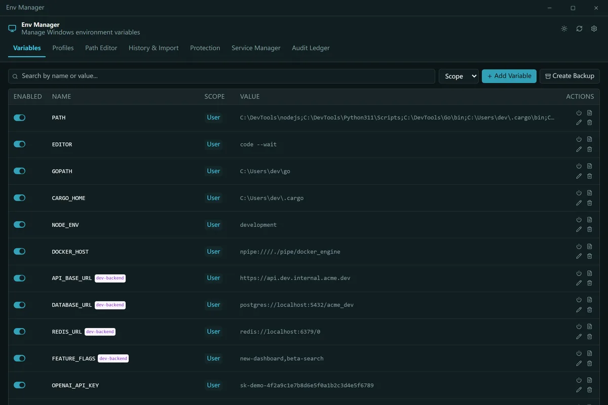
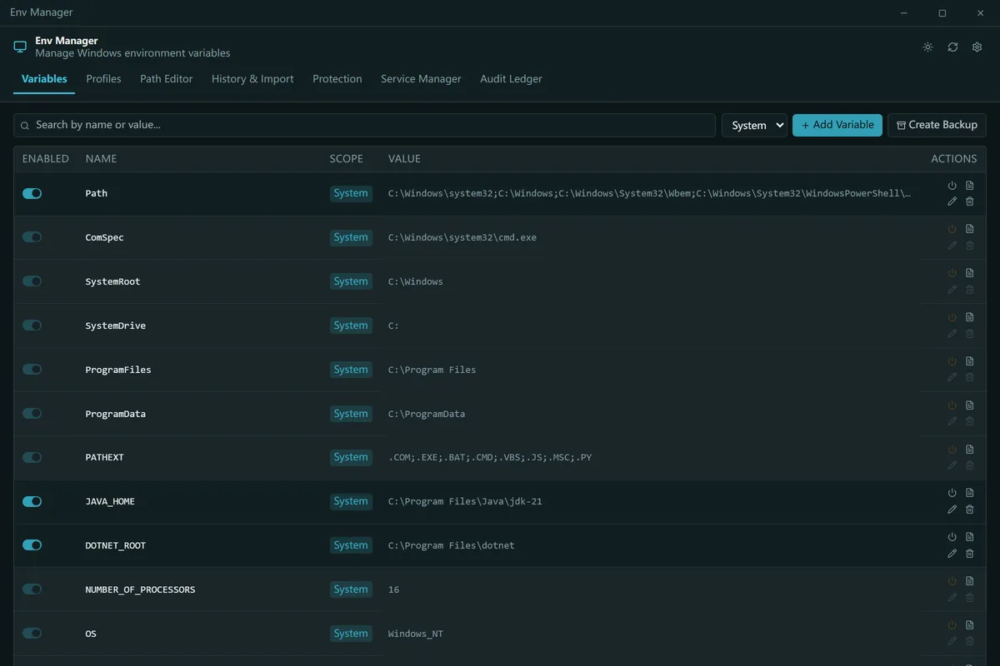
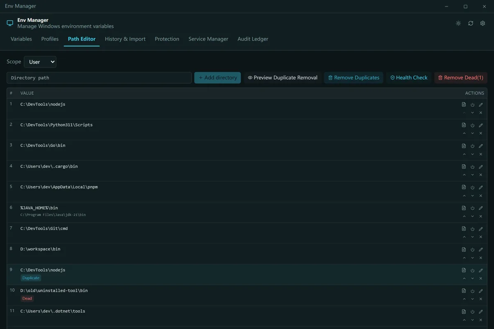
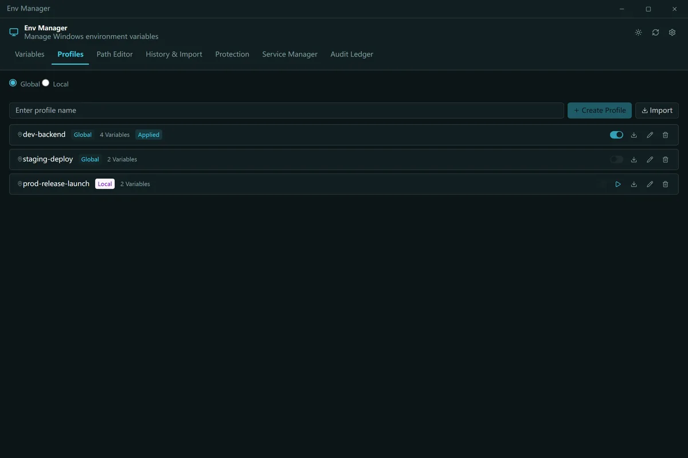
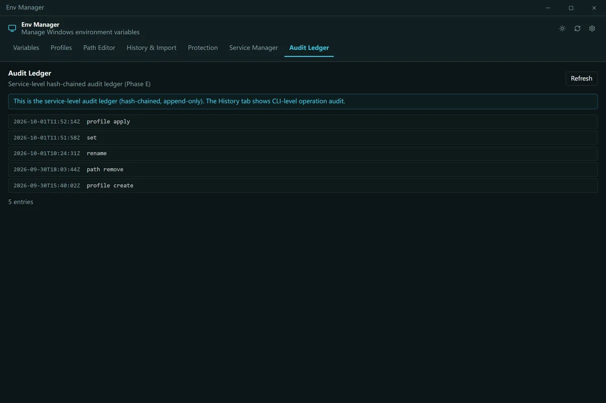
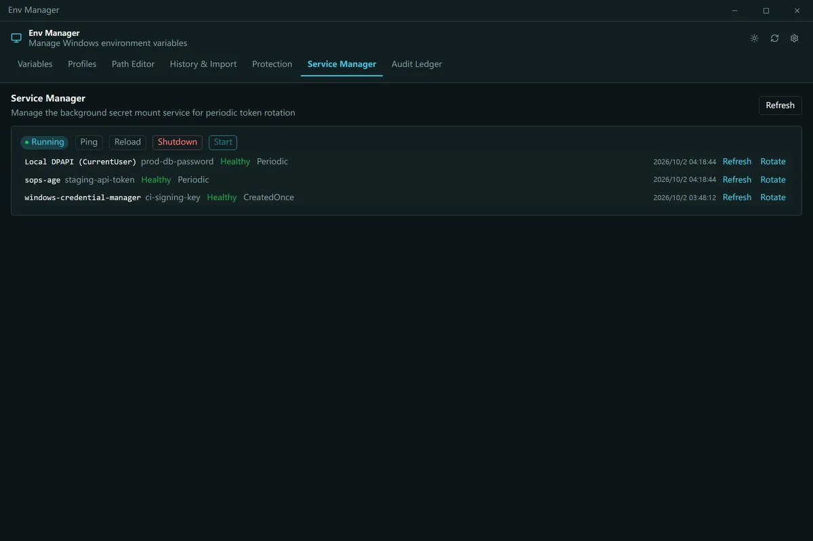
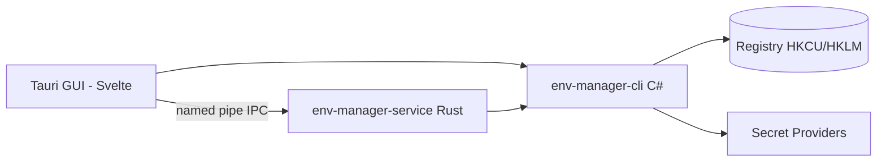

<!-- canonical: ../../README.md -->
<!-- sync: ef2a485dfffb -->

<div align="center">

<picture>
  <source media="(prefers-color-scheme: dark)" srcset="../../docs/assets/logo-dark-theme.png">
  <source media="(prefers-color-scheme: light)" srcset="../../docs/assets/logo-light-theme.png">
  
</picture>


# Env Manager

Un gestor de variables de entorno de Windows con dos frontends: una CLI en C# creada para scripts y agentes de IA, y una GUI en Tauri para la edición interactiva, sobre un mismo conjunto de contratos de registro.

**"Se adapta a la perfección a cada entorno."**

[](https://github.com/Xxx91n/env-manager/releases)
[](../../LICENSE)
[](#instalación)
[](#requisitos-previos)
[](#arquitectura)

[Instalación](#instalación) · [Características](#características) · [Referencia CLI](../../docs/cli-commands.md) · [Arquitectura](#arquitectura) · [Registro de cambios](../../CHANGELOG.md)

<!-- README-I18N:START -->
**Idiomas:** [English](../../README.md) · [简体中文](README.zh_CN.md) · [日本語](README.ja.md) · [한국어](README.ko.md) · [Deutsch](README.de.md) · [Français](README.fr.md) · **Español** · [Português](README.pt.md) · [Русский](README.ru.md) · [العربية](README.ar.md)
<!-- README-I18N:END -->

</div>

## Demos

### GUI

| | | |
|:-:|:-:|:-:|
| <br>**Variables** — búsqueda, filtro por ámbito, acciones por fila | <br>**Ámbito de sistema** — entradas protegidas bloqueadas | <br>**Editor de PATH** — detección de entradas muertas y duplicadas |
| <br>**Perfiles** — aplicar / lanzar / heredar | <br>**Registro de auditoría** — encadenado por hash, verificable | <br>**Gestor del servicio** — montajes de secretos |

## Características

- **Dos frontends** — `env-manager-cli` para scripting y CI, `env-manager.exe` (Tauri 2 + Svelte) para la edición interactiva. Ambos pasan por los mismos contratos de registro.
- **Protegido por defecto** — las variables del sistema y las entradas de PATH no se pueden eliminar ni renombrar; cada escritura se serializa a través de tres capas (mutex + bloqueo de escritura + verificación antes del intercambio).
- **Perfiles** — los perfiles globales se aplican al registro; los perfiles launch inyectan un bloque de entorno aislado en un único proceso sin tocar el registro. Herencia, vista previa de conflictos, reversión en orden inverso.
- **8 proveedores de secretos** — DPAPI, Credential Manager, SecretStore, HashiCorp Vault, SOPS, Azure Key Vault, 1Password, AWS Secrets Manager. Los verbos de secretos solo persisten sobres cifrados o referencias `mount:<id>` — la brecha de los verbos genéricos `add-var`/`edit-var` puede escribir texto en claro en el registro; el límite de exposición del texto en claro está en [Seguridad](#seguridad) y [docs/plaintext-sinks.md](../../docs/plaintext-sinks.md).
- **Salud de PATH** — `path health` detecta entradas duplicadas y muertas; `--fix` las reescribe, `--dry-run` informa.
- **Registro de auditoría** — historial de solo añadido (append-only) encadenado por hash SHA256, con reversión y exportación para recuperación ante desastres.

## Para agentes de IA

```bash
env-manager-cli agents            # print the embedded agent manual
env-manager-cli agents --path     # file path of the manual (AGENTS.cli.md)
env-manager-cli agents --summary  # one-line machine-readable spec
env-manager-cli agents --json     # full command table as structured JSON
```

- [AGENTS.md](../../AGENTS.md) — instrucciones a nivel de repositorio para agentes (arquitectura, límites estrictos, pruebas).
- [AGENTS.cli.md](../../AGENTS.cli.md) — se distribuye dentro del binario de la CLI, de modo que un agente puede descubrir el contrato en tiempo de ejecución.
- **Superficie acotada por capacidades** — una lista blanca `agentCapabilities` de inclusión voluntaria (opt-in) en `secret-providers.json` permite a los despliegues rechazar llamadas set/delete paralelas provenientes de agentes.

## Seguridad

> [!WARNING]
> Las compilaciones actuales **no están firmadas con código**. Windows SmartScreen puede mostrar una advertencia de "aplicación no reconocida" en el primer inicio: haz clic en "Más información" y luego en "Ejecutar de todos modos". Hemos solicitado la firma de código gratuita para código abierto a través de la SignPath Foundation; una vez aprobada, todos los artefactos de la versión (MSI + EXE) estarán firmados. Consulta la [Política de firma de código](../../docs/code-signing-policy.md).

Las variables protegidas y las entradas de PATH se deshabilitan antes de su eliminación, con verificación exacta del tipo de valor del registro al restaurar. La IPC por named pipe usa indicadores antisquatting y validación de entrada (máximo 64 argumentos, límite de 32767 caracteres, rechazo de bytes nulos). Consulta [SECURITY.md](../../SECURITY.md) para informar de vulnerabilidades.

**Modelo de amenaza.** El adversario contra el que *no* defendemos es cualquier proceso que se ejecute dentro de tu propia sesión de usuario de Windows: ya puede llamar a `profile reveal-secret`, leer el bloque de entorno de un proceso hijo lanzado o capturar los archivos temporales transitorios que generan los proveedores. Lo que el diseño *sí* acota: el texto cifrado DPAPI-CurrentUser es indescifrable para otro usuario o máquina, los verbos de secretos no pueden llevar un secreto al registro (salvo por la brecha de verbos genéricos mencionada), y los únicos destinos *diseñados* para transportar un valor secreto son los previstos y documentados en la matriz de texto en claro enlazada más abajo.

**Límite de texto en claro.** La matriz completa destino por destino —dónde puede existir texto en claro, durante cuánto tiempo y quién lo limpia— está en [docs/plaintext-sinks.md](../../docs/plaintext-sinks.md); la sección Plaintext lifecycle de `docs/architecture.md` es la lista de permitidos autoritativa por superficie. La puesta a cero de memoria y la depuración de logs son higiene en la medida de lo posible, no garantías; `tests/canary-redaction.Tests.ps1` revisa 7 destinos de salida en busca de un canary sembrado, y la suite de contratos compartida verifica `plaintext-never-in-envelope` en los 8 proveedores.

## Instalación

### Instalador MSI

Descarga el MSI desde [GitHub Releases](https://github.com/Xxx91n/env-manager/releases) y ejecútalo. Crea accesos directos del menú Inicio automáticamente. Disponible en x64, x86 y ARM64.

### Portable

Descarga el ZIP portable desde [GitHub Releases](https://github.com/Xxx91n/env-manager/releases). Extrae y ejecuta `env-manager.exe` directamente. No requiere instalación.

### Solo CLI

Descarga el ZIP solo CLI para uso sin interfaz o mediante scripting: `env-manager-cli.exe` más los archivos `.dll`. Sin GUI, sin dependencia de WebView2.

### Requisitos previos

> [!IMPORTANT]
> Las compilaciones **Portable** y **Solo CLI** dependen del framework: requieren el **.NET 10 Desktop Runtime** en la máquina de destino — descárgalo desde la [página oficial de descargas de .NET](https://dotnet.microsoft.com/download/dotnet/10.0). El **instalador MSI** no comprueba ni instala .NET — instala el runtime tú mismo antes del primer inicio.
>
> El **runtime WebView2** (para la GUI) viene preinstalado en Windows 11 y está disponible para Windows 10 21H2+ desde [Microsoft](https://developer.microsoft.com/microsoft-edge/webview/).

Para las herramientas externas opcionales de proveedores de secretos (SOPS, 1Password CLI, Vault CLI, AWS CLI, Azure CLI, PowerShell 7), consulta la [Guía de proveedores de secretos](../../docs/secret-providers-guide.md).

### winget

> [!NOTE]
> La distribución mediante winget está planificada pero aún no disponible. Haz seguimiento de las novedades en GitHub Issues.

### Desde el código fuente

```bash
git clone https://github.com/Xxx91n/env-manager.git
cd env-manager
cd frontend && npm ci && cd ..
node scripts/build.mjs --arch x64
```

Requiere .NET 10 SDK, Node.js 18+ y Rust estable con destino MSVC o GNU. Consulta [docs/build-and-release.md](../../docs/build-and-release.md) para más detalles.

## Uso

### CLI

```bash
# List / get / set
env-manager-cli.exe list
env-manager-cli.exe get PATH
env-manager-cli.exe set JAVA_HOME "D:\jdk17" --scope system

# Create a Launch profile and launch with isolated env
env-manager-cli.exe profile create dev --type launch --target python.exe
env-manager-cli.exe profile add-secret dev API_KEY "sk-xxx"
env-manager-cli.exe profile launch dev

# PATH health
env-manager-cli.exe path health

# Backup / restore
env-manager-cli.exe backup --output backup.json
env-manager-cli.exe restore backup.json

# Disaster recovery + tamper-evident audit
env-manager-cli.exe export-state --output state.dpapi
env-manager-cli.exe audit verify --strict

# Service control
env-manager-cli.exe service status
```

Consulta [docs/cli-commands.md](../../docs/cli-commands.md) para la referencia completa de comandos.

### GUI

Ejecuta `env-manager.exe`. La GUI ofrece una lista de variables en tiempo real con búsqueda, filtrado por ámbito y edición en línea, un editor de PATH con reordenación por arrastrar y soltar, gestión de perfiles, selección de proveedores de secretos, panel de control del servicio, historial de auditoría e i18n en 10 idiomas.

## Arquitectura



- **CLI**: ejecutable de archivo único en C# .NET 10 — la capa de coordinación y la puerta de enlace del registro.
- **Servicio**: binario Rust independiente que gestiona el ciclo de vida del montaje de secretos mediante IPC por named pipe.
- **GUI**: frontend Tauri 2 + Svelte 5 que usa los mismos contratos IPC.

## Proveedores de secretos

8 backends de proveedores con comprobación previa de activación — los fallos aparecen como avisos ámbar en línea directamente en el editor de perfiles:

| Proveedor | Método de autenticación | Refresco periódico | Docs |
|---|---|---|---|
| DPAPI CurrentUser | Windows DPAPI | No (por usuario) | [Guía](../../docs/secret-providers-guide.md) |
| Windows Credential Manager | CredMan + DPAPI | No (por usuario) | [Guía](../../docs/secret-providers-guide.md) |
| PowerShell SecretManagement | Almacén SecretStore | No (CreatedOnly) | [Guía](../../docs/secret-providers-guide.md) |
| HashiCorp Vault KV v2 | VAULT_TOKEN / cert. de AppRole | Sí | [Guía](../../docs/secret-providers-guide.md) |
| SOPS | Age / PGP / KMS | No (CreatedOnly) | [Guía](../../docs/secret-providers-guide.md) |
| Azure Key Vault | cert. de SP / identidad administrada | Sí | [Guía](../../docs/secret-providers-guide.md) |
| 1Password CLI | OP_SERVICE_ACCOUNT_TOKEN | Sí | [Guía](../../docs/secret-providers-guide.md) |
| AWS Secrets Manager | SigV4 + claves de acceso | Sí | [Guía](../../docs/secret-providers-guide.md) |

Consulta [docs/secret-providers-guide.md](../../docs/secret-providers-guide.md) para conocer los requisitos previos por proveedor, la configuración inicial única y los pasos para solucionar errores de activación.

## Modo servicio

`env-manager-service.exe` es un binario Rust independiente que gestiona el ciclo de vida del montaje de secretos mediante IPC por named pipe:

- **RuntimeMode**: Service (gestionado por SCM, arranque del sistema), Background (iniciado por el usuario), Cli (puerta de enlace de un solo uso)
- **Bucle de reconciliación**: escaneo completo periódico cada 300 s, controlador idempotente por elemento, retraso de 30 s en el primer ciclo
- **Registro de auditoría**: `audit-ledger.jsonl` de solo añadido y encadenado por hash, con rotación de 100 MB y detección de manipulación
- **IPC**: indicador de pipe antisquatting, límite de 65536 bytes por solicitud, protocolo JSON delimitado por saltos de línea
- **Watchdog**: recuperación en dos capas — reinicio automático de SCM (modo Service) + watchdog de ping de 30 s de la GUI (modo Background)

## Limitations

- Las compilaciones actuales no están firmadas con código: SmartScreen puede advertir en el primer inicio (ver [Seguridad](#seguridad)).
- La distribución por winget está planificada pero aún no disponible.
- La GUI requiere WebView2 Runtime; los builds Portable y Solo CLI requieren .NET 10 Desktop Runtime (ver Requisitos previos).
- Solo Windows.

## Documentación

| Documento | Contenido |
|---|---|
| [CHANGELOG.md](../../CHANGELOG.md) | Historial de versiones (formato keepachangelog) |
| [docs/cli-commands.md](../../docs/cli-commands.md) | Referencia completa de comandos CLI |
| [docs/architecture.md](../../docs/architecture.md) | Arquitectura en profundidad |
| [docs/plaintext-sinks.md](../../docs/plaintext-sinks.md) | Dónde puede existir texto en claro de secretos |
| [docs/backup-and-profiles.md](../../docs/backup-and-profiles.md) | Copia de seguridad, restauración, semántica de perfiles |
| [docs/secret-providers-guide.md](../../docs/secret-providers-guide.md) | Configuración de proveedores de secretos |
| [docs/build-and-release.md](../../docs/build-and-release.md) | Proceso de compilación y publicación |
| [AGENTS.md](../../AGENTS.md) / [AGENTS.cli.md](../../AGENTS.cli.md) | Guías para agentes |

## Mantenedores

[@Xxx91n](https://github.com/Xxx91n)

## Contribuciones

Se aceptan issues y PR. Lee primero [AGENTS.md](../../AGENTS.md) para conocer los límites de arquitectura y la política de pruebas.

## Licencia

Apache-2.0 © 2026 Env Manager Contributors. Consulta [LICENSE](../../LICENSE).
