<!-- canonical: ../../README.md -->
<!-- sync: ef2a485dfffb -->

<picture>
  <source media="(prefers-color-scheme: dark)" srcset="../../docs/assets/logo-dark-theme.png">
  <source media="(prefers-color-scheme: light)" srcset="../../docs/assets/logo-light-theme.png">
  
</picture>

  

# Env Manager

Un gestor moderno y ligero de variables de entorno de Windows, con modo dual CLI y GUI, inspirado en Microsoft PowerToys pero independiente y diseñado para agentes.

**"Se adapta sin fisuras a cualquier entorno."**

<!-- README-I18N:START -->
**言語:** [English](../../README.md) · **Español** · [日本語](README.ja.md) · [한국어](README.ko.md) · [Deutsch](README.de.md) · [Français](README.fr.md) · [Español](README.es.md) · [Português](README.pt.md) · [Русский](README.ru.md) · [العربية](README.ar.md)
<!-- README-I18N:END -->

---

## Demos

  

La demo muestra comandos CLI de solo lectura en acción: agents --summary, path health, get PATH y agents --json. Regenera con `node scripts/demo/capture.mjs`.

*La salida del terminal mostrada arriba usa datos simulados.*

### Galería

| | | |
|:-:|:-:|:-:|
| 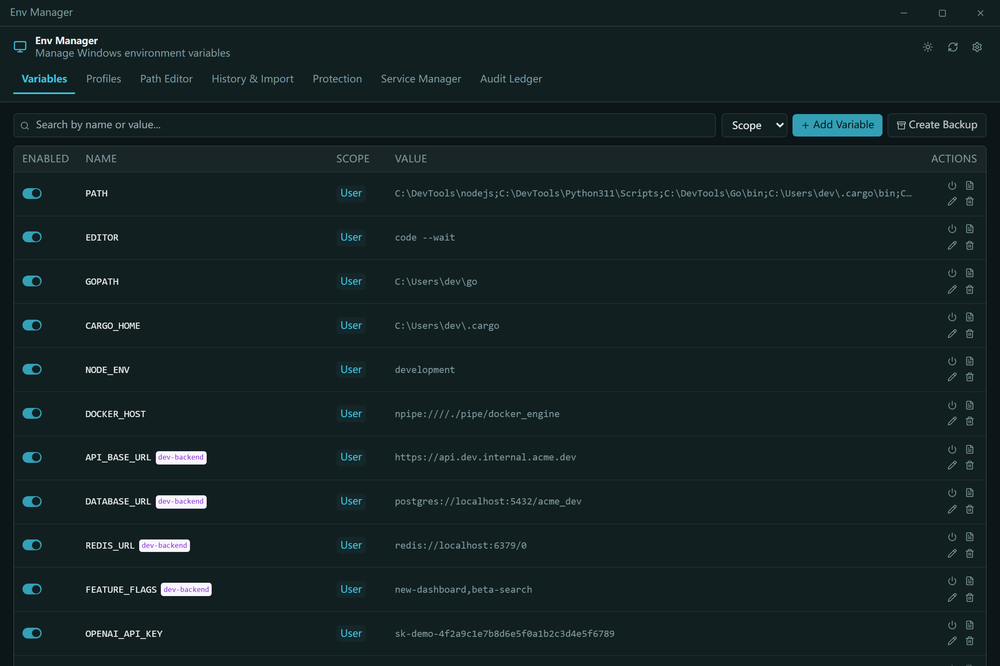 **Variables** — búsqueda, alcance, acciones por fila | 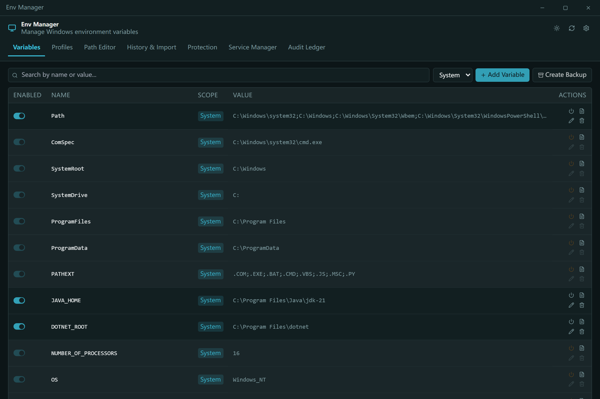 **Ámbito de sistema** — entradas protegidas bloqueadas | 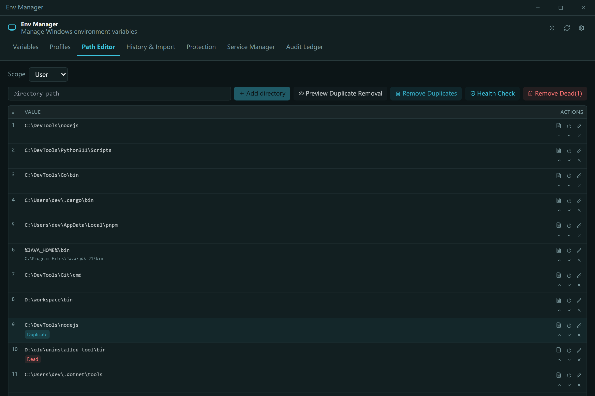 **Editor de PATH** — detección de entradas muertas y duplicadas |
| 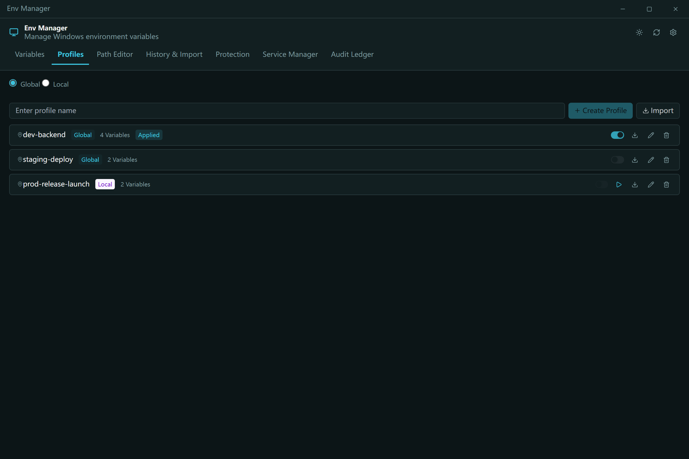 **Perfiles** — aplicar / lanzar / heredar | 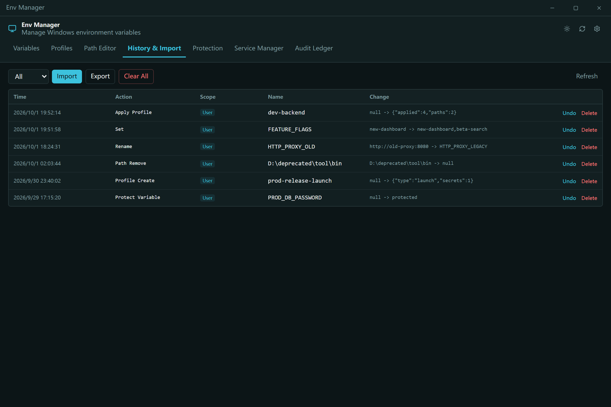 **Historial e importación** — cambios reversibles | 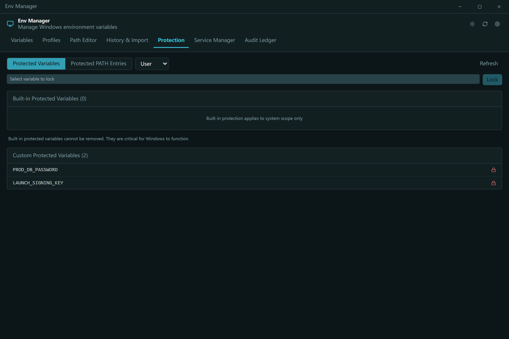 **Protección** — bloqueos personalizados |
| 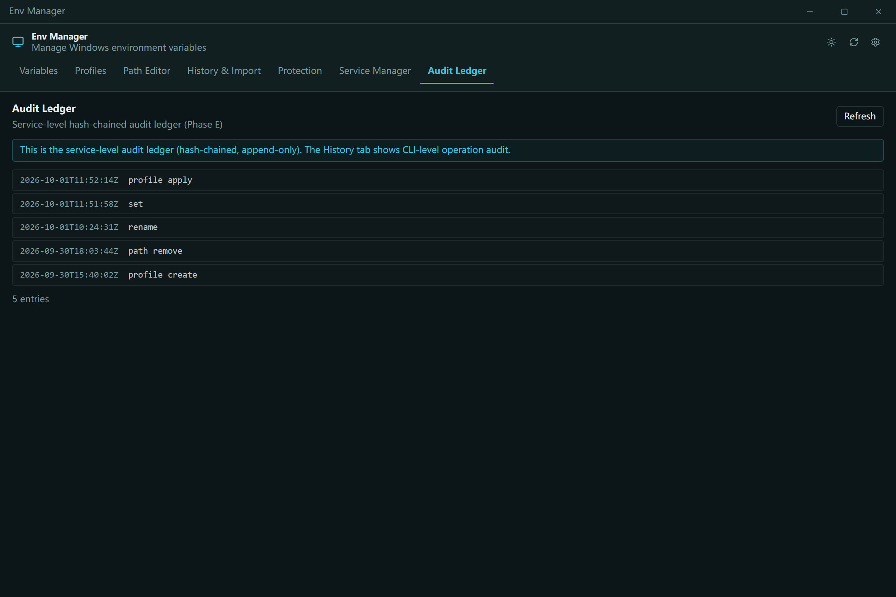 **Registro de auditoría** — encadenado por hash, verificable | 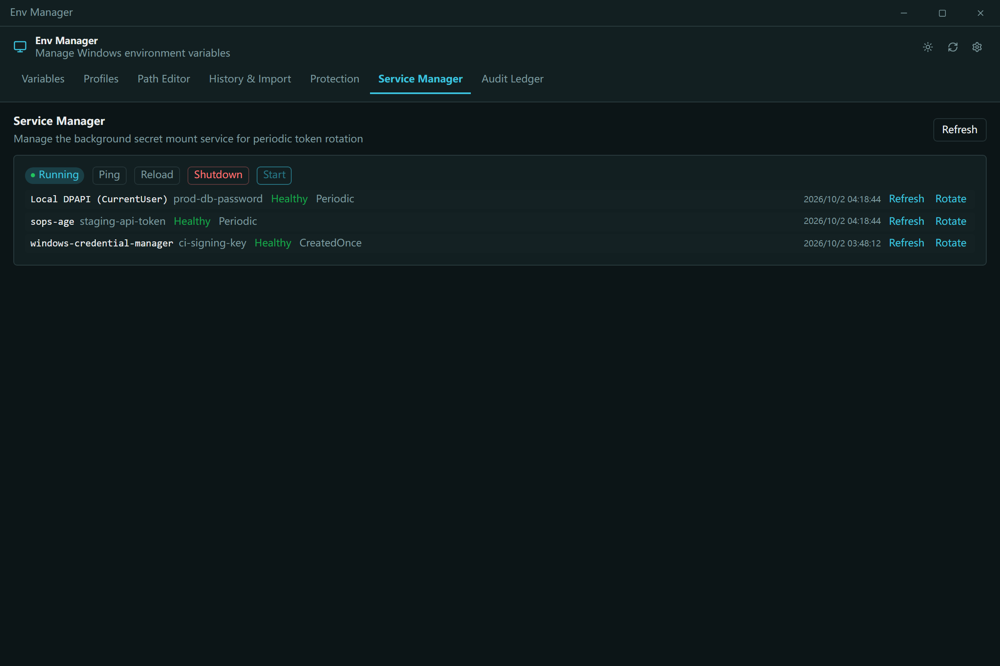 **Gestor de servicios** — montajes de secretos | 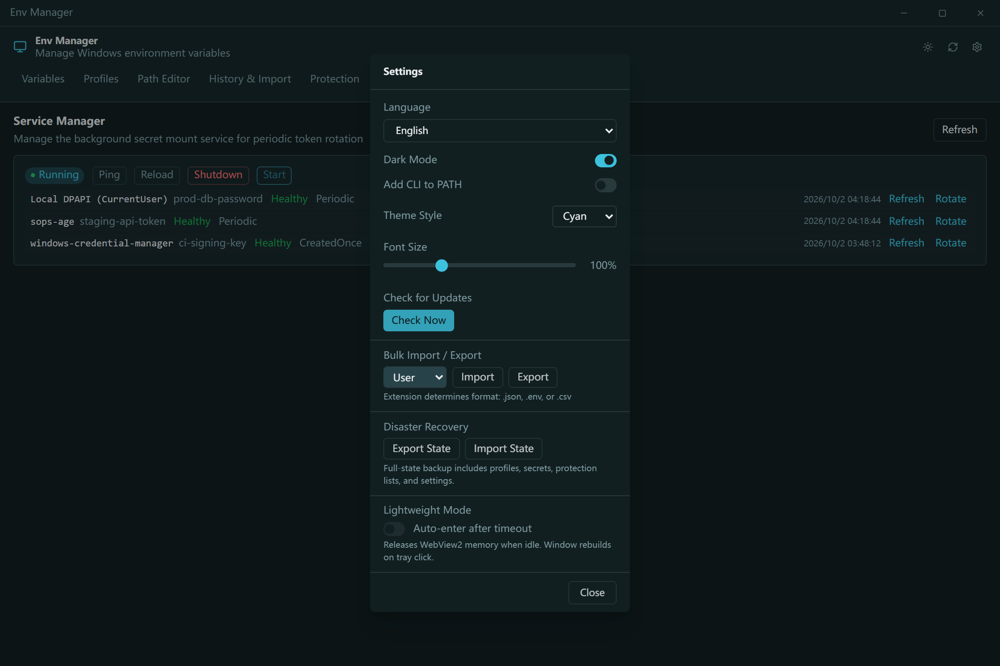 **Configuración** — i18n en 10 idiomas |
| 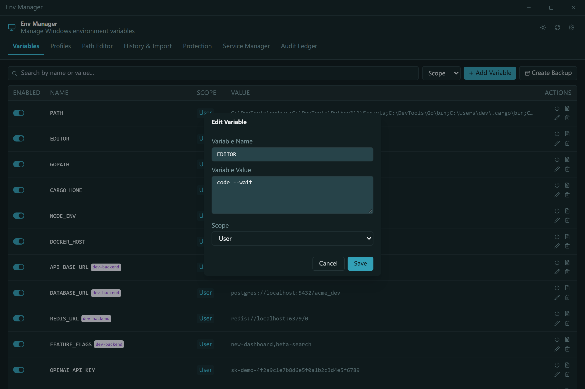 **Diálogo de edición** — vista previa del valor expandido | 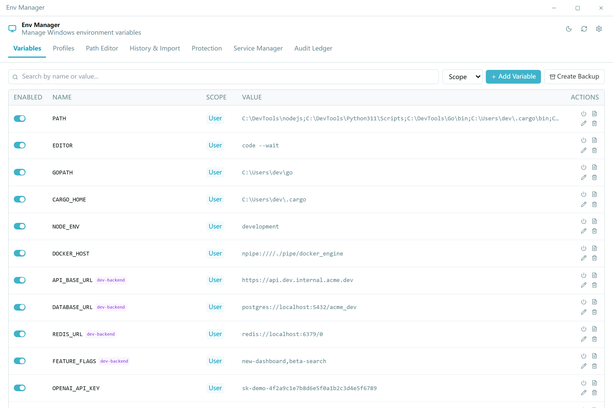 **Tema claro** — Variante | 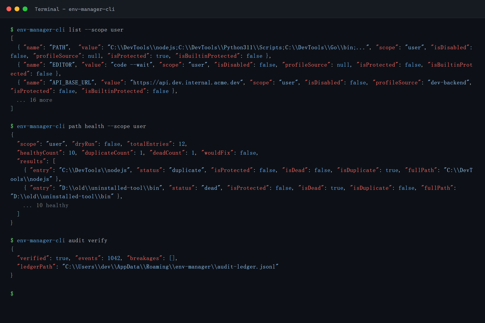 **CLI** — JSON primero, nativo para agentes |

## Características

- CLI nativo para agentes — más de 18 comandos con un contrato de máquina de primera clase: env-manager-cli agents --json expone una especificación estructurada de comandos, y cada capacidad está documentada en un manual orientado a agentes (AGENTS.cli.md) que se distribuye con el binario.
- Perfiles y configuración — los perfiles globales se aplican al registro; los perfiles de lanzamiento (Launch profiles) inyectan un bloque de entorno aislado en un único proceso (nunca tocan el registro ni emiten WM_SETTINGCHANGE). Incluyen herencia, vistas previas de conflictos y reversión segura en orden inverso.
- 8 proveedores de secretos, cero texto en claro — DPAPI, Credential Manager, SecretStore, HashiCorp Vault, SOPS, Azure Key Vault, 1Password, AWS Secrets Manager. El texto en claro nunca se persiste en disco ni en registros.
- Protegido por defecto — las variables del sistema y las entradas de PATH no se pueden eliminar ni renombrar; cada escritura es un contrato serializado de tres capas (mutex + bloqueo de escritura + verificación antes del intercambio).
- Salud de PATH — detecta entradas duplicadas y obsoletas, con --fix / --dry-run.
- Registro de auditoría — historial de solo añadido (append-only) encadenado por hash SHA256, con reversión y exportación para recuperación ante desastres.
- Modo dual CLI + GUI — CLI en C# para scripting/CI; GUI nativa Tauri 2 + Svelte para edición interactiva. Ambos pasan por los mismos contratos de registro. i18n en 10 idiomas.

## Para agentes de IA

Env Manager está diseñado para ser operado por agentes LLM, no solo por humanos:

- AGENTS.md — instrucciones a nivel de repositorio para agentes (arquitectura, límites estrictos, pruebas).
- AGENTS.cli.md — se distribuye con el binario CLI para que cualquier agente pueda descubrir el contrato en tiempo de ejecución.
- Superficie de agente acotada por capacidades — la lista blanca opcional (opt-in) agentCapabilities en secret-providers.json permite a los despliegues rechazar llamadas paralelas set/delete provenientes de agentes.

## Seguridad

> Las compilaciones actuales no están firmadas con código. Windows SmartScreen puede mostrar una advertencia de aplicación no reconocida en el primer inicio: haz clic en Más información y luego en Ejecutar de todos modos. Hemos solicitado la firma gratuita de código para código abierto a través de la SignPath Foundation; una vez aprobada, todos los artefactos de la versión (MSI + EXE) estarán firmados.

Las variables protegidas y las entradas de PATH se deshabilitan antes de su eliminación, con verificación exacta del tipo de valor del registro al restaurar. Los valores de secretos se cifran mediante mecanismos específicos de cada proveedor: el texto en claro nunca se persiste en disco ni en registros. La IPC por named pipe usa indicadores antisquatting y validación de entrada (máximo 64 argumentos, límite de 32767 caracteres, rechazo de bytes nulos).

### Dónde puede existir texto en claro (tabla de límites de secretos)

| Destino | ¿Queda texto en claro? | Duración | Limpieza | Fundamento |
|---|---|---|---|---|
| `profiles.json` / `secretMount.json` | No para los verbos de secretos: solo el sobre `{provider, version, createdAt, ciphertext, targetName}` o una referencia `mount:<id>`; los verbos genéricos `add-var`/`edit-var` omiten el marcador (ver [Ciclo de vida del texto en claro](../../docs/architecture.md#v070-dpapi-secrets-runtime)) | Hasta que se elimina el secreto | `profile remove-secret` elimina el sobre y el estado del lado del proveedor | límite estricto; aserción de contrato `plaintext-never-in-envelope` |
| dpapi-current-user | No: DPAPI `CryptProtectData`, ámbito CurrentUser | Dentro del sobre | Junto con el sobre | límite estricto (v0.7.0) |
| credential-manager | No: el blob de CredMan se cifra con DPAPI antes de persistirse | Hasta el `Delete` del proveedor | `Delete` en remove-secret | [guía de proveedores](../../docs/secret-providers-guide.md) |
| powershell-secretmanagement | El archivo del almacén SecretStore sigue cifrado, pero el texto en claro pasa por el argumento `pwsh -EncodedCommand` (script en base64) en cada llamada | Vida del proceso pwsh; la entrada del almacén hasta que se elimina | El argumento muere con el proceso; la entrada del almacén se borra con remove-secret | límite estricto (v0.7.4) |
| vault-kv2 · azure-keyvault · aws-secretsmanager · 1password | Sin texto en claro local: el perfil guarda una referencia de ruta/ID de secreto; el secreto permanece en el backend remoto | Política del operador, en el backend | `Delete` del proveedor; `secret-provider rotate` vuelve a cifrar | [guía de proveedores](../../docs/secret-providers-guide.md) |
| sops | Solo texto cifrado en el sobre, **más** `secret.json` / `secret.dec.json` en claro en un directorio propio de cada llamada durante el cifrado/descifrado: `%TEMP%\env-manager-sops-*`, o un directorio dentro de la raíz propiedad del servicio cuando la rotación se delegó | Segundos por llamada | `Directory.Delete` de ese directorio. Si lo delega el servicio, el servicio borra toda la raíz cuando el proceso hijo de la CLI ya no existe —incluida una parada que terminó la CLI—, con reintentos acotados y un log de nivel error (nunca en silencio) si el borrado sigue fallando; ejecutado a mano, el borrado es en la medida de lo posible y un fallo puede dejarlo huérfano. El directorio se crea solo para el propietario (herencia desactivada; identidad actual, SYSTEM, Administrators), así que un huérfano solo es legible por esas identidades, salvo que aplicar esa DACL haya fallado, en cuyo caso conserva la ACL que habría heredado (la de `%TEMP%`, o la de la raíz scratch del servicio en una delegación) | límite estricto (v0.7.11); `SopsProvider`, `SecretTempDirectory`, `service/src/sops_scratch.rs` |
| Memoria del proceso lanzador (`env-manager-cli`) | Sí: los bytes descifrados existen brevemente en el proceso lanzador | Milisegundos, hasta completar la inyección/reveal | `SecretString` pone a cero su `char[]` en Dispose, en la **medida de lo posible**: copias del GC y cadenas intermedias pueden sobrevivir | Puesta a cero de `SecretString`; [red canary de cero fugas](../../docs/architecture.md#canary-zero-leak-assertion-net-and-goldensnapshot-layers) |
| Bloque de entorno del proceso hijo lanzado | Sí: las variables inyectadas están en claro dentro del proceso hijo | Vida del proceso hijo | Imposible: por diseño del SO, los bloques de entorno son legibles por el mismo usuario | Diseño de los perfiles Launch |
| Salida estándar de `profile reveal-secret` | Sí, **por diseño**; una de las dos rutas de salida en claro (`profile reveal-secret`, `profile show --reveal`) | Hasta que se borra el historial del terminal | Ninguna: la invoca el usuario | límite estricto; la red canary omite deliberadamente estos destinos |
| Archivos temporales del kit de supervivencia (`envmanager-kit-*.json` bajo `%TEMP%\env-manager-kit-<guid>\`, `mount-survival-kit.tmp.json`) | Sí: un breve archivo temporal en claro durante el ensamblado del kit. El archivo del kit del lado de la CLI se escribe dentro de `%TEMP%\env-manager-kit-<guid>\`, un directorio creado solo para el propietario (herencia desactivada; identidad actual, SYSTEM, Administrators), así que un huérfano solo es legible por esas identidades, salvo que aplicar esa DACL haya fallado, en cuyo caso conserva la ACL heredada de `%TEMP%`. El `mount-survival-kit.tmp.json` del lado del servicio está en el directorio del ledger, no bajo `%TEMP%` | Segundos | Borrado en la medida de lo posible tras el cifrado y, después, borrado en la medida de lo posible del directorio que lo contenía: si falla el borrado del directorio queda un directorio vacío, y si también falló el del archivo, el archivo en claro sobrevive igualmente; ambos en la medida de lo posible, como en las filas de sops anteriores | `AuditLedgerMigration.RunAuditExportSurvivalKit`, `SecretTempDirectory.Create`; `service/src/audit_ledger.rs` |
| `audit-ledger.jsonl` | No: solo nombres de variables + marcadores `<redacted>`/`<encrypted>`; las entradas del lado de la CLI además se cifran en reposo con AES-256-GCM (DEK envuelta con DPAPI) | Solo anexado, rotación a 100MB | Rotación | límite estricto (v0.9.13); cifrado estático `AuditCrypto` |
| Archivo de `export-state` | No: doble capa: carga útil AES-256-GCM + DEK envuelta con DPAPI + HMAC-SHA256 | Hasta que borres el archivo | Gestionado por el usuario | `AuditCrypto` (v0.9.13) |
| `logs/env-manager.log` / stderr | No por diseño: el texto de las excepciones se depura primero de 22 patrones con secretos; lista de permitidos en la **medida de lo posible**: un formato de secreto no reconocido aún podría filtrarse, acotado por un truncado a 512 caracteres | Retención de logs | — | Lista de permitidos `ScrubExceptionMessage`; `CanaryRedactionTests` + red canary de 7 destinos |
| GUI (WebView2) / servicio Rust | No: la GUI muestra marcadores `<encrypted>` y no tiene vista de reveal; el servicio no persiste valores | — | — | límite de secretos de la arquitectura |
| Registro de Windows | No para los verbos de secretos: los perfiles Launch no pueden escribir en el registro y apply los rechaza; la brecha de renombrado de los verbos genéricos puede alcanzarlo (ver [Ciclo de vida del texto en claro](../../docs/architecture.md#v070-dpapi-secrets-runtime)) | — | — | límite estricto; invariante `launch-env-injection.Tests.ps1` |

Esta tabla es el resumen para usuarios; la lista de permitidos autoritativa por superficie, incluida la brecha de los verbos genéricos, es la sección Plaintext lifecycle de `docs/architecture.md`.

La puesta a cero de memoria y la limpieza de logs son higiene en la medida de lo posible, no garantías: la misma salvedad que Microsoft documenta para `SecureString` (cadenas inmutables, reubicación del GC, copias de interop). Donde la afirmación puede probarse, se prueba: `tests/canary-redaction.Tests.ps1` revisa 7 salidas en busca de un canary sembrado, y la suite de contratos compartida verifica `plaintext-never-in-envelope` en los 8 proveedores.

## Instalación

### Instalador MSI

Descarga el MSI desde GitHub Releases y ejecútalo. Crea accesos directos del menú Inicio automáticamente. Disponible en x64, x86 y ARM64.

### Portable

Descarga el ZIP portable desde GitHub Releases. Extrae y ejecuta env-manager.exe directamente. No requiere instalación.

### Solo CLI

Descarga el ZIP solo CLI para uso sin interfaz o mediante scripting: env-manager-cli.exe más los archivos .dll. Sin GUI, sin dependencia de WebView2.

### Requisitos previos

> Las compilaciones portable y solo CLI dependen del framework: requieren el .NET 10 Desktop Runtime en la máquina de destino. El instalador MSI comprueba .NET 10 durante la instalación y lo solicita automáticamente.
> El runtime WebView2 (para la GUI) viene preinstalado en Windows 11 y está disponible para Windows 10 21H2+ desde Microsoft.

Para las herramientas externas opcionales de proveedores de secretos (SOPS, 1Password CLI, Vault CLI, AWS CLI, Azure CLI, PowerShell 7), consulta la Guía de proveedores de secretos.

### winget

> La distribución mediante winget está planificada pero aún no disponible. Haz seguimiento de las novedades en GitHub Issues.

### Desde el código fuente

Requiere .NET 10 SDK, Node.js 20+ y Rust estable con destino MSVC.

## Uso

### CLI

Consulta docs/cli-commands.md para la referencia completa de comandos.

### GUI

Ejecuta env-manager.exe. La GUI ofrece una lista de variables en tiempo real con búsqueda, filtrado por ámbito, edición en línea, un editor de PATH con reordenación por arrastrar y soltar, gestión de perfiles, selección de proveedores de secretos, panel de control del servicio, historial de auditoría e i18n en 10 idiomas.

## Arquitectura

- CLI: ejecutable de archivo único en C# .NET 10 — la capa de coordinación y la puerta de enlace del registro.
- Servicio: binario Rust independiente que gestiona el ciclo de vida del montaje de secretos mediante IPC por named pipe.
- GUI: frontend Tauri 2 + Svelte 4 que usa los mismos contratos IPC.

## Proveedores de secretos

8 backends de proveedores con comprobación previa de activación: los fallos aparecen como avisos ámbar en línea directamente en el editor de perfiles.

Consulta docs/secret-providers-guide.md para conocer los requisitos previos por proveedor, la configuración inicial única y los pasos para solucionar errores de activación.

## Modo servicio

env-manager-service.exe es un binario Rust independiente que gestiona el ciclo de vida del montaje de secretos mediante IPC por named pipe:

- RuntimeMode: Service (gestionado por SCM, arranque de la máquina), Background (iniciado por el usuario), Cli (puerta de enlace de un solo uso)
- Bucle de reconciliación: escaneo completo periódico cada 300 s, controlador idempotente por elemento, retraso de 30 s en el primer ciclo
- Arranque con certificados: la autenticación basada en certificados de Vault AppRole y Azure SP elimina los tokens de larga duración
- Registro de auditoría: audit-ledger.jsonl de solo añadido y encadenado por hash, con rotación de 100 MB y detección de manipulación
- IPC: indicador de pipe antisquatting, límite de 65536 bytes por solicitud, protocolo JSON delimitado por saltos de línea
- Watchdog: recuperación en dos capas — reinicio automático de SCM (modo Service) + watchdog de ping de 30 s de la GUI (modo Background)

## Documentación

## Mantenedores

## Contribuciones

Se aceptan issues y PR. Lee primero AGENTS.md para conocer los límites de arquitectura y la política de pruebas.

## Licencia

Apache-2.0 (c) 2026 Env Manager Contributors.
