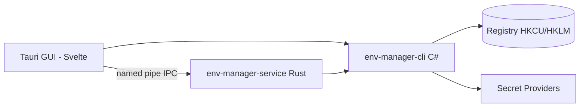

<!-- canonical: ../../README.md -->
<!-- sync: 099ff2392de6f77f24072fced3a782fdf9111ed6 -->

<div align="center">

<picture>
  <source media="(prefers-color-scheme: dark)" srcset="../../docs/assets/logo-dark-theme.png">
  <source media="(prefers-color-scheme: light)" srcset="../../docs/assets/logo-light-theme.png">
  
</picture>

# Env Manager

Un gestor de variables de entorno para Windows con dos interfaces: una herramienta de consola en C# pensada para scripts y agentes de IA, y una app de escritorio en Tauri para editar a mano en una interfaz visual. Ambas usan exactamente las mismas reglas de registro.

**"Se adapta sin problemas a cualquier entorno."**

[](https://github.com/Xxx91n/env-manager/releases)
[](../../LICENSE)
[](#instalación)
[](#requisitos-previos)
[](#arquitectura)

[Instalación](#instalación) · [Características](#características) · [Referencia de CLI](../../docs/cli-commands.md) · [Arquitectura](#arquitectura) · [Registro de cambios](../../CHANGELOG.md)

<!-- README-I18N:START -->
**Idiomas:** [English](../../README.md) · [简体中文](README.zh_CN.md) · [日本語](README.ja.md) · [한국어](README.ko.md) · [Deutsch](README.de.md) · [Français](README.fr.md) · **Español** · [Português](README.pt.md) · [Русский](README.ru.md) · [العربية](README.ar.md)
<!-- README-I18N:END -->

</div>

## Showcase

https://github.com/user-attachments/assets/7657b508-42bb-45a8-94b7-7c1fa052a4d0

## Características

- **Dos interfaces** — `env-manager-cli` para scripts y CI, y `env-manager.exe` (Tauri 2 + Svelte) para usar con ratón y pantalla. Ambas siguen las mismas reglas al tocar el registro.
- **Protegido por defecto** — las variables del sistema y las rutas de PATH no se pueden borrar ni renombrar. Al renombrar o cambiar de ámbito, primero se escribe y comprueba el nuevo valor antes de borrar el anterior. Toda escritura adquiere los tres bloqueos a la vez: un mutex de Windows en la CLI, un bloqueo de lectura/escritura en el motor de Rust y una cola de escritura en la interfaz gráfica.
- **Profiles** — un Global profile escribe sus valores en el registro al aplicarse; un Launch profile pasa sus valores a un solo proceso secundario y jamás toca el registro. Los perfiles pueden heredar de otros perfiles, y la app te muestra los posibles conflictos antes de aplicar nada.
- **Nueve secret providers** — DPAPI, Credential Manager, SecretStore, HashiCorp Vault, SOPS, Azure Key Vault, 1Password, AWS Secrets Manager y AWS IAM Roles Anywhere. Los secretos se guardan como secret envelopes cifrados o como referencias `mount:<id>`. Los comandos comunes `add-var` y `edit-var` aún pueden escribir texto sin formato en el registro; todos los detalles están en [Seguridad](#seguridad) y en [docs/plaintext-sinks.md](../../docs/plaintext-sinks.md).
- **Salud de PATH** — `path health` localiza entradas duplicadas o rutas que ya no existen; `--fix` limpia y reescribe la lista, y `--dry-run` solo te dice qué cambiaría sin tocar nada.
- **Audit ledger** — un historial protegido por hash SHA256 donde solo se pueden añadir datos, con opción de marcha atrás y copia para recuperar el sistema en caso de desastre.

## Para agentes de IA

```bash
env-manager-cli agents            # print the embedded agent manual
env-manager-cli agents --path     # file path of the manual (AGENTS.cli.md)
env-manager-cli agents --summary  # one-line machine-readable spec
env-manager-cli agents --json     # full command table as structured JSON
```

- [AGENTS.md](../../AGENTS.md) — instrucciones del repositorio para agentes (arquitectura, límites estrictos y pruebas).
- [AGENTS.cli.md](../../AGENTS.cli.md) — viene incluido dentro del ejecutable de la CLI para que un agente pueda consultar las normas en cualquier momento.

## Seguridad

> [!WARNING]
> Las versiones actuales **no están firmadas digitalmente**. Es posible que Windows SmartScreen muestre un aviso de "aplicación no reconocida" la primera vez que la abras: pulsa en "Más información" y después en "Ejecutar de todas formas". Ya hemos solicitado el certificado gratuito para proyectos de código abierto a SignPath Foundation; en cuanto nos lo concedan, todos los instaladores y ejecutables (MSI y EXE) vendrán firmados. Consulta nuestra [Política de firma de código](../../docs/code-signing-policy.md).

Las variables protegidas y las rutas del PATH se desactivan antes de eliminarse, y al restaurar se comprueba exactamente qué tipo de clave de registro era. Todos los valores se revisan antes de guardarlos en el registro, y la tubería con nombre (named pipe) no permite que otro proceso suplante el canal y limita las peticiones a un máximo de 65536 bytes. Si encuentras algún problema de seguridad, revisa [SECURITY.md](../../SECURITY.md) para informarnos.

**Modelo de amenazas.** El programa no intenta defenderse de otros programas que se estén ejecutando dentro de tu propia sesión de usuario de Windows. Cualquier programa en tu sesión ya tiene permiso para llamar a `profile reveal-secret`, mirar las variables de un proceso secundario lanzado o leer los archivos temporales de corta duración que dejan los proveedores. Lo que sí hace el diseño es acotar daños: nadie puede descifrar los datos cifrados con DPAPI CurrentUser desde otro usuario u otro ordenador, los comandos específicos de secretos no guardan datos sin cifrar en el registro (al margen del aviso sobre comandos genéricos mencionado arriba) y los únicos sitios pensados para manejar secretos en claro son los que figuran en la lista enlazada a continuación.

**Límites de texto sin formato.** La lista completa con cada lugar donde un secreto puede estar sin cifrar, cuánto tiempo dura y qué se encarga de limpiarlo está explicada en [docs/plaintext-sinks.md](../../docs/plaintext-sinks.md). El apartado de ciclo de vida del texto sin formato de `docs/architecture.md` es la referencia oficial por superficie. Borrar la memoria y limpiar los registros se hace siempre de buena fe pero sin garantías absolutas: la prueba `tests/canary-redaction.Tests.ps1` revisa 7 salidas buscando texto de prueba, y las pruebas de contrato comprueban en ocho proveedores que el texto sin formato jamás se guarde dentro del sobre, mientras que `aws-roles-anywhere` lo cubre la prueba sin conexión.

## Instalación

### Instalador MSI

Descarga el archivo MSI desde [GitHub Releases](https://github.com/Xxx91n/env-manager/releases) y ábrelo. Te creará los accesos directos en el menú Inicio automáticamente. Hay versiones para x64, x86 y ARM64.

### Portable

Descarga el archivo ZIP portable desde [GitHub Releases](https://github.com/Xxx91n/env-manager/releases). Descomprímelo en la carpeta que quieras y abre `env-manager.exe`. No necesitas instalar nada.

### Solo CLI

Si solo quieres usar comandos en terminal o scripts, descarga el ZIP de solo CLI: contiene `env-manager-cli.exe` y sus archivos `.dll`. No trae interfaz gráfica ni necesita WebView2.

### Requisitos previos

> [!IMPORTANT]
> Las versiones **Portable** y **Solo CLI** no traen el entorno integrado: necesitan tener instalado **.NET 10 Desktop Runtime** en el equipo. Puedes descargarlo directamente de la [página oficial de .NET](https://dotnet.microsoft.com/download/dotnet/10.0). El **instalador MSI** no comprueba ni instala .NET por su cuenta, así que asegúrate de instalarlo tú antes de abrir la app por primera vez.
>
> La librería **WebView2 Runtime** (necesaria para la interfaz gráfica) ya viene instalada de fábrica en Windows 11, y se puede descargar para Windows 10 (versión 21H2 en adelante) desde la web de [Microsoft](https://developer.microsoft.com/microsoft-edge/webview/).

Si vas a usar herramientas externas para conectar proveedores de secretos (como SOPS, la CLI de 1Password, la CLI de Vault, la CLI de AWS, Azure CLI o PowerShell 7), échale un vistazo a la [Guía de secret providers](../../docs/secret-providers-guide.md).

### winget

> [!NOTE]
> Tenemos previsto incluir la app en winget, pero todavía no está lista ahí. Puedes seguir el avance en GitHub Issues.

### Compilar desde el código fuente

```bash
git clone https://github.com/Xxx91n/env-manager.git
cd env-manager
cd frontend && npm ci && cd ..
node scripts/build.mjs --arch x64
```

Necesitas el SDK de .NET 10, Node.js 18 o superior, y Rust estable configurado para compilar con MSVC o GNU. Consulta [docs/build-and-release.md](../../docs/build-and-release.md) para más información.

## Uso

### CLI

```bash
# Listar / consultar / asignar
env-manager-cli.exe list
env-manager-cli.exe get PATH
env-manager-cli.exe set JAVA_HOME "D:\jdk17" --scope system

# Crear un Launch profile y lanzarlo con variables aisladas
env-manager-cli.exe profile create dev --type launch --target python.exe
env-manager-cli.exe profile add-secret dev API_KEY "sk-xxx"
env-manager-cli.exe profile launch dev

# Comprobar el estado del PATH
env-manager-cli.exe path health

# Copia de seguridad y restauración
env-manager-cli.exe backup --output backup.json
env-manager-cli.exe restore backup.json

# Recuperación ante desastres y comprobación del registro de auditoría
env-manager-cli.exe export-state --output state.dpapi
env-manager-cli.exe audit verify --strict

# Control del servicio
env-manager-cli.exe service status
```

Consulta [docs/cli-commands.md](../../docs/cli-commands.md) para ver la lista completa de comandos.

### GUI

Abre `env-manager.exe`. La interfaz te muestra tus variables al momento: puedes buscar, filtrar por ámbito, editar al vuelo, ordenar las rutas del PATH arrastrando y soltando, gestionar perfiles, elegir tu proveedor de secretos, controlar el servicio en segundo plano, revisar el historial de auditoría y cambiar entre 10 idiomas.

## Arquitectura



- **CLI**: ejecutable en C# .NET 10 que coordina todo el trabajo y es el único autorizado para escribir en el registro.
- **Servicio**: un ejecutable independiente en Rust que se encarga de mantener al día los secret mounts a través de una tubería con nombre (named pipe).
- **GUI**: interfaz de usuario hecha con Tauri 2 y Svelte 5 que se comunica usando los mismos contratos de mensajes.

## Secret providers

Dispones de nueve secret providers. Cada vez que cambias a uno, la aplicación comprueba si funciona bien; si algo falla, verás una advertencia naranja directamente en el editor de perfiles:

| Provider | Modo de autenticación | Comprobación periódica | Documentación |
|---|---|---|---|
| DPAPI CurrentUser | Windows DPAPI | No (por usuario) | [Guía](../../docs/secret-providers-guide.md) |
| Windows Credential Manager | Credential Manager + DPAPI | No (por usuario) | [Guía](../../docs/secret-providers-guide.md) |
| PowerShell SecretManagement | Almacén SecretStore | No (`CreatedOnly`) | [Guía](../../docs/secret-providers-guide.md) |
| HashiCorp Vault KV v2 | VAULT_TOKEN / certificado AppRole | Sí | [Guía](../../docs/secret-providers-guide.md) |
| SOPS | Age / PGP / KMS | No (`CreatedOnly`) | [Guía](../../docs/secret-providers-guide.md) |
| Azure Key Vault | Certificado de Service Principal / identidad administrada | Sí | [Guía](../../docs/secret-providers-guide.md) |
| 1Password CLI | OP_SERVICE_ACCOUNT_TOKEN | Sí | [Guía](../../docs/secret-providers-guide.md) |
| AWS Secrets Manager | SigV4 + claves de acceso | Sí | [Guía](../../docs/secret-providers-guide.md) |
| AWS IAM Roles Anywhere | Certificado del almacén de máquina canjeado por credenciales temporales | No, todavía no: el servicio no vuelve a leer los secret mounts `Periodic` | [Guía](../../docs/secret-providers-guide.md) |

En la columna «Comprobación periódica», «Sí» significa que el proveedor declara compatibilidad con `Periodic`; el servicio todavía no vuelve a leer esos secret mounts, así que los valores no se actualizan solos por ahora (ver [este issue](https://github.com/Xxx91n/env-manager/issues/276)).

Consulta la [Guía de secret providers](../../docs/secret-providers-guide.md) para ver los requisitos de cada uno, cómo configurarlos y cómo resolver fallos habituales.

## Modo servicio

`env-manager-service.exe` es un ejecutable independiente en Rust que mantiene al día los secret mounts y responde peticiones por una tubería con nombre:

- **Modos de servicio**: Service (gestionado por Windows SCM al arrancar el equipo), Background (iniciado por el usuario en segundo plano) o Cli (como puente de una sola ejecución).
- **Ciclo de reconciliación**: escaneo completo cada 300 segundos, tratamiento seguro por elemento y una espera inicial de 30 segundos tras arrancar.
- **Audit ledger**: archivo `audit-ledger.jsonl` encadenado con hashes SHA256 donde solo se añade información, con rotación a los 100 MB y detección de alteraciones.
- **Comunicación IPC**: protección contra secuestro de tuberías, límite de 65536 bytes por petición y mensajes JSON separados por saltos de línea.
- **Vigilancia (watchdog)**: dos niveles de recuperación — reinicio automático de Windows en modo Service y comprobaciones cada 30 segundos desde la GUI en modo Background.

## Documentación

| Documento | Contenido |
|---|---|
| [CHANGELOG.md](../../CHANGELOG.md) | Historial de versiones y cambios |
| [docs/cli-commands.md](../../docs/cli-commands.md) | Manual completo de comandos de la CLI |
| [docs/architecture.md](../../docs/architecture.md) | Explicación a fondo de la arquitectura |
| [docs/plaintext-sinks.md](../../docs/plaintext-sinks.md) | Dónde pueden aparecer secretos en texto plano |
| [docs/backup-and-profiles.md](../../docs/backup-and-profiles.md) | Copias de seguridad, restauración y normas de perfiles |
| [docs/secret-providers-guide.md](../../docs/secret-providers-guide.md) | Configuración paso a paso de secret providers |
| [docs/build-and-release.md](../../docs/build-and-release.md) | Cómo compilar y publicar el proyecto |
| [AGENTS.md](../../AGENTS.md) / [AGENTS.cli.md](../../AGENTS.cli.md) | Guías para agentes de IA |

## Desarrolladores y responsables

[@Xxx91n](https://github.com/Xxx91n)

## Cómo colaborar

Cualquier sugerencia, reporte de error o aportación de código es bienvenida. Antes de empezar, te recomendamos leer [AGENTS.md](../../AGENTS.md) para conocer las normas de diseño y pruebas.

## Licencia

Apache-2.0 © 2026 Env Manager Contributors. Consulta [LICENSE](../../LICENSE).
