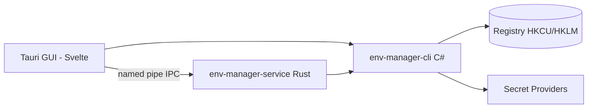

<!-- canonical: ../../README.md -->
<!-- sync: 55daccb8e73e8f14bbfe54452fe7c2969337492d -->

<div align="center">

<picture>
  <source media="(prefers-color-scheme: dark)" srcset="../../docs/assets/logo-dark-theme.png">
  <source media="(prefers-color-scheme: light)" srcset="../../docs/assets/logo-light-theme.png">
  
</picture>

# Env Manager

Un gestionnaire de variables d'environnement pour Windows doté de deux interfaces : un outil en ligne de commande en C# taillé pour les scripts et les agents IA, et une application de bureau Tauri pour éditer tout ça directement à la main. Les deux partagent exactement les mêmes règles d'écriture dans le registre.

**« S'adapte en toute simplicité à tous les environnements. »**

[](https://github.com/Xxx91n/env-manager/releases)
[](../../LICENSE)
[](#install)
[](#prerequisites)
[](#architecture)

[Installer](#install) · [Fonctionnalités](#features) · [Guide de la CLI](../../docs/cli-commands.md) · [Architecture](#architecture) · [Historique des versions](../../CHANGELOG.md)

<!-- README-I18N:START -->
**Langues :** [English](../../README.md) · [简体中文](README.zh_CN.md) · [日本語](README.ja.md) · [한국어](README.ko.md) · [Deutsch](README.de.md) · **Français** · [Español](README.es.md) · [Português](README.pt.md) · [Русский](README.ru.md) · [العربية](README.ar.md)
<!-- README-I18N:END -->

</div>

## Showcase

https://github.com/user-attachments/assets/7657b508-42bb-45a8-94b7-7c1fa052a4d0

## Features

- **Deux interfaces complémentaires** — `env-manager-cli` pour vos scripts et votre CI, et `env-manager.exe` (Tauri 2 + Svelte) pour modifier vos variables à la souris. Les deux passent par les mêmes règles de registre.
- **Protégé d'office** — impossible de supprimer ou renommer par mégarde les variables système et les chemins du PATH. Lors d'un renommage ou d'un changement de portée, la nouvelle valeur est écrite et vérifiée avant de supprimer l'ancienne. Chaque écriture verrouille tout à la fois : un mutex Windows dans la CLI, un verrou lecture/écriture dans le cœur Rust et une file d'attente dans l'interface graphique.
- **Profils** — un profil Global écrit directement ses valeurs dans le registre ; un profil Launch injecte ses valeurs uniquement dans l'environnement d'un sous-processus sans toucher au registre. Les profils peuvent hériter d'autres profils, et les conflits sont prévisualisés avant la moindre application.
- **Neuf fournisseurs de secrets** — DPAPI, Credential Manager, SecretStore, HashiCorp Vault, SOPS, Azure Key Vault, 1Password, AWS Secrets Manager et AWS IAM Roles Anywhere. Les secrets restent sous forme d'enveloppes chiffrées ou de références `mount:<id>`. Attention : les commandes génériques `add-var` et `edit-var` peuvent tout de même écrire du texte en clair dans le registre ; tous les détails sont expliqués dans [Sécurité](#security) et [docs/plaintext-sinks.md](../../docs/plaintext-sinks.md).
- **Nettoyage du PATH** — la commande `path health` repère les doublons et les dossiers introuvables ; `--fix` remet de l'ordre dans la liste et `--dry-run` affiche simplement le constat sans rien toucher.
- **Registre d'audit** — un journal en ajout seul chaîné en SHA256 avec retour en arrière possible et export de secours.

## For AI agents

```bash
env-manager-cli agents            # print the embedded agent manual
env-manager-cli agents --path     # file path of the manual (AGENTS.cli.md)
env-manager-cli agents --summary  # one-line machine-readable spec
env-manager-cli agents --json     # full command table as structured JSON
```

- [AGENTS.md](../../AGENTS.md) — instructions complètes pour les agents (architecture, règles strictes, tests).
- [AGENTS.cli.md](../../AGENTS.cli.md) — guide embarqué directement dans l'exécutable CLI pour que les agents le lisent à tout moment.

## Security

> [!WARNING]
> Les versions actuelles ne disposent **pas encore de signature numérique**. Windows SmartScreen peut donc afficher une alerte « Application inconnue » au tout premier lancement : cliquez simplement sur « Informations complémentaires » puis sur « Exécuter quand même ». Une demande de certificat open source gratuit est en cours auprès de la fondation SignPath ; dès sa validation, tous les fichiers publiés (MSI et EXE) seront signés. Consultez la [Politique de signature de code](../../docs/code-signing-policy.md).

Les variables et chemins protégés sont désactivés avant toute suppression, et le type exact de la clé de registre est scrupuleusement vérifié lors d'une restauration. Les valeurs sont contrôlées avant d'atteindre le registre, et le canal nommé refuse tout second créateur tout en plafonnant chaque requête à 65 536 octets. Voir [SECURITY.md](../../SECURITY.md) pour signaler un problème de sécurité.

**Modèle de menace.** L'application ne peut pas vous protéger contre un programme malveillant qui tournerait déjà dans votre propre session Windows. Un tel processus a déjà le pouvoir de lancer `profile reveal-secret`, de lire l'environnement d'un processus enfant ou de récupérer les fichiers temporaires créés par les fournisseurs. L'architecture limite toutefois les risques : un secret chiffré par DPAPI CurrentUser ne peut être lu par un autre utilisateur ou sur un autre PC, les commandes dédiées aux secrets n'écrivent jamais dans le registre (hors commandes génériques mentionnées plus haut), et les seuls endroits où un secret peut transiter en clair sont clairement listés dans le tableau ci-dessous.

**Frontière du texte en clair.** Le tableau complet — où le texte en clair peut se trouver, combien de temps et qui l'efface — se trouve dans [docs/plaintext-sinks.md](../../docs/plaintext-sinks.md). La section consacrée au cycle de vie du texte en clair dans `docs/architecture.md` fait foi pour chaque cas. L'effacement de la mémoire et le masquage dans les journaux sont faits au mieux sans être des garanties absolues : le script `tests/canary-redaction.Tests.ps1` vérifie sept sorties pour s'assurer qu'un mot-clé secret ne fuite pas, et la suite de tests valide la règle `plaintext-never-in-envelope` sur huit fournisseurs, tandis que `aws-roles-anywhere` est couvert par la suite hors ligne.

## Install

### MSI Installer

Téléchargez l'installateur MSI depuis la page des [versions GitHub](https://github.com/Xxx91n/env-manager/releases) et lancez-le. Les raccourcis du menu Démarrer sont créés tout seuls. Disponible pour x64, x86 et ARM64.

### Portable

Téléchargez l'archive ZIP portable depuis la page des [versions GitHub](https://github.com/Xxx91n/env-manager/releases). Décompressez-la et double-cliquez sur `env-manager.exe`. Aucune installation n'est nécessaire.

### CLI-Only

Téléchargez l'archive ZIP réservée à la CLI pour vos serveurs ou vos scripts automatiques : vous y trouverez `env-manager-cli.exe` et ses fichiers `.dll`. Sans interface graphique et sans dépendance à WebView2.

### Prerequisites

> [!IMPORTANT]
> Les versions **Portable** et **CLI-Only** ont besoin du runtime de bureau : elles nécessitent le **runtime .NET 10 Desktop** sur votre machine — vous pouvez le récupérer sur la [page officielle de téléchargement de .NET](https://dotnet.microsoft.com/download/dotnet/10.0). L'**installateur MSI** n'installe pas .NET automatiquement : pensez à installer le runtime avant le premier lancement.
>
> Le **runtime WebView2** (utile pour l'interface graphique) est déjà présent sous Windows 11 et téléchargeable pour Windows 10 (21H2 ou plus récent) chez [Microsoft](https://developer.microsoft.com/microsoft-edge/webview/).

Pour les outils externes optionnels liés aux secrets (SOPS, 1Password CLI, Vault CLI, AWS CLI, Azure CLI, PowerShell 7), consultez le [Guide des fournisseurs de secrets](../../docs/secret-providers-guide.md).

### winget

> [!NOTE]
> La disponibilité via winget arrive prochainement. Vous pouvez suivre l'avancement dans les tickets GitHub.

### From Source

```bash
git clone https://github.com/Xxx91n/env-manager.git
cd env-manager
cd frontend && npm ci && cd ..
node scripts/build.mjs --arch x64
```

Nécessite le SDK .NET 10, Node.js 18+ et une version stable de Rust avec la cible MSVC ou GNU. Tous les détails figurent dans [docs/build-and-release.md](../../docs/build-and-release.md).

## Usage

### CLI

```bash
# List / get / set
env-manager-cli.exe list
env-manager-cli.exe get PATH
env-manager-cli.exe set JAVA_HOME "D:\jdk17" --scope system

# Create a Launch profile and launch with an isolated environment
env-manager-cli.exe profile create dev --type launch --target python.exe
env-manager-cli.exe profile add-secret dev API_KEY "sk-xxx"
env-manager-cli.exe profile launch dev

# PATH health
env-manager-cli.exe path health

# Backup / restore
env-manager-cli.exe backup --output backup.json
env-manager-cli.exe restore backup.json

# Disaster recovery and tamper-evident audit
env-manager-cli.exe export-state --output state.dpapi
env-manager-cli.exe audit verify --strict

# Service control
env-manager-cli.exe service status
```

Consultez [docs/cli-commands.md](../../docs/cli-commands.md) pour retrouver l'ensemble des commandes disponibles.

### GUI

Lancez simplement `env-manager.exe`. L'interface affiche la liste en direct de vos variables avec recherche, filtre par portée et modification immédiate, un éditeur de PATH réorganisable par glisser-déposer, la gestion des profils, le choix du fournisseur de secrets, le pilotage du service d'arrière-plan, le registre d'audit et la prise en charge de dix langues.

## Architecture



- **CLI** : un exécutable C# .NET 10 qui pilote les opérations et reste le seul à pouvoir modifier le registre Windows.
- **Service** : un binaire Rust autonome qui garde les montages de secrets à jour via un canal nommé.
- **GUI** : une interface en Tauri 2 et Svelte 5 qui utilise les mêmes échanges de messages.

## Secret providers

Neuf fournisseurs de secrets sont disponibles, chacun étant testé dès que vous basculez dessus. Si la configuration coince, un bandeau orange apparaît directement dans l'éditeur de profil :

| Fournisseur | Méthode d'authentification | Rafraîchissement automatique | Guide |
|---|---|---|---|
| DPAPI CurrentUser | Windows DPAPI | Non (propre à l'utilisateur) | [Guide](../../docs/secret-providers-guide.md) |
| Windows Credential Manager | Credential Manager + DPAPI | Non (propre à l'utilisateur) | [Guide](../../docs/secret-providers-guide.md) |
| PowerShell SecretManagement | Coffre SecretStore | Non (`CreatedOnly`) | [Guide](../../docs/secret-providers-guide.md) |
| HashiCorp Vault KV v2 | VAULT_TOKEN / certificat AppRole | Oui | [Guide](../../docs/secret-providers-guide.md) |
| SOPS | Age / PGP / KMS | Non (`CreatedOnly`) | [Guide](../../docs/secret-providers-guide.md) |
| Azure Key Vault | Certificat de principal de service / identité managée | Oui | [Guide](../../docs/secret-providers-guide.md) |
| 1Password CLI | OP_SERVICE_ACCOUNT_TOKEN | Oui | [Guide](../../docs/secret-providers-guide.md) |
| AWS Secrets Manager | SigV4 + clés d'accès | Oui | [Guide](../../docs/secret-providers-guide.md) |
| AWS IAM Roles Anywhere | Certificat du magasin machine échangé contre des identifiants temporaires | Non, pas encore : le service ne relit pas les montages de secrets `Periodic` | [Guide](../../docs/secret-providers-guide.md) |

Consultez le [Guide des fournisseurs de secrets](../../docs/secret-providers-guide.md) pour voir les prérequis de chaque outil, la configuration initiale et comment corriger les erreurs courantes.

## Service mode

`env-manager-service.exe` est un programme Rust autonome qui veille sur les montages de secrets et répond via un canal nommé :

- **ServiceMode** : Service (géré par Windows au démarrage du système), Background (lancé à la demande par l'utilisateur), Cli (passerelle rapide à usage unique).
- **Boucle de contrôle** : balayage complet toutes les 300 s, traitement sûr même répété plusieurs fois, et premier contrôle après 30 s d'attente.
- **Registre d'audit** : fichier `audit-ledger.jsonl` écrit uniquement à la suite avec chaîne de hachage, découpage à 100 Mo et détection de modifications anormales.
- **IPC** : protection contre le détournement de canal, taille maximale de 65 536 octets par requête, protocole JSON simple ligne par ligne.
- **Surveillance** : double sécurité — redémarrage automatique par le gestionnaire de services Windows (mode Service) et vérification régulière toutes les 30 s par l'interface graphique (mode Background).

## Documentation

| Document | Contenu |
|---|---|
| [CHANGELOG.md](../../CHANGELOG.md) | Historique des versions (format keepachangelog) |
| [docs/cli-commands.md](../../docs/cli-commands.md) | Référence détaillée de toutes les commandes |
| [docs/architecture.md](../../docs/architecture.md) | Architecture technique détaillée |
| [docs/plaintext-sinks.md](../../docs/plaintext-sinks.md) | Où les secrets peuvent transiter en clair |
| [docs/backup-and-profiles.md](../../docs/backup-and-profiles.md) | Sauvegarde, restauration et règles des profils |
| [docs/secret-providers-guide.md](../../docs/secret-providers-guide.md) | Mise en place des fournisseurs de secrets |
| [docs/build-and-release.md](../../docs/build-and-release.md) | Compilation et publication des versions |
| [AGENTS.md](../../AGENTS.md) / [AGENTS.cli.md](../../AGENTS.cli.md) | Guides dédiés aux agents IA |

## Maintainers

[@Xxx91n](https://github.com/Xxx91n)

## Contributing

Les signalements de bugs et les propositions d'améliorations sont les bienvenus. Pensez à jeter un œil à [AGENTS.md](../../AGENTS.md) pour bien comprendre les règles d'architecture et les exigences de tests.

## License

Apache-2.0 © 2026 Contributeurs d'Env Manager. Voir [LICENSE](../../LICENSE).
