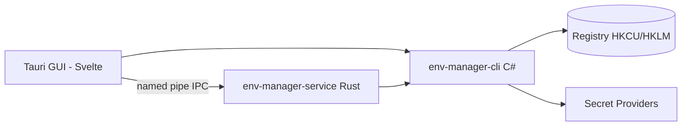

<!-- canonical: ../../README.md -->
<!-- sync: ef2a485dfffb -->

<div align="center">

<picture>
  <source media="(prefers-color-scheme: dark)" srcset="../../docs/assets/logo-dark-theme.png">
  <source media="(prefers-color-scheme: light)" srcset="../../docs/assets/logo-light-theme.png">
  
</picture>


# Env Manager

Un gestionnaire de variables d'environnement Windows doté de deux interfaces — une CLI C# pensée pour les scripts et les agents IA, et une GUI Tauri pour l'édition interactive — reposant sur un même ensemble de contrats de registre.

**« S'adapte sans couture à chaque environnement. »**

[](https://github.com/Xxx91n/env-manager/releases)
[](../../LICENSE)
[](#install)
[](#prérequis)
[](#architecture)

[Installation](#install) · [Fonctionnalités](#features) · [Référence CLI](../../docs/cli-commands.md) · [Architecture](#architecture) · [Changelog](../../CHANGELOG.md)

<!-- README-I18N:START -->
**Langues :** [English](../../README.md) · [简体中文](README.zh_CN.md) · [日本語](README.ja.md) · [한국어](README.ko.md) · [Deutsch](README.de.md) · **Français** · [Español](README.es.md) · [Português](README.pt.md) · [Русский](README.ru.md) · [العربية](README.ar.md)
<!-- README-I18N:END -->

</div>

## Showcase

### GUI

| | | |
|:-:|:-:|:-:|
| <br>**Variables** — recherche, filtre par portée, actions par ligne | <br>**Portée système** — entrées protégées verrouillées | <br>**Éditeur PATH** — détection des entrées mortes et des doublons |
| <br>**Profils** — appliquer / lancer / hériter | <br>**Registre d'audit** — chaîné par hash, vérifiable | <br>**Gestionnaire de services** — montages de secrets |

## Features

- **Deux interfaces** — `env-manager-cli` pour les scripts et la CI, `env-manager.exe` (Tauri 2 + Svelte) pour l'édition interactive. Les deux passent par les mêmes contrats de registre.
- **Protégé par défaut** — les variables système et les entrées PATH ne peuvent être ni supprimées ni renommées ; chaque écriture est sérialisée à travers trois couches (mutex + verrou d'écriture + vérification avant remplacement).
- **Profils** — les profils globaux s'appliquent au registre ; les profils Launch injectent un bloc d'environnement isolé dans un seul processus sans toucher au registre. Héritage, aperçu des conflits, rollback en ordre inverse.
- **8 fournisseurs de secrets** — DPAPI, Credential Manager, SecretStore, HashiCorp Vault, SOPS, Azure Key Vault, 1Password, AWS Secrets Manager. Les verbes de secrets ne persistent que des enveloppes chiffrées ou des références `mount:<id>` — la faille des verbes génériques `add-var`/`edit-var` peut écrire du texte en clair dans le registre ; la frontière d'exposition du texte en clair est décrite dans [Security](#security) et [docs/plaintext-sinks.md](../../docs/plaintext-sinks.md).
- **Santé du PATH** — `path health` détecte les doublons et les entrées mortes ; `--fix` réécrit, `--dry-run` rapporte.
- **Registre d'audit** — historique en ajout uniquement, chaîné par hash SHA256, avec rollback et export de récupération après sinistre.

## For AI agents

```bash
env-manager-cli agents            # print the embedded agent manual
env-manager-cli agents --path     # file path of the manual (AGENTS.cli.md)
env-manager-cli agents --summary  # one-line machine-readable spec
env-manager-cli agents --json     # full command table as structured JSON
```

- [AGENTS.md](../../AGENTS.md) — instructions d'agent au niveau du dépôt (architecture, limites strictes, tests).
- [AGENTS.cli.md](../../AGENTS.cli.md) — fourni dans le binaire CLI, pour qu'un agent puisse découvrir le contrat à l'exécution.
- **Surface agentique par capacités** — une liste blanche opt-in `agentCapabilities` dans `secret-providers.json` permet aux déploiements de rejeter les appels set/delete parallèles venant des agents.

## Security

> [!WARNING]
> Les builds actuels ne sont **pas signés numériquement**. Windows SmartScreen peut afficher un avertissement « application non reconnue » au premier lancement — cliquez sur « Plus d'informations » puis sur « Exécuter quand même ». Nous avons demandé une signature de code open source gratuite via la SignPath Foundation ; une fois approuvée, tous les artefacts de version (MSI + EXE) seront signés. Voir la [Politique de signature de code](../../docs/code-signing-policy.md).

Les variables protégées et les entrées PATH sont désactivées avant suppression, avec vérification exacte du type de valeur du registre lors de la restauration. L'IPC par named pipe utilise des indicateurs anti-squatting et une validation des entrées (64 arguments max, limite de 32767 caractères, rejet des octets nuls). Voir [SECURITY.md](../../SECURITY.md) pour le signalement des vulnérabilités.

**Modèle de menace.** L'adversaire contre lequel nous ne défendons *pas* est tout processus s'exécutant dans votre propre session utilisateur Windows — il peut déjà appeler `profile reveal-secret`, lire le bloc d'environnement d'un processus enfant lancé ou intercepter les fichiers temporaires éphémères produits par les fournisseurs. Ce que la conception *borne* réellement : le chiffré DPAPI-CurrentUser est indéchiffrable pour un autre utilisateur ou une autre machine, les verbes de secrets ne peuvent pas déposer un secret dans le registre (à l’écart de la faille des verbes génériques ci-dessus), et les seuls puits *censés* transporter une valeur secrète sont ceux, prévus, documentés dans la matrice de frontière du texte en clair ci-dessous.

**Frontière du texte en clair.** La matrice complète des points de chute — où le texte en clair peut exister, pendant combien de temps et qui le nettoie — se trouve dans [docs/plaintext-sinks.md](../../docs/plaintext-sinks.md) ; la section Plaintext lifecycle de `docs/architecture.md` constitue la liste d'autorisation de référence par surface. La mise à zéro de la mémoire et le nettoyage des journaux sont des mesures d'hygiène au mieux, pas des garanties ; `tests/canary-redaction.Tests.ps1` analyse 7 sorties à la recherche d'un canary planté et la suite de contrats partagée vérifie `plaintext-never-in-envelope` sur les 8 fournisseurs.

## Install

### Installateur MSI

Téléchargez le MSI depuis [GitHub Releases](https://github.com/Xxx91n/env-manager/releases) et exécutez-le. Les raccourcis du menu Démarrer sont créés automatiquement. Disponible en x64, x86 et ARM64.

### Portable

Téléchargez le ZIP portable depuis [GitHub Releases](https://github.com/Xxx91n/env-manager/releases). Extrayez-le et exécutez `env-manager.exe` directement. Aucune installation requise.

### CLI uniquement

Téléchargez le ZIP CLI-only pour une utilisation sans interface ou par scripts : `env-manager-cli.exe` plus les fichiers `.dll`. Pas de GUI, pas de dépendance WebView2.

### Prérequis

> [!IMPORTANT]
> Les builds **Portable** et **CLI uniquement** dépendent du framework : ils nécessitent le **runtime .NET 10 Desktop** sur la machine cible — téléchargez-le depuis la [page de téléchargement officielle de .NET](https://dotnet.microsoft.com/download/dotnet/10.0). L'**installateur MSI** ne vérifie ni n'installe .NET — installez le runtime vous-même avant le premier lancement.
>
> Le **runtime WebView2** (pour la GUI) est préinstallé sur Windows 11 et disponible pour Windows 10 21H2+ auprès de [Microsoft](https://developer.microsoft.com/microsoft-edge/webview/).

Pour les outils externes facultatifs de fournisseurs de secrets (SOPS, 1Password CLI, Vault CLI, AWS CLI, Azure CLI, PowerShell 7), consultez le [Guide des fournisseurs de secrets](../../docs/secret-providers-guide.md).

### winget

> [!NOTE]
> La distribution via winget est prévue mais pas encore disponible. Suivez les mises à jour via GitHub Issues.

### Depuis les sources

```bash
git clone https://github.com/Xxx91n/env-manager.git
cd env-manager
cd frontend && npm ci && cd ..
node scripts/build.mjs --arch x64
```

Nécessite le SDK .NET 10, Node.js 18+ et Rust stable avec cible MSVC ou GNU. Voir [docs/build-and-release.md](../../docs/build-and-release.md) pour les détails.

## Usage

### CLI

```bash
# List / get / set
env-manager-cli.exe list
env-manager-cli.exe get PATH
env-manager-cli.exe set JAVA_HOME "D:\jdk17" --scope system

# Create a Launch profile and launch with isolated env
env-manager-cli.exe profile create dev --type launch --target python.exe
env-manager-cli.exe profile add-secret dev API_KEY "sk-xxx"
env-manager-cli.exe profile launch dev

# PATH health
env-manager-cli.exe path health

# Backup / restore
env-manager-cli.exe backup --output backup.json
env-manager-cli.exe restore backup.json

# Disaster recovery + tamper-evident audit
env-manager-cli.exe export-state --output state.dpapi
env-manager-cli.exe audit verify --strict

# Service control
env-manager-cli.exe service status
```

Voir [docs/cli-commands.md](../../docs/cli-commands.md) pour la référence complète des commandes.

### GUI

Exécutez `env-manager.exe`. La GUI offre une liste de variables en temps réel avec recherche, filtrage par portée et édition en ligne, un éditeur PATH avec réorganisation par glisser-déposer, la gestion des profils, la sélection des fournisseurs de secrets, un panneau de contrôle du service, l'historique d'audit et l'i18n en 10 langues.

## Architecture



- **CLI** : exécutable mono-fichier C# .NET 10 — la couche de coordination et la passerelle vers le registre.
- **Service** : binaire Rust autonome gérant le cycle de vie des montages de secrets via IPC par named pipe.
- **GUI** : frontend Tauri 2 + Svelte 5 utilisant les mêmes contrats IPC.

## Secret providers

8 backends de fournisseurs avec pré-vérification d'activation — les échecs apparaissent sous forme de bannières ambre intégrées directement dans l'éditeur de profils :

| Fournisseur | Méthode d'authentification | Rafraîchissement périodique | Docs |
|---|---|---|---|
| DPAPI CurrentUser | Windows DPAPI | Non (par utilisateur) | [Guide](../../docs/secret-providers-guide.md) |
| Windows Credential Manager | CredMan + DPAPI | Non (par utilisateur) | [Guide](../../docs/secret-providers-guide.md) |
| PowerShell SecretManagement | Coffre SecretStore | Non (CreatedOnly) | [Guide](../../docs/secret-providers-guide.md) |
| HashiCorp Vault KV v2 | VAULT_TOKEN / certificat AppRole | Oui | [Guide](../../docs/secret-providers-guide.md) |
| SOPS | Age / PGP / KMS | Non (CreatedOnly) | [Guide](../../docs/secret-providers-guide.md) |
| Azure Key Vault | Certificat SP / identité managée | Oui | [Guide](../../docs/secret-providers-guide.md) |
| 1Password CLI | OP_SERVICE_ACCOUNT_TOKEN | Oui | [Guide](../../docs/secret-providers-guide.md) |
| AWS Secrets Manager | SigV4 + clés d'accès | Oui | [Guide](../../docs/secret-providers-guide.md) |

Voir [docs/secret-providers-guide.md](../../docs/secret-providers-guide.md) pour les prérequis par fournisseur, la configuration initiale et les étapes de résolution des erreurs d'activation.

## Service mode

`env-manager-service.exe` est un binaire Rust autonome gérant le cycle de vie des montages de secrets via IPC par named pipe :

- **RuntimeMode** : Service (géré par SCM, au démarrage de la machine), Background (lancé par l'utilisateur), Cli (passerelle à usage unique)
- **Boucle de réconciliation** : scan complet périodique de 300 s, gestionnaire idempotent par élément, délai de 30 s avant le premier tick
- **Registre d'audit** : `audit-ledger.jsonl` en annexe seule et chaîné par hash, avec rotation à 100 Mo et détection de falsification
- **IPC** : indicateur de pipe anti-squatting, limite de requête de 65536 octets, protocole JSON délimité par sauts de ligne
- **Watchdog** : récupération à deux niveaux — redémarrage automatique SCM (mode Service) + watchdog de ping de 30 s de la GUI (mode Background)

## Limitations

- Les builds actuels ne sont pas signés numériquement — SmartScreen peut afficher un avertissement au premier lancement (voir [Security](#security)).
- La distribution via winget est prévue mais pas encore disponible.
- La GUI requiert le WebView2 Runtime ; les builds Portable et CLI uniquement requièrent le .NET 10 Desktop Runtime (voir Prérequis).
- Windows uniquement.

## Documentation

| Document | Contenu |
|---|---|
| [CHANGELOG.md](../../CHANGELOG.md) | Historique des versions (format keepachangelog) |
| [docs/cli-commands.md](../../docs/cli-commands.md) | Référence complète des commandes CLI |
| [docs/architecture.md](../../docs/architecture.md) | Architecture approfondie |
| [docs/plaintext-sinks.md](../../docs/plaintext-sinks.md) | Où le texte en clair des secrets peut exister |
| [docs/backup-and-profiles.md](../../docs/backup-and-profiles.md) | Sauvegarde, restauration, sémantique des profils |
| [docs/secret-providers-guide.md](../../docs/secret-providers-guide.md) | Configuration des fournisseurs de secrets |
| [docs/build-and-release.md](../../docs/build-and-release.md) | Processus de build et de release |
| [AGENTS.md](../../AGENTS.md) / [AGENTS.cli.md](../../AGENTS.cli.md) | Guides destinés aux agents |

## Maintainers

[@Xxx91n](https://github.com/Xxx91n)

## Contributing

Les issues et les PR sont les bienvenues. Lisez d'abord [AGENTS.md](../../AGENTS.md) pour les limites d'architecture et la politique de test.

## License

Apache-2.0 © 2026 Env Manager Contributors. Voir [LICENSE](../../LICENSE).
