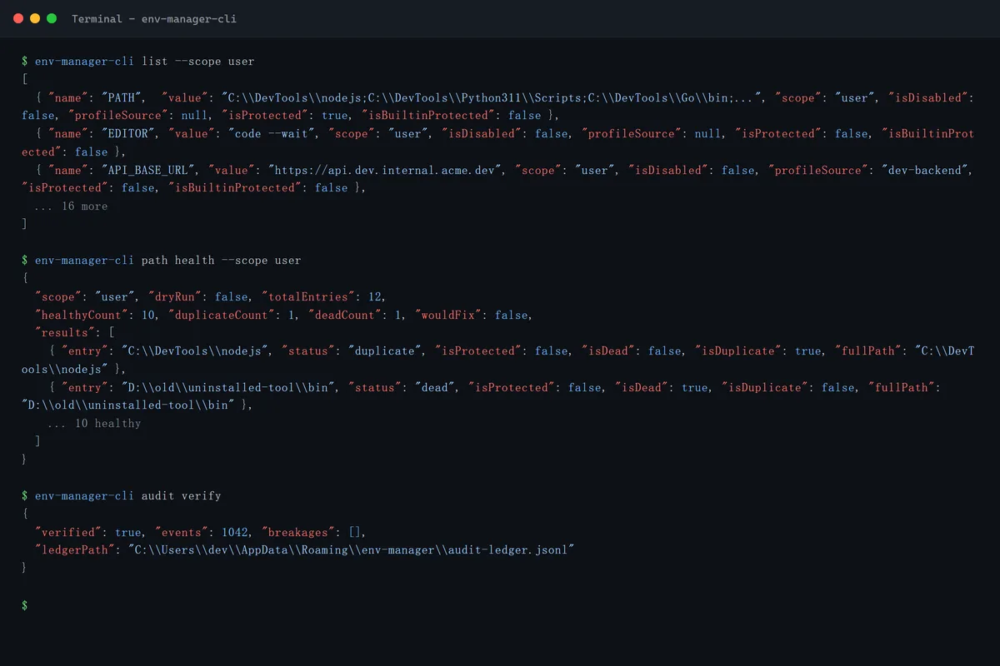
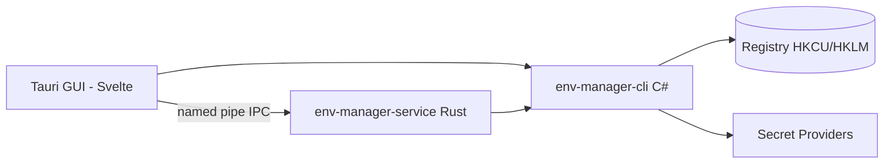

<!-- canonical: ../../README.md -->
<!-- sync: ef2a485dfffb -->

<div align="center">

<picture>
  <source media="(prefers-color-scheme: dark)" srcset="../../docs/assets/logo-dark-theme.png">
  <source media="(prefers-color-scheme: light)" srcset="../../docs/assets/logo-light-theme.png">
  
</picture>

<p align="center">
  
</p>

# Env Manager

2 つのフロントエンドを備えた Windows 環境変数マネージャー — スクリプトと AI エージェント向けに作られた C# CLI と、対話型編集用の Tauri GUI — 単一のレジストリコントラクト群の上に構築されています。

**「あらゆる環境にシームレスに適応します。」**

[](https://github.com/Xxx91n/env-manager/releases)
[](../../LICENSE)
[](#install)
[](#prerequisites)
[](#architecture)

[Install](#install) · [Features](#features) · [CLI Reference](../../docs/cli-commands.md) · [Architecture](#architecture) · [Changelog](../../CHANGELOG.md)

<!-- README-I18N:START -->
**言語:** [English](../../README.md) · [简体中文](README.zh_CN.md) · **日本語** · [한국어](README.ko.md) · [Deutsch](README.de.md) · [Français](README.fr.md) · [Español](README.es.md) · [Português](README.pt.md) · [Русский](README.ru.md) · [العربية](README.ar.md)
<!-- README-I18N:END -->

</div>

## Showcase

### GUI

| | | |
|:-:|:-:|:-:|
| <br>**変数** — 検索、スコープフィルター、行ごとの操作 | <br>**System スコープ** — 保護エントリはロック済み | <br>**PATH エディター** — 無効・重複エントリの検出 |
| <br>**プロファイル** — 適用 / 起動 / 継承 | <br>**監査台帳** — ハッシュチェーンで検証可能 | <br>**サービスマネージャー** — シークレットのマウント |

### CLI

<p align="center">
  
</p>

| | |
|:-:|:-:|
| <br>**JSON ファーストの出力** — `agents --json` が完全なコマンド仕様を出力 | CLI はファーストクラスのサーフェスです: 18 以上のコマンド、すべてがスクリプト化され JSON で利用可能。エージェント向けマニュアルはバイナリに同梱されています — `env-manager-cli agents` を実行すると表示されます。上記の読み取り専用コマンドはシミュレートされた端末出力を使用しています。`node scripts/demo/capture.mjs` で再生成できます。 |

## Features

- **デュアルフロントエンド** — スクリプトと CI 用の `env-manager-cli`、対話型編集用の `env-manager.exe` (Tauri 2 + Svelte)。どちらも同じレジストリコントラクトを経由します。
- **デフォルトで保護** — システム変数と PATH エントリは削除・名前変更できません。すべての書き込みは 3 層の直列化 (mutex + write lock + 検証後スワップ) を通ります。
- **プロファイル** — グローバルプロファイルはレジストリに適用されます。Launch プロファイルはレジストリに触れずに単一プロセスへ隔離された env ブロックを注入します。継承、競合プレビュー、逆順ロールバックに対応。
- **8 つのシークレットプロバイダー** — DPAPI、Credential Manager、SecretStore、HashiCorp Vault、SOPS、Azure Key Vault、1Password、AWS Secrets Manager。シークレット系コマンドは暗号文エンベロープまたは `mount:<id>` 参照のみを永続化します — 汎用 `add-var`/`edit-var` の抜け穴からは平文がレジストリに書き込まれ得ます。平文露出の境界は [Security](#security) と [docs/plaintext-sinks.md](../../docs/plaintext-sinks.md) を参照してください。
- **PATH ヘルス** — `path health` が重複や無効なエントリを検出します。`--fix` で書き換え、`--dry-run` でレポート。
- **監査台帳** — 追記のみ、SHA256 ハッシュチェーンによる履歴。ロールバックと災害復旧エクスポートに対応。

## For AI agents

```bash
env-manager-cli agents            # print the embedded agent manual
env-manager-cli agents --path     # file path of the manual (AGENTS.cli.md)
env-manager-cli agents --summary  # one-line machine-readable spec
env-manager-cli agents --json     # full command table as structured JSON
```

- [AGENTS.md](../../AGENTS.md) — リポジトリレベルのエージェント向け手順書 (アーキテクチャ、ハードバウンダリ、テスト方針)。
- [AGENTS.cli.md](../../AGENTS.cli.md) — CLI バイナリに同梱され、エージェントが実行時にコントラクトを発見できます。
- **機能単位のエージェントサーフェス** — `secret-providers.json` のオプトイン方式の `agentCapabilities` ホワイトリストにより、デプロイメントはエージェントからの並行 set/delete 呼び出しを拒否できます。

## Security

> [!WARNING]
> 現在のビルドは**コード署名されていません**。初回起動時に Windows SmartScreen が「認識されていないアプリ」の警告を表示する場合があります — [詳細情報] をクリックしてから [実行] を選択してください。無料のオープンソース向けコード署名を SignPath Foundation 経由で申請済みです。承認され次第、すべてのリリース成果物 (MSI + EXE) が署名されます。[コード署名ポリシー](../../docs/code-signing-policy.md) を参照してください。

保護された変数と PATH エントリは削除前に無効化され、復元時にはレジストリの値の型を厳密に検証します。名前付きパイプ IPC はアンチスクワッティングフラグと入力検証 (引数最大 64、32767 文字上限、null バイト拒否) を採用しています。脆弱性の報告については [SECURITY.md](../../SECURITY.md) を参照してください。

**脅威モデル。** この設計が防御*しない*敵対者は、あなた自身の Windows ユーザーセッション内で動作するあらゆるプロセスです — それは既に `profile reveal-secret` を呼び出したり、起動された子プロセスの環境ブロックを読んだり、プロバイダーが生成する一時的な temp ファイルを捕捉したりできます。この設計が*実際に*制限するもの: DPAPI-CurrentUser の暗号文は他のユーザーやマシンでは復号できず、シークレット系コマンドがレジストリにシークレットを書き込むことはなく（前述の汎用コマンドの抜け穴を除き）、シークレット値を運ぶことが*意図されている* sink は、平文境界マトリクスに記載された設計上のものだけです。

**平文の境界。** 平文が存在しうる場所、存続期間、クリーンアップ担当を網羅した sink ごとの完全なマトリクスは [docs/plaintext-sinks.md](../../docs/plaintext-sinks.md) にあります。`docs/architecture.md` の Plaintext lifecycle 節がサーフェスごとの正式な許可リストです。メモリのゼロ化とログの除去はベストエフォートの衛生対策であり保証ではありません。`tests/canary-redaction.Tests.ps1` は 7 つの出力 sink に仕込んだ canary をスキャンし、共有契約スイートは 8 つすべてのプロバイダーで `plaintext-never-in-envelope` をアサートします。

## Install

### MSI Installer

[GitHub Releases](https://github.com/Xxx91n/env-manager/releases) から MSI をダウンロードして実行してください。スタートメニューのショートカットが自動的に作成されます。x64、x86、ARM64 に対応。

### Portable

[GitHub Releases](https://github.com/Xxx91n/env-manager/releases) からポータブル ZIP をダウンロードしてください。解凍して `env-manager.exe` を直接実行します。インストールは不要です。

### CLI-Only

ヘッドレスまたはスクリプト用途向けに CLI 専用 ZIP をダウンロードしてください: `env-manager-cli.exe` と `.dll` ファイル。GUI なし、WebView2 依存なし。

### Prerequisites

> [!IMPORTANT]
> **ポータブル版**と **CLI 専用**ビルドはフレームワーク依存です: 対象マシンに **.NET 10 Desktop Runtime** が必要です — 公式の [.NET ダウンロードページ](https://dotnet.microsoft.com/download/dotnet/10.0) から入手してください。**MSI インストーラー**は .NET をチェックもインストールもしません — CLI の実行前に手動でインストールしてください。
>
> **WebView2 Runtime** (GUI 用) は Windows 11 にプレインストールされており、Windows 10 21H2+ では [Microsoft](https://developer.microsoft.com/microsoft-edge/webview/) から入手できます。

オプションの外部シークレットプロバイダーツール (SOPS、1Password CLI、Vault CLI、AWS CLI、Azure CLI、PowerShell 7) については、[Secret Providers Guide](../../docs/secret-providers-guide.md) を参照してください。

### winget

> [!NOTE]
> winget での配布は計画中ですが、まだ利用できません。更新情報は GitHub Issues で追跡してください。

### From Source

```bash
git clone https://github.com/Xxx91n/env-manager.git
cd env-manager
cd frontend && npm ci && cd ..
node scripts/build.mjs --arch x64
```

.NET 10 SDK、Node.js 18+、MSVC または GNU ターゲットの Rust stable が必要です。詳細は [docs/build-and-release.md](../../docs/build-and-release.md) を参照してください。

## Usage

### CLI

```bash
# List / get / set
env-manager-cli.exe list
env-manager-cli.exe get PATH
env-manager-cli.exe set JAVA_HOME "D:\jdk17" --scope system

# Create a Launch profile and launch with isolated env
env-manager-cli.exe profile create dev --type launch --target python.exe
env-manager-cli.exe profile add-secret dev API_KEY "sk-xxx"
env-manager-cli.exe profile launch dev

# PATH health
env-manager-cli.exe path health

# Backup / restore
env-manager-cli.exe backup --output backup.json
env-manager-cli.exe restore backup.json

# Disaster recovery + tamper-evident audit
env-manager-cli.exe export-state --output state.dpapi
env-manager-cli.exe audit verify --strict

# Service control
env-manager-cli.exe service status
```

完全なコマンドリファレンスは [docs/cli-commands.md](../../docs/cli-commands.md) を参照してください。

### GUI

`env-manager.exe` を実行してください。GUI は検索・スコープフィルタリング・インライン編集に対応したリアルタイム変数リスト、ドラッグ & ドロップで並べ替え可能な PATH エディター、プロファイル管理、シークレットプロバイダー選択、サービスコントロールパネル、監査履歴、10 言語の i18n を提供します。

## Architecture



- **CLI**: C# .NET 10 の単一ファイル実行可能ファイル — 調整レイヤー兼レジストリゲートウェイ。
- **Service**: 名前付きパイプ IPC 経由でシークレットマウントのライフサイクルを管理するスタンドアロンの Rust バイナリ。
- **GUI**: 同じ IPC コントラクトを使用する Tauri 2 + Svelte 5 フロントエンド。

## Secret providers

アクティベーション前チェックを備えた 8 つのプロバイダーバックエンド — 失敗はプロファイルエディター内にインラインの琥珀色バナーとして直接表示されます:

| プロバイダー | 認証方式 | 定期リフレッシュ | ドキュメント |
|---|---|---|---|
| DPAPI CurrentUser | Windows DPAPI | なし (ユーザー単位) | [ガイド](../../docs/secret-providers-guide.md) |
| Windows Credential Manager | CredMan + DPAPI | なし (ユーザー単位) | [ガイド](../../docs/secret-providers-guide.md) |
| PowerShell SecretManagement | SecretStore vault | なし（CreatedOnly）| [ガイド](../../docs/secret-providers-guide.md) |
| HashiCorp Vault KV v2 | VAULT_TOKEN / AppRole cert | あり | [ガイド](../../docs/secret-providers-guide.md) |
| SOPS | Age / PGP / KMS | なし（CreatedOnly）| [ガイド](../../docs/secret-providers-guide.md) |
| Azure Key Vault | SP cert / managed identity | あり | [ガイド](../../docs/secret-providers-guide.md) |
| 1Password CLI | OP_SERVICE_ACCOUNT_TOKEN | あり | [ガイド](../../docs/secret-providers-guide.md) |
| AWS Secrets Manager | SigV4 + access keys | あり | [ガイド](../../docs/secret-providers-guide.md) |

プロバイダーごとの前提条件、初期セットアップ、アクティベーションエラーの修正手順については [docs/secret-providers-guide.md](../../docs/secret-providers-guide.md) を参照してください。

## Service mode

`env-manager-service.exe` は、名前付きパイプ IPC 経由でシークレットマウントのライフサイクルを管理するスタンドアロンの Rust バイナリです:

- **RuntimeMode**: Service (SCM 管理、マシン起動時)、Background (ユーザー起動)、Cli (ワンショットゲートウェイ)
- **リコンサイルループ**: 300 秒間隔の定期的なフルスキャン、項目ごとの冪等ハンドラー、30 秒の初回ティック遅延
- **監査台帳**: 追記のみのハッシュチェーン方式 `audit-ledger.jsonl`、100MB ローテーションと改ざん検出
- **IPC**: アンチスクワッティングパイプフラグ、65536 バイトのリクエスト上限、改行区切り JSON プロトコル
- **ウォッチドッグ**: 2 層のリカバリー — SCM 自動再起動 (Service モード) + GUI の 30 秒ピングウォッチドッグ (Background モード)

## Documentation

| ドキュメント | 内容 |
|---|---|
| [CHANGELOG.md](../../CHANGELOG.md) | バージョン履歴 (keepachangelog 形式) |
| [docs/cli-commands.md](../../docs/cli-commands.md) | 完全な CLI コマンドリファレンス |
| [docs/architecture.md](../../docs/architecture.md) | 詳細なアーキテクチャ |
| [docs/plaintext-sinks.md](../../docs/plaintext-sinks.md) | シークレットの平文が存在しうる場所 |
| [docs/backup-and-profiles.md](../../docs/backup-and-profiles.md) | バックアップ、リストア、プロファイルのセマンティクス |
| [docs/secret-providers-guide.md](../../docs/secret-providers-guide.md) | シークレットプロバイダーのセットアップ |
| [docs/build-and-release.md](../../docs/build-and-release.md) | ビルドとリリースのプロセス |
| [AGENTS.md](../../AGENTS.md) / [AGENTS.cli.md](../../AGENTS.cli.md) | エージェント向けガイド |

## Maintainers

[@Xxx91n](https://github.com/Xxx91n)

## Contributing

Issue と PR を歓迎します。アーキテクチャの境界とテスト方針については、まず [AGENTS.md](../../AGENTS.md) をお読みください。

## License

Apache-2.0 © 2026 Env Manager Contributors。[LICENSE](../../LICENSE) を参照してください。
