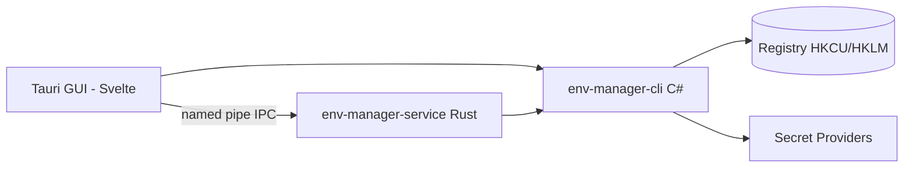

<!-- canonical: ../../README.md -->
<!-- sync: c9cb30d200cd6eb93a8484348306bc939cd3753c -->

<div align="center">

<picture>
  <source media="(prefers-color-scheme: dark)" srcset="../../docs/assets/logo-dark-theme.png">
  <source media="(prefers-color-scheme: light)" srcset="../../docs/assets/logo-light-theme.png">
  
</picture>

# Env Manager

Windows の環境変数を手軽に管理できるツールです。スクリプトや AI エージェントから扱いやすい C# 製コマンドラインツールと、画面を見ながら操作できる Tauri デスクトップアプリの 2 つを備えています。どちらを使っても、レジストリを安全に書き換える共通のルールで動作します。

**"どんな環境にも、すんなり馴染む。"**

[](https://github.com/Xxx91n/env-manager/releases)
[](../../LICENSE)
[](#install)
[](#prerequisites)
[](#architecture)

[Install](#install) · [Features](#features) · [CLI Reference](../../docs/cli-commands.md) · [Architecture](#architecture) · [Changelog](../../CHANGELOG.md)

<!-- README-I18N:START -->
**言語:** [English](../../README.md) · [简体中文](README.zh_CN.md) · **日本語** · [한국어](README.ko.md) · [Deutsch](README.de.md) · [Français](README.fr.md) · [Español](README.es.md) · [Português](README.pt.md) · [Русский](README.ru.md) · [العربية](README.ar.md)
<!-- README-I18N:END -->

</div>

## Showcase

https://github.com/user-attachments/assets/7657b508-42bb-45a8-94b7-7c1fa052a4d0

## Features

- **CLI と GUI の 2 系統** — スクリプトや CI 自動化でサクッと動かせる `env-manager-cli` と、画面上で直感的に編集できる `env-manager.exe`（Tauri 2 + Svelte）。どちらを使っても同じレジストリルールに沿って安全に処理されます。
- **安心のデフォルト保護** — システム変数や大事な PATH 項目は、うっかり削除したり名前を変えたりできないよう保護されています。名前やスコープを変更する際も、新しい値が正しく書き込めたことを確かめてから古い方を消す念の入れよう。書き込み時は毎回、CLI の Windows ミューテックス、Rust シェルの読み書きロック、GUI の書き込みキューという 3 つのロックをしっかり確保します。
- **2 種類のプロファイル** — レジストリにまとめて書き込む「Global プロファイル」と、指定した子プロセスだけに環境変数を渡してレジストリを一切汚さない「Launch プロファイル」があります。他のプロファイルから設定を引き継ぐ（継承する）こともでき、適用前にぶつかる項目がないかプレビュー確認できます。
- **9 つのシークレット管理に対応** — DPAPI、資格情報マネージャー、SecretStore、HashiCorp Vault、SOPS、Azure Key Vault、1Password、AWS Secrets Manager、AWS IAM Roles Anywhere に対応。大事なパスワードやキーは暗号化されたエンベロープ、または `mount:<id>` 参照の形で保持します。なお、汎用の `add-var` や `edit-var` コマンドを使うと平文のままレジストリに書き込まれてしまうため、どこまで平文を許容するかの詳しい線引きは [Security](#security) や [docs/plaintext-sinks.md](../../docs/plaintext-sinks.md) をご覧ください。
- **PATH のお掃除機能** — `path health` を実行するだけで、重複した項目やもう存在しないリンク切れフォルダをすぐに見つけてくれます。`--fix` を付ければ綺麗に整頓でき、`--dry-run` を付ければ実際には変更せず確認だけできます。
- **改ざんを防ぐ監査台帳** — 変更履歴は SHA256 ハッシュチェーンによる追記専用の台帳に記録。いつでも過去の状態へロールバックでき、万が一に備えた障害復旧用エクスポートにも対応しています。

## For AI agents

```bash
env-manager-cli agents            # 内蔵されているエージェント向け説明書を表示
env-manager-cli agents --path     # 説明書ファイル (AGENTS.cli.md) の保存パスを表示
env-manager-cli agents --summary  # プログラムで読み取りやすい 1 行仕様を出力
env-manager-cli agents --json     # 全コマンド一覧を構造化 JSON で出力
```

- [AGENTS.md](../../AGENTS.md) — リポジトリ全体のエージェント向け仕様（アーキテクチャ、変更禁止ルール、テスト方針）。
- [AGENTS.cli.md](../../AGENTS.cli.md) — CLI バイナリ内に組み込まれており、エージェントが実行時にルールを直接読み取れます。

## Security

> [!WARNING]
> 現在のビルドには**コード署名がついていません**。初回起動時に Windows SmartScreen が「認識されていないアプリ」という警告を出すことがあります。その場合は「詳細情報」をクリックして「実行」を選んでください。現在、SignPath Foundation を通じてオープンソース向けの無料コード署名を申請中です。承認され次第、配布ファイル（MSI と EXE）すべてに署名が付きます。詳しくは [コード署名ポリシー](../../docs/code-signing-policy.md) をご覧ください。

保護対象の変数や PATH 項目は、いきなり削除せずまず無効化されます。また復元時には、レジストリの値の型が元通りか厳格にチェックします。不正な値がレジストリに入り込まないよう手前で検証し、名前付きパイプ通信も二重作成を拒否した上でリクエスト上限を 65,536 バイトに制限しています。脆弱性の報告については [SECURITY.md](../../SECURITY.md) をご覧ください。

**脅威モデル:** 同じ Windows ユーザーセッション内で動いている別の悪意あるプロセスからの攻撃は防ぎきれません。同じユーザー権限があるプロセスなら、すでに `profile reveal-secret` を叩いたり、起動された子プロセスの環境変数を覗き見たり、プロバイダーが一時的に書き出す一時ファイルを捕捉できてしまうからです。ただし被害を最小限に抑える工夫はしています。DPAPI CurrentUser の暗号文は他のユーザーや別の PC では復号できませんし、シークレット操作コマンドからレジストリへシークレットが書き込まれることも防いでいます（前述の汎用変数の手動追加を除く）。シークレット値がどこに現れるかは、後述の平文取り扱い一覧にすべて明記しています。

**平文の境界:** 平文データがどこに存在し、どのくらいの時間残り、何がそれを片付けるのかをまとめた一覧は、[docs/plaintext-sinks.md](../../docs/plaintext-sinks.md) に載せています。正式な取り扱いルールは `docs/architecture.md` の「Plaintext lifecycle」節をご確認ください。なお、メモリのゼロクリアやログのマスキングはベストエフォート（可能な限り努める）であり、完全な保証ではありません。自動テスト（`tests/canary-redaction.Tests.ps1`）では 7 か所の出力先をスキャンしてシークレット漏れがないか確認しており、共通テストでは 8 つのプロバイダーについて `plaintext-never-in-envelope`（エンベロープ内に平文を残さないこと）をチェックし、`aws-roles-anywhere` はオフラインのテストで別にチェックしています。

## Install

### MSI Installer

[GitHub Releases](https://github.com/Xxx91n/env-manager/releases) から MSI ファイルをダウンロードして実行するだけです。スタートメニューのショートカットも自動で作られます。x64、x86、ARM64 の各アーキテクチャに対応しています。

### Portable

インストール不要で使いたい場合は、[GitHub Releases](https://github.com/Xxx91n/env-manager/releases) から ZIP をダウンロードし、解凍して中にある `env-manager.exe` をそのまま起動してください。

### CLI-Only

サーバーやスクリプトだけで使いたい方向けの軽量版です。ZIP の中に `env-manager-cli.exe` と必要な `.dll` ファイル一式が入っています。GUI や WebView2 は一切不要です。

### Prerequisites

> [!IMPORTANT]
> **ポータブル版**と **CLI 専用版**を使うには、PC に **.NET 10 Desktop Runtime** が入っている必要があります。マイクロソフト公式の [.NET ダウンロードページ](https://dotnet.microsoft.com/download/dotnet/10.0) からインストールしてください。なお、**MSI インストーラー**も .NET の自動検出や自動インストールは行わないため、初回起動前にご自身でランタイムを入れておいてください。
>
> GUI で使う **WebView2 ランタイム**は、Windows 11 には標準で入っています。Windows 10（21H2 以降）をお使いの方は、[Microsoft 公式サイト](https://developer.microsoft.com/microsoft-edge/webview/) から入手できます。

外部のシークレット管理ツール（SOPS、1Password CLI、Vault CLI、AWS CLI、Azure CLI、PowerShell 7 など）を連携させたい場合は、[シークレットプロバイダーガイド](../../docs/secret-providers-guide.md) をご覧ください。

### winget

> [!NOTE]
> winget での配信も計画中ですが、現在はまだ準備中です。進捗は GitHub Issues で随時お知らせします。

### From Source

```bash
git clone https://github.com/Xxx91n/env-manager.git
cd env-manager
cd frontend && npm ci && cd ..
node scripts/build.mjs --arch x64
```

.NET 10 SDK、Node.js 18 以上、MSVC または GNU ターゲットの Rust stable が必要です。詳しくは [docs/build-and-release.md](../../docs/build-and-release.md) を確認してください。

## Usage

### CLI

```bash
# 一覧表示 / 取得 / 設定
env-manager-cli.exe list
env-manager-cli.exe get PATH
env-manager-cli.exe set JAVA_HOME "D:\jdk17" --scope system

# Launch プロファイルを作成し、隔離された環境でアプリを起動
env-manager-cli.exe profile create dev --type launch --target python.exe
env-manager-cli.exe profile add-secret dev API_KEY "sk-xxx"
env-manager-cli.exe profile launch dev

# PATH の健全性チェック
env-manager-cli.exe path health

# バックアップと復元
env-manager-cli.exe backup --output backup.json
env-manager-cli.exe restore backup.json

# 障害復旧用の状態保存と改ざんチェック
env-manager-cli.exe export-state --output state.dpapi
env-manager-cli.exe audit verify --strict

# バックグラウンドサービスの状態確認
env-manager-cli.exe service status
```

すべてのコマンド一覧は [docs/cli-commands.md](../../docs/cli-commands.md) に載っています。

### GUI

`env-manager.exe` を立ち上げると画面が開きます。環境変数の検索・絞り込み・直接編集はもちろん、ドラッグ＆ドロップで順番を入れ替えられる PATH エディター、プロファイル管理、シークレットプロバイダーの切り替え、バックグラウンドサービスの制御、監査台帳の確認まで、すべて画面上から直感的に操作できます。10 言語の表示切り替えにも対応しています。

## Architecture



- **CLI**: 全体の処理を取りまとめる C# .NET 10 製の実行ファイル。レジストリへの書き込みを行えるのはこの CLI だけです。
- **Service**: 名前付きパイプ経由でシークレットマウントを常に最新に保つ、独立した Rust 製のバックグラウンドプロセスです。
- **GUI**: Tauri 2 + Svelte 5 で作られたデスクトップ画面。同じ IPC ルールを通じて裏側とやり取りします。

## Secret providers

全部で 9 種類のプロバイダーに対応しています。利用先を切り替えるたびに動作確認が行われ、もし設定が足りないなどの問題があれば、プロファイル編集画面にオレンジ色の警告メッセージがすぐ表示されます。

| プロバイダー | 認証方法 | 定期リフレッシュ | ドキュメント |
|---|---|---|---|
| DPAPI CurrentUser | Windows DPAPI | なし（ユーザー単位） | [ガイド](../../docs/secret-providers-guide.md) |
| Windows 資格情報マネージャー | 資格情報マネージャー + DPAPI | なし（ユーザー単位） | [ガイド](../../docs/secret-providers-guide.md) |
| PowerShell SecretManagement | SecretStore コンテナー | なし（`CreatedOnly`） | [ガイド](../../docs/secret-providers-guide.md) |
| HashiCorp Vault KV v2 | VAULT_TOKEN / AppRole 証明書 | あり | [ガイド](../../docs/secret-providers-guide.md) |
| SOPS | Age / PGP / KMS | なし（`CreatedOnly`） | [ガイド](../../docs/secret-providers-guide.md) |
| Azure Key Vault | サービスプリンシパル証明書 / マネージド ID | あり | [ガイド](../../docs/secret-providers-guide.md) |
| 1Password CLI | OP_SERVICE_ACCOUNT_TOKEN | あり | [ガイド](../../docs/secret-providers-guide.md) |
| AWS Secrets Manager | SigV4 + アクセスキー | あり | [ガイド](../../docs/secret-providers-guide.md) |
| AWS IAM Roles Anywhere | マシン証明書ストアの証明書を一時的な認証情報に交換 | いいえ、まだです。サービスは `Periodic` マウントを読み直しません | [ガイド](../../docs/secret-providers-guide.md) |

「定期リフレッシュ」列の「あり」は、プロバイダーが `Periodic` 対応を宣言していることを意味します。サービスはまだこれらのマウントを読み直さないため、値が自動的に更新されるわけではありません（[この issue](https://github.com/Xxx91n/env-manager/issues/276) を参照）。

各プロバイダーを使うための準備や初回設定、うまく動かないときの対処法は [docs/secret-providers-guide.md](../../docs/secret-providers-guide.md) をご覧ください。

## Service mode

`env-manager-service.exe` は、名前付きパイプで通信を受け付けながら、シークレットマウントを常に最新に保つ単体の Rust プログラムです。

- **ServiceMode（動作モード）**: Service（Windows サービス管理、PC 起動時に自動開始）、Background（ユーザーによる手動起動）、Cli（1 回限りのコマンド中継）
- **同期ループ（Reconcile loop）**: 300 秒ごとの定期スキャン、重複処理を防ぐ安全な個別更新、起動後 30 秒の初回待機
- **監査台帳**: 追記専用で SHA256 ハッシュをつないだ `audit-ledger.jsonl`。100MB での世代交代（ローテーション）と改ざん検知に対応
- **IPC 通信**: パイプの乗っ取りを防ぐ専用フラグ、1 リクエスト最大 65,536 バイト制限、改行区切り JSON（NDJSON）形式
- **監視（ウォッチドッグ）**: 2 段構えの自動復旧 — Windows サービスによる自動再起動（Service モード）＋ GUI からの 30 秒間隔死活監視（Background モード）

## Documentation

| ドキュメント | 内容 |
|---|---|
| [CHANGELOG.md](../../CHANGELOG.md) | バージョン更新履歴（Keep a Changelog 形式） |
| [docs/cli-commands.md](../../docs/cli-commands.md) | CLI コマンドの完全リファレンス |
| [docs/architecture.md](../../docs/architecture.md) | アーキテクチャと詳細設計 |
| [docs/plaintext-sinks.md](../../docs/plaintext-sinks.md) | シークレットの平文が残りうる場所のまとめ |
| [docs/backup-and-profiles.md](../../docs/backup-and-profiles.md) | バックアップ、復元、プロファイルの詳しい仕様 |
| [docs/secret-providers-guide.md](../../docs/secret-providers-guide.md) | シークレットプロバイダーの設定手順 |
| [docs/build-and-release.md](../../docs/build-and-release.md) | ビルドとリリースの手順 |
| [AGENTS.md](../../AGENTS.md) / [AGENTS.cli.md](../../AGENTS.cli.md) | AI エージェント向け説明書 |

## Maintainers

[@Xxx91n](https://github.com/Xxx91n)

## Contributing

不具合報告（Issue）や改善提案（PR）は大歓迎です。開発ルールや設計上の境界線、テスト方針については、まず [AGENTS.md](../../AGENTS.md) をご覧ください。

## License

Apache-2.0 © 2026 Env Manager Contributors。詳細は [LICENSE](../../LICENSE) をご覧ください。
