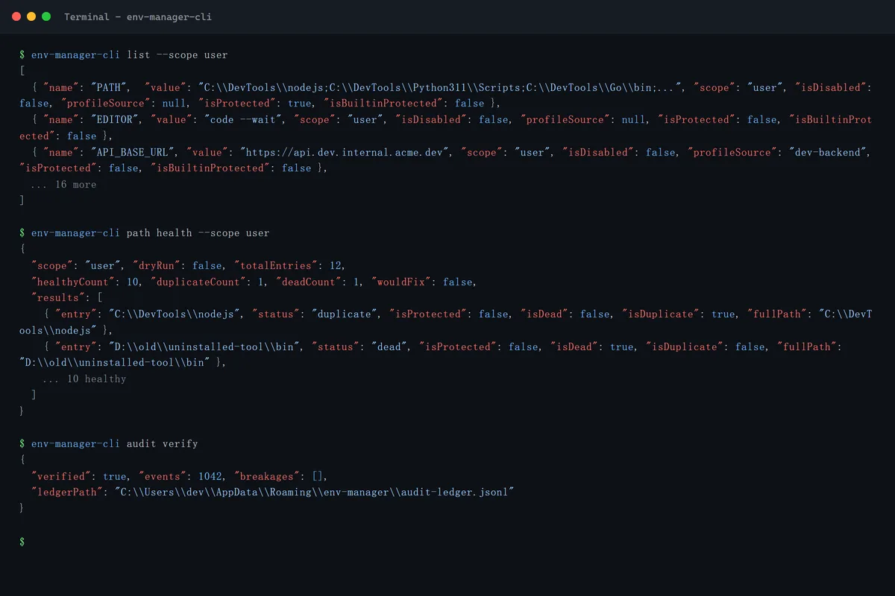
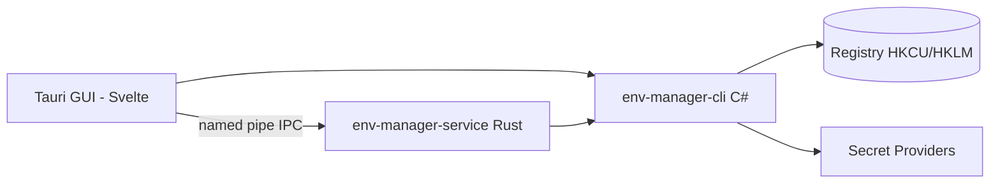

<!-- canonical: ../../README.md -->
<!-- sync: ef2a485dfffb -->

<div align="center">

<picture>
  <source media="(prefers-color-scheme: dark)" srcset="../../docs/assets/logo-dark-theme.png">
  <source media="(prefers-color-scheme: light)" srcset="../../docs/assets/logo-light-theme.png">
  
</picture>

<p align="center">
  
</p>

# Env Manager

두 개의 프런트엔드를 갖춘 Windows 환경 변수 관리자 — 스크립트와 AI 에이전트를 위한 C# CLI, 그리고 대화형 편집을 위한 Tauri GUI — 하나의 레지스트리 계약 집합 위에서 동작합니다.

**"모든 환경에 매끄럽게 적응합니다."**

[](https://github.com/Xxx91n/env-manager/releases)
[](../../LICENSE)
[](#install)
[](#prerequisites)
[](#architecture)

[설치](#install) · [기능](#features) · [CLI 참조](../../docs/cli-commands.md) · [아키텍처](#architecture) · [변경 로그](../../CHANGELOG.md)

<!-- README-I18N:START -->
**언어:** [English](../../README.md) · [简体中文](README.zh_CN.md) · [日本語](README.ja.md) · **한국어** · [Deutsch](README.de.md) · [Français](README.fr.md) · [Español](README.es.md) · [Português](README.pt.md) · [Русский](README.ru.md) · [العربية](README.ar.md)
<!-- README-I18N:END -->

</div>

## Showcase

### GUI

| | | |
|:-:|:-:|:-:|
| <br>**변수** — 검색, 범위 필터, 행별 작업 | <br>**system 범위** — 보호된 항목 잠금 | <br>**PATH 편집기** — 끊어진/중복 항목 감지 |
| <br>**프로필** — 적용 / 실행 / 상속 | <br>**감사 원장** — 해시 체인, 검증 가능 | <br>**서비스 관리자** — 시크릿 마운트 |

### CLI

<p align="center">
  
</p>

| | |
|:-:|:-:|
| <br>**JSON 우선 출력** — `agents --json`이 전체 명령 사양을 출력 | CLI는 일급 서피스입니다: 18개 이상의 명령이 모두 스크립팅 가능하고 JSON으로 소비할 수 있습니다. 에이전트 매뉴얼은 바이너리에 내장되어 있습니다 — `env-manager-cli agents`를 실행하면 출력됩니다. 위의 읽기 전용 명령은 시뮬레이션된 터미널 출력을 사용하며, `node scripts/demo/capture.mjs`로 다시 생성할 수 있습니다. |

## Features

- **듀얼 프런트엔드** — 스크립팅과 CI를 위한 `env-manager-cli`, 대화형 편집을 위한 `env-manager.exe`(Tauri 2 + Svelte). 둘 다 동일한 레지스트리 계약을 거칩니다.
- **기본적으로 보호** — 시스템 변수와 PATH 항목은 삭제하거나 이름을 바꿀 수 없습니다. 모든 쓰기는 세 계층(mutex + write lock + 검증 후 교체)을 통해 직렬화됩니다.
- **프로필** — 글로벌 프로필은 레지스트리에 적용되고, launch 프로필은 레지스트리를 건드리지 않고 단일 프로세스에 격리된 env 블록을 주입합니다. 상속, 충돌 미리보기, 역순 롤백을 지원합니다.
- **8가지 시크릿 공급자** — DPAPI, Credential Manager, SecretStore, HashiCorp Vault, SOPS, Azure Key Vault, 1Password, AWS Secrets Manager. secret 명령군은 암호문 엔벨로프 또는 `mount:<id>` 참조만 저장하며 — 일반 `add-var`/`edit-var` 갭은 평문을 레지스트리에 기록할 수 있습니다 — 평문 노출 경계는 [Security](#security)와 [docs/plaintext-sinks.md](../../docs/plaintext-sinks.md)에 정리되어 있습니다.
- **PATH 상태 검사** — `path health`가 중복 및 유효하지 않은 항목을 감지합니다. `--fix`는 다시 쓰고 `--dry-run`은 보고만 합니다.
- **감사 원장** — 롤백과 재해 복구 내보내기를 지원하는 추가 전용 SHA256 해시 체인 히스토리.

## For AI agents

```bash
env-manager-cli agents            # print the embedded agent manual
env-manager-cli agents --path     # file path of the manual (AGENTS.cli.md)
env-manager-cli agents --summary  # one-line machine-readable spec
env-manager-cli agents --json     # full command table as structured JSON
```

- [AGENTS.md](../../AGENTS.md) — 리포지토리 수준의 에이전트 지침(아키텍처, 하드 경계, 테스트).
- [AGENTS.cli.md](../../AGENTS.cli.md) — CLI 바이너리에 내장되어 배포되므로 에이전트가 런타임에 계약을 발견할 수 있습니다.
- **기능 범위별 서피스** — `secret-providers.json`의 옵트인 `agentCapabilities` 화이트리스트를 통해 배포 환경이 에이전트의 병렬 set/delete 호출을 거부할 수 있습니다.

## Security

> [!WARNING]
> 현재 빌드는 **코드 서명되지 않았습니다**. Windows SmartScreen이 첫 실행 시 "인식할 수 없는 앱" 경고를 표시할 수 있습니다 — "추가 정보"를 클릭한 다음 "실행"을 클릭하세요. SignPath Foundation을 통해 무료 오픈소스 코드 서명을 신청했으며, 승인되면 모든 릴리스 아티팩트(MSI + EXE)가 서명됩니다. [코드 서명 정책](../../docs/code-signing-policy.md)을 참조하세요.

보호된 변수와 PATH 항목은 삭제 전에 비활성화되며, 복원 시 레지스트리 값 종류를 정확히 검증합니다. 명명된 파이프 IPC는 안티 스쿼팅 플래그와 입력 검증(인수 최대 64개, 32767자 상한, null 바이트 거부)을 사용합니다. 취약점 보고는 [SECURITY.md](../../SECURITY.md)를 참조하세요.

**위협 모델.** 우리가 방어하지 *않는* 상대는 사용자 자신의 Windows 세션 안에서 실행되는 모든 프로세스입니다 — 그런 프로세스는 이미 `profile reveal-secret`을 호출하거나, 실행된 자식 프로세스의 환경 블록을 읽거나, 공급자가 만들어 내는 임시 파일을 가로챌 수 있습니다. 설계가 실제로 제한하는 것은: DPAPI-CurrentUser 암호문은 다른 사용자나 머신에서 복호화할 수 없고, 시크릿 명령은 시크릿을 레지스트리에 기록할 수 없으며(위의 일반 명령 갭은 예외), 시크릿 값을 담도록 *의도된* 싱크는 평문 경계 매트릭스에 문서화된 설계상의 것뿐이라는 점입니다.

**평문 경계.** 평문이 어디에 존재할 수 있는지, 얼마나 오래 남는지, 누가 정리하는지를 정리한 싱크별 전체 매트릭스는 [docs/plaintext-sinks.md](../../docs/plaintext-sinks.md)에 있으며, `docs/architecture.md`의 Plaintext lifecycle 절이 표면별 공식 허용 목록입니다. 메모리 제로화와 로그 정리는 최선 노력의 위생 조치이지 보장이 아닙니다. `tests/canary-redaction.Tests.ps1`은 7개 출력 싱크에서 심어 둔 canary를 검사하고, 공유 계약 스위트는 8개 공급자 모두에 대해 `plaintext-never-in-envelope`를 단언합니다.

## Install

### MSI Installer

[GitHub Releases](https://github.com/Xxx91n/env-manager/releases)에서 MSI를 다운로드하여 실행하세요. 시작 메뉴 바로 가기가 자동으로 생성됩니다. x64, x86, ARM64로 제공됩니다.

### Portable

[GitHub Releases](https://github.com/Xxx91n/env-manager/releases)에서 휴대용 ZIP을 다운로드하세요. 압축을 풀고 `env-manager.exe`를 직접 실행하면 됩니다. 설치가 필요 없습니다.

### CLI-Only

헤드리스 또는 스크립트 용도로 CLI 전용 ZIP을 다운로드하세요: `env-manager-cli.exe`와 `.dll` 파일. GUI 없음, WebView2 종속성 없음.

### Prerequisites

> [!IMPORTANT]
> **휴대용** 및 **CLI 전용** 빌드는 프레임워크 종속적입니다. 대상 머신에 **.NET 10 Desktop Runtime**이 필요합니다 — 공식 [.NET 다운로드 페이지](https://dotnet.microsoft.com/download/dotnet/10.0)에서 받으세요. **MSI 설치 관리자**는 .NET을 확인하거나 설치하지 않습니다 — CLI 실행 전에 수동으로 설치하세요.
>
> **WebView2 Runtime**(GUI용)은 Windows 11에 사전 설치되어 있으며, Windows 10 21H2+에서는 [Microsoft](https://developer.microsoft.com/microsoft-edge/webview/)에서 제공됩니다.

선택적 외부 시크릿 공급자 도구(SOPS, 1Password CLI, Vault CLI, AWS CLI, Azure CLI, PowerShell 7)에 대해서는 [시크릿 공급자 가이드](../../docs/secret-providers-guide.md)를 참조하세요.

### winget

> [!NOTE]
> winget 배포는 계획 중이며 아직 제공되지 않습니다. 업데이트는 GitHub Issues에서 추적하세요.

### From Source

```bash
git clone https://github.com/Xxx91n/env-manager.git
cd env-manager
cd frontend && npm ci && cd ..
node scripts/build.mjs --arch x64
```

.NET 10 SDK, Node.js 18+, MSVC 또는 GNU 타깃의 Rust stable이 필요합니다. 자세한 내용은 [docs/build-and-release.md](../../docs/build-and-release.md)를 참조하세요.

## Usage

### CLI

```bash
# List / get / set
env-manager-cli.exe list
env-manager-cli.exe get PATH
env-manager-cli.exe set JAVA_HOME "D:\jdk17" --scope system

# Create a Launch profile and launch with isolated env
env-manager-cli.exe profile create dev --type launch --target python.exe
env-manager-cli.exe profile add-secret dev API_KEY "sk-xxx"
env-manager-cli.exe profile launch dev

# PATH health
env-manager-cli.exe path health

# Backup / restore
env-manager-cli.exe backup --output backup.json
env-manager-cli.exe restore backup.json

# Disaster recovery + tamper-evident audit
env-manager-cli.exe export-state --output state.dpapi
env-manager-cli.exe audit verify --strict

# Service control
env-manager-cli.exe service status
```

전체 명령 참조는 [docs/cli-commands.md](../../docs/cli-commands.md)를 참조하세요.

### GUI

`env-manager.exe`를 실행하세요. GUI는 검색, 범위 필터링, 인라인 편집이 가능한 실시간 변수 목록, 드래그 앤 드롭으로 순서를 바꿀 수 있는 PATH 편집기, 프로필 관리, 시크릿 공급자 선택, 서비스 제어 패널, 감사 기록, 10개 언어 i18n을 제공합니다.

## Architecture



- **CLI**: C# .NET 10 단일 파일 실행 파일 — 조정 계층이자 레지스트리 게이트웨이.
- **Service**: 명명된 파이프 IPC를 통해 시크릿 마운트 수명 주기를 관리하는 독립 실행형 Rust 바이너리.
- **GUI**: 동일한 IPC 계약을 사용하는 Tauri 2 + Svelte 4 프런트엔드.

## Secret providers

활성화 사전 점검을 갖춘 8가지 공급자 백엔드 — 실패는 프로필 편집기에서 인라인 앰버 배너로 직접 표시됩니다:

| 공급자 | 인증 방법 | 주기적 갱신 | 문서 |
|---|---|---|---|
| DPAPI CurrentUser | Windows DPAPI | 아니오 (사용자별) | [가이드](../../docs/secret-providers-guide.md) |
| Windows Credential Manager | CredMan + DPAPI | 아니오 (사용자별) | [가이드](../../docs/secret-providers-guide.md) |
| PowerShell SecretManagement | SecretStore vault | 없음 (CreatedOnly) | [가이드](../../docs/secret-providers-guide.md) |
| HashiCorp Vault KV v2 | VAULT_TOKEN / AppRole cert | 예 | [가이드](../../docs/secret-providers-guide.md) |
| SOPS | Age / PGP / KMS | 없음 (CreatedOnly) | [가이드](../../docs/secret-providers-guide.md) |
| Azure Key Vault | SP cert / managed identity | 예 | [가이드](../../docs/secret-providers-guide.md) |
| 1Password CLI | OP_SERVICE_ACCOUNT_TOKEN | 예 | [가이드](../../docs/secret-providers-guide.md) |
| AWS Secrets Manager | SigV4 + access keys | 예 | [가이드](../../docs/secret-providers-guide.md) |

공급자별 사전 요구 사항, 일회성 설정, 활성화 오류 수정 단계는 [docs/secret-providers-guide.md](../../docs/secret-providers-guide.md)를 참조하세요.

## Service mode

`env-manager-service.exe`는 명명된 파이프 IPC를 통해 시크릿 마운트 수명 주기를 관리하는 독립 실행형 Rust 바이너리입니다:

- **RuntimeMode**: Service(SCM 관리, 머신 부팅), Background(사용자 시작), Cli(원샷 게이트웨이)
- **재조정 루프**: 300초 주기 전체 검사, 항목별 멱등 핸들러, 30초 첫 틱 지연
- **감사 원장**: 추가 전용 해시 체인 `audit-ledger.jsonl`, 100MB 로테이션 및 변조 감지
- **IPC**: 안티 스쿼팅 파이프 플래그, 65536바이트 요청 상한, 개행 구분 JSON 프로토콜
- **워치독**: 2계층 복구 — SCM 자동 재시작(Service 모드) + GUI 30초 핑 워치독(Background 모드)

## Documentation

| 문서 | 내용 |
|---|---|
| [CHANGELOG.md](../../CHANGELOG.md) | 버전 기록(keepachangelog 형식) |
| [docs/cli-commands.md](../../docs/cli-commands.md) | 전체 CLI 명령 참조 |
| [docs/architecture.md](../../docs/architecture.md) | 심층 아키텍처 |
| [docs/plaintext-sinks.md](../../docs/plaintext-sinks.md) | 시크릿 평문이 존재할 수 있는 곳 |
| [docs/backup-and-profiles.md](../../docs/backup-and-profiles.md) | 백업, 복원, 프로필 의미 |
| [docs/secret-providers-guide.md](../../docs/secret-providers-guide.md) | 시크릿 공급자 설정 |
| [docs/build-and-release.md](../../docs/build-and-release.md) | 빌드 및 릴리스 프로세스 |
| [AGENTS.md](../../AGENTS.md) / [AGENTS.cli.md](../../AGENTS.cli.md) | 에이전트용 가이드 |

## Maintainers

[@Xxx91n](https://github.com/Xxx91n)

## Contributing

이슈와 PR을 환영합니다. 아키텍처 경계와 테스트 정책을 위해 먼저 [AGENTS.md](../../AGENTS.md)를 읽어주세요.

## License

Apache-2.0 © 2026 Env Manager Contributors. [LICENSE](../../LICENSE)를 참조하세요.
