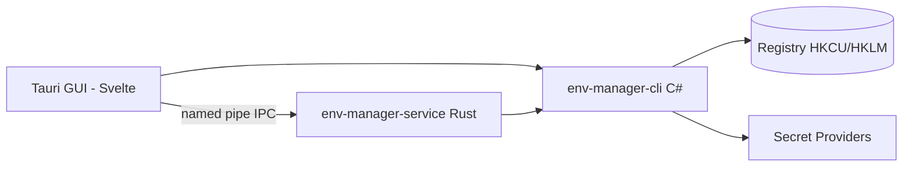

<!-- canonical: ../../README.md -->
<!-- sync: 55daccb8e73e8f14bbfe54452fe7c2969337492d -->

<div align="center">

<picture>
  <source media="(prefers-color-scheme: dark)" srcset="../../docs/assets/logo-dark-theme.png">
  <source media="(prefers-color-scheme: light)" srcset="../../docs/assets/logo-light-theme.png">
  
</picture>

# Env Manager

두 가지 프런트엔드를 지원하는 Windows 환경 변수 관리 도구입니다. 스크립트 작성과 AI 에이전트에 맞춘 C# 명령줄(CLI) 도구와 직접 화면을 보며 다루는 Tauri 데스크톱 앱을 제공하며, 둘 다 똑같은 레지스트리 규칙에 따라 안전하게 동작합니다.

**"어떤 환경에도 매끄럽게 맞춥니다."**

[](https://github.com/Xxx91n/env-manager/releases)
[](../../LICENSE)
[](#install)
[](#prerequisites)
[](#architecture)

[설치](#install) · [주요 기능](#features) · [CLI 명령 명세](../../docs/cli-commands.md) · [아키텍처](#architecture) · [변경 이력](../../CHANGELOG.md)

<!-- README-I18N:START -->
**언어:** [English](../../README.md) · [简体中文](README.zh_CN.md) · [日本語](README.ja.md) · **한국어** · [Deutsch](README.de.md) · [Français](README.fr.md) · [Español](README.es.md) · [Português](README.pt.md) · [Русский](README.ru.md) · [العربية](README.ar.md)
<!-- README-I18N:END -->

</div>

## Showcase

https://github.com/user-attachments/assets/7657b508-42bb-45a8-94b7-7c1fa052a4d0

## Features

- **두 가지 프런트엔드** — 스크립트 작성과 CI 자동화에 쓰기 좋은 `env-manager-cli`, 직접 화면을 보며 손쉽게 편집할 수 있는 `env-manager.exe`(Tauri 2 + Svelte). 두 프런트엔드 모두 똑같은 레지스트리 규칙에 따라 안전하게 동작합니다.
- **기본 보호 기능** — 시스템 필수 변수와 PATH 항목은 실수로 지우거나 이름을 바꾸지 못하도록 보호됩니다. 이름을 바꾸거나 적용 범위를 바꿀 때도 새 값을 먼저 쓰고 검증한 뒤에야 기존 값을 지웁니다. 모든 쓰기 작업은 세 단계 잠금(CLI의 Windows mutex, Rust 셸의 읽기/쓰기 잠금, GUI의 쓰기 큐)을 거쳐 충돌 없이 안전하게 처리됩니다.
- **프로필** — 글로벌 프로필을 적용하면 레지스트리에 값이 기록되며, 실행 프로필은 레지스트리를 건드리지 않고 실행할 하나의 하위 프로세스 환경 변수에만 값을 채워 넣습니다. 다른 프로필의 값을 상속받을 수 있고, 적용하기 전에 충돌 여부를 미리 보여줍니다.
- **9가지 시크릿 제공자** — DPAPI, Windows 자격 증명 관리자(Credential Manager), PowerShell SecretStore, HashiCorp Vault, SOPS, Azure Key Vault, 1Password, AWS Secrets Manager, AWS IAM Roles Anywhere를 지원합니다. 시크릿 값은 암호화된 엔벨로프나 `mount:<id>` 참조 형태로 안전하게 보관됩니다. 일반 변수 추가/편집 명령(`add-var`, `edit-var`)은 일반 텍스트를 그대로 레지스트리에 쓸 수 있으므로, 자세한 보안 경계는 [보안](#security) 및 [docs/plaintext-sinks.md](../../docs/plaintext-sinks.md) 문서를 참고하세요.
- **PATH 상태 점검** — `path health` 명령으로 중복된 경로와 존재하지 않는 잘못된 경로를 찾아냅니다. `--fix` 옵션으로 목록을 깔끔하게 다시 쓸 수 있고, `--dry-run` 옵션으로 실제 변경 없이 점검 결과만 먼저 확인할 수도 있습니다.
- **감사 원장** — 이전 상태로 되돌리는 롤백 기능과 비상 복구용 내보내기를 지원하며, SHA256 해시 체인으로 기록이 위변조되지 않도록 지켜주는 추가 전용 감사 기록을 제공합니다.

## For AI agents

```bash
env-manager-cli agents            # print the embedded agent manual
env-manager-cli agents --path     # file path of the manual (AGENTS.cli.md)
env-manager-cli agents --summary  # one-line machine-readable spec
env-manager-cli agents --json     # full command table as structured JSON
```

- [AGENTS.md](../../AGENTS.md) — 저장소 수준의 에이전트 작업 지침(아키텍처, 핵심 경계 규칙, 테스트 가이드).
- [AGENTS.cli.md](../../AGENTS.cli.md) — CLI 바이너리 안에 내장되어 있어, 에이전트가 런타임에 언제든 명령 명세를 직접 읽을 수 있습니다.

## Security

> [!WARNING]
> 현재 빌드는 아직 **코드 서명이 되어 있지 않습니다**. Windows SmartScreen에서 처음 실행할 때 "인식할 수 없는 앱" 경고가 뜰 수 있습니다. 이때는 "추가 정보"를 누른 뒤 "실행"을 클릭하시면 됩니다. 현재 SignPath Foundation을 통해 무료 오픈소스 코드 서명을 신청해 둔 상태이며, 승인이 완료되면 모든 설치 파일(MSI 및 EXE)에 정식 서명이 적용될 예정입니다. 자세한 내용은 [코드 서명 정책](../../docs/code-signing-policy.md)을 참고하세요.

보호된 변수나 PATH 항목은 삭제 전에 먼저 비활성화되며, 백업에서 복원할 때도 원래 레지스트리 값 형식을 꼼꼼히 확인합니다. 모든 값은 레지스트리에 쓰기 전에 유효성을 먼저 검사하고, 통신용 명명된 파이프(named pipe)는 중복 생성을 거부하며 요청 크기를 최대 65,536바이트로 제한합니다. 보안 취약점 제보는 [SECURITY.md](../../SECURITY.md)를 참고하세요.

**위협 모델.** 현재 로그인된 Windows 사용자 세션 안에서 이미 실행 중인 다른 프로세스까지는 막지 못합니다. 그런 프로세스는 이미 `profile reveal-secret`을 실행하거나, 실행된 하위 프로세스의 환경 변수를 읽거나, 제공자가 잠깐 만드는 임시 파일을 가로챌 권한이 있기 때문입니다. 대신 설계 차원에서 피해를 확실하게 줄입니다: DPAPI CurrentUser 암호문은 다른 사용자나 다른 컴퓨터에서 절대 풀 수 없으며, 시크릿 관리 명령은 시크릿을 레지스트리에 남기지 않습니다(앞서 언급한 일반 변수 추가 명령 예외 제외). 시크릿 값이 머물 수 있도록 설계된 곳은 아래 링크의 평문 취급 위치 목록에 나온 곳뿐입니다.

**평문 취급 위치.** 암호화되지 않은 일반 텍스트(평문)가 어디에, 얼마나 오래 머무르고, 어떻게 지워지는지는 [docs/plaintext-sinks.md](../../docs/plaintext-sinks.md)에 상세히 정리되어 있습니다. `docs/architecture.md` 문서의 Plaintext lifecycle 절이 기준이 되는 공식 목록입니다. 메모리 즉시 삭제(zeroing)와 로그 마스킹은 가능한 최선을 다해 처리하지만 기술적으로 100% 보장되는 것은 아닙니다. 실제 동작 검증을 위해 `tests/canary-redaction.Tests.ps1` 테스트가 7개 출력 위치에서 테스트 문자열이 새어 나가지 않는지 검사하며, 공통 계약 테스트는 8개 제공자에서 `plaintext-never-in-envelope` 규칙(엔벨로프 안에 평문이 들어가지 않음)을 검증하고, `aws-roles-anywhere`는 오프라인 테스트에서 따로 검증합니다.

## Install

### MSI Installer

[GitHub Releases](https://github.com/Xxx91n/env-manager/releases)에서 MSI 설치 파일을 받아 실행하세요. 시작 메뉴 바로가기가 자동으로 만들어집니다. x64, x86, ARM64 버전을 지원합니다.

### Portable

[GitHub Releases](https://github.com/Xxx91n/env-manager/releases)에서 무설치 ZIP 압축 파일을 받아 압축을 푼 뒤, `env-manager.exe`를 바로 실행하면 됩니다. 따로 설치할 필요가 없습니다.

### CLI-Only

화면 없이 백그라운드 스크립트나 CI에서 쓰려면 CLI 전용 ZIP 파일을 받으세요: `env-manager-cli.exe`와 필요한 `.dll` 파일들만 깔끔하게 들어 있습니다. GUI나 WebView2 설치가 필요 없습니다.

### Prerequisites

> [!IMPORTANT]
> **포터블 버전**과 **CLI 전용 버전**은 프레임워크 종속 방식이라 실행할 PC에 **.NET 10 데스크톱 런타임**이 깔려 있어야 합니다. 공식 [.NET 다운로드 페이지](https://dotnet.microsoft.com/download/dotnet/10.0)에서 받으실 수 있습니다. **MSI 설치 프로그램** 역시 .NET을 자동으로 깔아주지 않으므로, 프로그램을 처음 실행하기 전에 런타임을 미리 설치해 두세요.
>
> GUI 표시에 쓰이는 **WebView2 런타임**은 Windows 11에는 기본 탑재되어 있으며, Windows 10 21H2 이상 버전에서는 [Microsoft 공식 페이지](https://developer.microsoft.com/microsoft-edge/webview/)에서 따로 받으실 수 있습니다.

선택 사항인 외부 시크릿 도구(SOPS, 1Password CLI, Vault CLI, AWS CLI, Azure CLI, PowerShell 7)에 대한 안내는 [시크릿 제공자 가이드](../../docs/secret-providers-guide.md)를 참고하세요.

### winget

> [!NOTE]
> winget 지원은 준비 중이며 아직 이용할 수 없습니다. 진행 상황은 GitHub Issues에서 확인하실 수 있습니다.

### From Source

```bash
git clone https://github.com/Xxx91n/env-manager.git
cd env-manager
cd frontend && npm ci && cd ..
node scripts/build.mjs --arch x64
```

.NET 10 SDK, Node.js 18 이상, MSVC 또는 GNU 타깃의 최신 안정 버전(stable) Rust가 필요합니다. 자세한 빌드 방법은 [docs/build-and-release.md](../../docs/build-and-release.md)를 참고하세요.

## Usage

### CLI

```bash
# List / get / set
env-manager-cli.exe list
env-manager-cli.exe get PATH
env-manager-cli.exe set JAVA_HOME "D:\jdk17" --scope system

# Create a Launch profile and launch with an isolated environment
env-manager-cli.exe profile create dev --type launch --target python.exe
env-manager-cli.exe profile add-secret dev API_KEY "sk-xxx"
env-manager-cli.exe profile launch dev

# PATH health
env-manager-cli.exe path health

# Backup / restore
env-manager-cli.exe backup --output backup.json
env-manager-cli.exe restore backup.json

# Disaster recovery and tamper-evident audit
env-manager-cli.exe export-state --output state.dpapi
env-manager-cli.exe audit verify --strict

# Service control
env-manager-cli.exe service status
```

전체 명령 명세는 [docs/cli-commands.md](../../docs/cli-commands.md)를 참고하세요.

### GUI

`env-manager.exe`를 실행하세요. 실시간 검색과 범위별 필터링, 클릭 한 번으로 고치는 인라인 편집, 마우스로 끌어다 놓는 PATH 순서 변경, 프로필 관리, 시크릿 제공자 선택, 서비스 제어, 위변조 방지 감사 원장, 10개 언어 인터페이스를 지원합니다.

## Architecture



- **CLI**: 작업을 조율하고 레지스트리에 실제로 값을 쓰는 유일한 C# .NET 10 실행 프로그램입니다.
- **Service**: 명명된 파이프(named pipe) 통신으로 시크릿 마운트 정보를 최신 상태로 유지해 주는 독립 실행형 Rust 프로그램입니다.
- **GUI**: 똑같은 IPC 규칙을 사용해 직관적인 화면을 제공하는 Tauri 2 + Svelte 5 프런트엔드입니다.

## Secret providers

9가지 시크릿 제공자를 지원하며, 제공자를 바꿀 때마다 상태를 자동 점검합니다. 점검에 실패하면 프로필 편집기 안에 노란색 알림 배너가 바로 표시됩니다:

| Provider | Auth Method | Timer Refresh | Docs |
|---|---|---|---|
| DPAPI CurrentUser | Windows DPAPI | 아니오 (사용자 단위) | [가이드](../../docs/secret-providers-guide.md) |
| Windows Credential Manager | Credential Manager + DPAPI | 아니오 (사용자 단위) | [가이드](../../docs/secret-providers-guide.md) |
| PowerShell SecretManagement | SecretStore vault | 아니오 (`CreatedOnly`) | [가이드](../../docs/secret-providers-guide.md) |
| HashiCorp Vault KV v2 | VAULT_TOKEN / AppRole cert | 예 | [가이드](../../docs/secret-providers-guide.md) |
| SOPS | Age / PGP / KMS | 아니오 (`CreatedOnly`) | [가이드](../../docs/secret-providers-guide.md) |
| Azure Key Vault | 서비스 주체 인증서 / managed identity | 예 | [가이드](../../docs/secret-providers-guide.md) |
| 1Password CLI | OP_SERVICE_ACCOUNT_TOKEN | 예 | [가이드](../../docs/secret-providers-guide.md) |
| AWS Secrets Manager | SigV4 + access keys | 예 | [가이드](../../docs/secret-providers-guide.md) |
| AWS IAM Roles Anywhere | 컴퓨터 인증서 저장소의 인증서를 임시 자격 증명으로 교환 | 아직 아님: 서비스가 `Periodic` 마운트를 다시 읽지 않음 | [가이드](../../docs/secret-providers-guide.md) |

각 제공자별 필수 준비 사항, 최초 설정 방법, 오류 해결 방법은 [docs/secret-providers-guide.md](../../docs/secret-providers-guide.md)를 참고하세요.

## Service mode

`env-manager-service.exe`는 명명된 파이프를 통해 시크릿 마운트를 최신 상태로 유지해 주는 독립 실행형 Rust 프로그램입니다:

- **ServiceMode**: Service(SCM 관리, 시스템 부팅 시 시작), Background(사용자가 실행), Cli(일회성 게이트웨이)
- **Reconcile loop**: 300초 주기 전체 점검, 항목별 멱등성 보장 처리, 첫 실행 30초 대기
- **Audit ledger**: 100MB 자동 로테이션과 위변조 감지 기능을 갖춘 추가 전용 해시 체인 파일 `audit-ledger.jsonl`
- **IPC**: 파이프 선점 방지(anti-squatting) 플래그, 최대 65,536바이트 요청 제한, 줄바꿈 구분 JSON 프로토콜
- **Watchdog**: 2단계 복구 체계 — SCM 자동 재시작(Service 모드) + GUI의 30초 주기 ping 감시(Background 모드)

## Documentation

| Document | Content |
|---|---|
| [CHANGELOG.md](../../CHANGELOG.md) | 버전별 변경 이력 (Keep a Changelog 형식) |
| [docs/cli-commands.md](../../docs/cli-commands.md) | 전체 CLI 명령 명세 |
| [docs/architecture.md](../../docs/architecture.md) | 상세 아키텍처 및 설계 원칙 |
| [docs/plaintext-sinks.md](../../docs/plaintext-sinks.md) | 시크릿 평문이 머물 수 있는 위치와 수명 주기 |
| [docs/backup-and-profiles.md](../../docs/backup-and-profiles.md) | 백업, 복원, 프로필 동작 방식 |
| [docs/secret-providers-guide.md](../../docs/secret-providers-guide.md) | 시크릿 제공자 설정 및 문제 해결 |
| [docs/build-and-release.md](../../docs/build-and-release.md) | 빌드 및 배포 가이드 |
| [AGENTS.md](../../AGENTS.md) / [AGENTS.cli.md](../../AGENTS.cli.md) | AI 에이전트 연동 가이드 |

## Maintainers

[@Xxx91n](https://github.com/Xxx91n)

## Contributing

이슈 등록과 PR을 환영합니다. 변경 전에 아키텍처 경계와 테스트 정책을 다룬 [AGENTS.md](../../AGENTS.md)를 먼저 확인해 주세요.

## License

Apache-2.0 © 2026 Env Manager Contributors. [LICENSE](../../LICENSE) 파일을 참고하세요.
