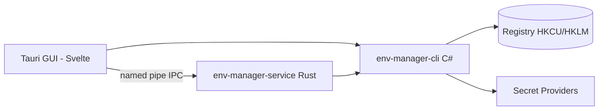

<!-- canonical: ../../README.md -->
<!-- sync: 952812b58e9c0d3cf82955667674f2f5e7c3ac5f -->

<div align="center">

<picture>
  <source media="(prefers-color-scheme: dark)" srcset="../../docs/assets/logo-dark-theme.png">
  <source media="(prefers-color-scheme: light)" srcset="../../docs/assets/logo-light-theme.png">
  
</picture>

# Env Manager

Um gerenciador de variáveis de ambiente do Windows com duas interfaces: uma ferramenta de linha de comando em C# feita para scripts e agentes de IA, e um aplicativo desktop em Tauri para editar tudo visualmente. As duas interfaces seguem exatamente as mesmas regras de registro.

**"Adapta-se perfeitamente a qualquer ambiente."**

[](https://github.com/Xxx91n/env-manager/releases)
[](../../LICENSE)
[](#instalação)
[](#pré-requisitos)
[](#arquitetura)

[Instalação](#instalação) · [Recursos](#recursos) · [Referência da CLI](../../docs/cli-commands.md) · [Arquitetura](#arquitetura) · [Changelog](../../CHANGELOG.md)

<!-- README-I18N:START -->
**Idiomas:** [English](../../README.md) · [简体中文](README.zh_CN.md) · [日本語](README.ja.md) · [한국어](README.ko.md) · [Deutsch](README.de.md) · [Français](README.fr.md) · [Español](README.es.md) · **Português** · [Русский](README.ru.md) · [العربية](README.ar.md)
<!-- README-I18N:END -->

</div>

## Demonstração

https://github.com/user-attachments/assets/7657b508-42bb-45a8-94b7-7c1fa052a4d0

## Recursos

- **Duas interfaces** — use `env-manager-cli` em scripts e rotinas de CI, ou `env-manager.exe` (Tauri 2 + Svelte) para mexer pela interface gráfica. As duas passam pelas mesmas regras do registro do Windows.
- **Protegido por padrão** — variáveis do sistema e pastas do PATH não podem ser apagadas nem renomeadas por engano. Ao renomear ou trocar o escopo, o app grava e confere o valor novo antes de apagar o antigo. Toda gravação segura três travas ao mesmo tempo: um mutex do Windows na CLI, uma trava de leitura/escrita no shell em Rust e uma fila de gravação na interface gráfica.
- **Perfis** — um Perfil Global grava seus valores direto no registro do Windows; já um Perfil Launch coloca as variáveis apenas na memória de um processo filho e não mexe no registro. Perfis também podem herdar configurações de outros perfis, e o app mostra os conflitos antes de aplicar.
- **Nove provedores de segredos** — DPAPI, Gerenciador de Credenciais, SecretStore, HashiCorp Vault, SOPS, Azure Key Vault, 1Password, AWS Secrets Manager e AWS IAM Roles Anywhere. Os valores secretos ficam guardados em envelopes de segredos criptografados ou como referências `mount:<id>`. Os comandos comuns `add-var` e `edit-var` ainda podem gravar texto puro no registro; veja todos os detalhes em [Segurança](#segurança) e em [docs/plaintext-sinks.md](../../docs/plaintext-sinks.md).
- **Diagnóstico do PATH** — o comando `path health` acha caminhos duplicados e pastas que não existem mais; use `--fix` para limpar a lista ou `--dry-run` apenas para ver o relatório sem alterar nada.
- **Livro de registro de auditoria** — histórico permanente e encadeado por hash SHA256, com opção de desfazer alterações e exportar para recuperação de desastres.

## Para agentes de IA

```bash
env-manager-cli agents            # print the embedded agent manual
env-manager-cli agents --path     # file path of the manual (AGENTS.cli.md)
env-manager-cli agents --summary  # one-line machine-readable spec
env-manager-cli agents --json     # full command table as structured JSON
```

- [AGENTS.md](../../AGENTS.md) — orientações gerais do repositório para agentes (arquitetura, regras obrigatórias e testes).
- [AGENTS.cli.md](../../AGENTS.cli.md) — manual embutido direto no executável da CLI para consultas em tempo de execução.

## Segurança

> [!WARNING]
> As versões atuais **ainda não possuem assinatura digital de código**. O Windows SmartScreen pode mostrar um alerta de "aplicativo não reconhecido" na primeira vez que você abrir — basta clicar em "Mais informações" e depois em "Executar assim mesmo". Já solicitamos o certificado gratuito para projetos de código aberto pela SignPath Foundation; assim que for liberado, todos os instaladores (MSI e EXE) virão assinados. Veja nossa [Política de assinatura de código](../../docs/code-signing-policy.md).

Variáveis e pastas do PATH protegidas são desativadas antes de qualquer exclusão, e o tipo exato do valor no registro é conferido na hora de restaurar. Os dados são validados antes de chegar ao registro, e o named pipe rejeita tentativas de criar instâncias duplicadas, limitando cada requisição a 65536 bytes. Veja em [SECURITY.md](../../SECURITY.md) como relatar problemas de segurança.

**Modelo de ameaças.** O projeto não protege contra programas que estejam rodando na sua própria sessão de usuário do Windows. Qualquer processo na sua sessão já pode rodar `profile reveal-secret`, ler as variáveis de ambiente de processos que você abrir ou acessar os arquivos temporários criados na hora pelos provedores. O que o sistema faz é limitar o estrago: o texto cifrado pelo DPAPI CurrentUser não pode ser lido por outro usuário nem em outro computador, os comandos de segredo nunca jogam segredos em texto puro no registro (tirando os comandos genéricos já citados), e os únicos lugares onde um segredo pode aparecer estão listados na tabela de texto puro abaixo.

**Onde o texto puro pode aparecer.** A tabela completa — mostrando onde o texto puro pode existir, por quanto tempo e como ele é limpo — está em [docs/plaintext-sinks.md](../../docs/plaintext-sinks.md). A seção de ciclo de vida do texto puro em `docs/architecture.md` traz a lista oficial detalhada. A limpeza de memória e de logs é feita na medida do possível, sem garantias absolutas: o teste `tests/canary-redaction.Tests.ps1` confere 7 pontos de saída procurando um texto de teste proposital, e a suíte de testes confere em oito provedores que o segredo nunca vaza em texto puro; o `aws-roles-anywhere` fica coberto pelo teste offline.

## Instalação

### Instalador MSI

Baixe o arquivo MSI na página de [Releases no GitHub](https://github.com/Xxx91n/env-manager/releases) e instale normalmente. Os atalhos no Menu Iniciar são criados sozinhos. Disponível para x64, x86 e ARM64.

### Versão portátil (sem instalador)

Baixe o arquivo ZIP portátil na página de [Releases no GitHub](https://github.com/Xxx91n/env-manager/releases). Descompacte onde quiser e abra o `env-manager.exe`. Não precisa instalar nada.

### Somente CLI

Baixe o ZIP exclusivo da CLI se você só for rodar em linha de comando ou em servidores: vem o `env-manager-cli.exe` junto com as bibliotecas `.dll`. Não precisa de interface gráfica nem de WebView2.

### Pré-requisitos

> [!IMPORTANT]
> As versões **Portátil** e **Somente CLI** precisam do **.NET 10 Desktop Runtime** instalado no Windows — você pode baixar direto da [página oficial do .NET](https://dotnet.microsoft.com/download/dotnet/10.0). O **instalador MSI** não instala o .NET sozinho; instale o runtime antes de abrir o programa pela primeira vez.
>
> O **WebView2 Runtime** (usado pela interface visual) já vem pronto no Windows 11 e pode ser instalado no Windows 10 (versão 21H2 ou mais recente) pelo site da [Microsoft](https://developer.microsoft.com/microsoft-edge/webview/).

Se você for usar ferramentas externas para gerenciar segredos (como SOPS, 1Password CLI, Vault CLI, AWS CLI, Azure CLI ou PowerShell 7), dê uma olhada no [Guia de provedores de segredos](../../docs/secret-providers-guide.md).

### winget

> [!NOTE]
> A instalação pelo winget está nos nossos planos, mas ainda não está liberada. Acompanhe o andamento pelas Issues no GitHub.

### Compilando direto do código-fonte

```bash
git clone https://github.com/Xxx91n/env-manager.git
cd env-manager
cd frontend && npm ci && cd ..
node scripts/build.mjs --arch x64
```

Você vai precisar do .NET 10 SDK, Node.js 18 ou superior e do Rust estável configurado para MSVC ou GNU. Confira todos os passos em [docs/build-and-release.md](../../docs/build-and-release.md).

## Como usar

### Linha de comando (CLI)

```bash
# Listar / consultar / definir variáveis
env-manager-cli.exe list
env-manager-cli.exe get PATH
env-manager-cli.exe set JAVA_HOME "D:\jdk17" --scope system

# Criar um Perfil Launch e iniciar um programa com ambiente isolado
env-manager-cli.exe profile create dev --type launch --target python.exe
env-manager-cli.exe profile add-secret dev API_KEY "sk-xxx"
env-manager-cli.exe profile launch dev

# Diagnóstico do PATH
env-manager-cli.exe path health

# Fazer backup e restaurar
env-manager-cli.exe backup --output backup.json
env-manager-cli.exe restore backup.json

# Exportação para recuperação de desastres e verificação de auditoria
env-manager-cli.exe export-state --output state.dpapi
env-manager-cli.exe audit verify --strict

# Ver o status do serviço
env-manager-cli.exe service status
```

Veja a lista completa de comandos em [docs/cli-commands.md](../../docs/cli-commands.md).

### Interface gráfica (GUI)

Abra o `env-manager.exe`. A tela inicial mostra a lista das suas variáveis atualizada em tempo real, com barra de busca, filtro por escopo e edição rápida. Você também conta com um editor de PATH onde dá para reorganizar pastas arrastando e soltando, controle de perfis, troca de provedor de segredos, controle do serviço em segundo plano, livro de registro de auditoria e suporte a 10 idiomas.

## Arquitetura



- **CLI**: executável em C# (.NET 10) que organiza as operações e é o único autorizado a gravar no registro do Windows.
- **Serviço**: aplicativo em Rust que roda separado e cuida das montagens de segredos através de um named pipe.
- **GUI**: tela feita em Tauri 2 com Svelte 5 que usa essas mesmas regras de comunicação.

## Provedores de segredos

O sistema conta com nove provedores de segredos. Sempre que você escolhe um provedor, o app faz uma checagem rápida; se faltar alguma configuração, um aviso em amarelo aparece direto na edição do perfil:

| Provedor | Como autentica | Atualização por temporizador | Documentação |
|---|---|---|---|
| DPAPI CurrentUser | Windows DPAPI | Não (por usuário) | [Guia](../../docs/secret-providers-guide.md) |
| Gerenciador de Credenciais do Windows | Credential Manager + DPAPI | Não (por usuário) | [Guia](../../docs/secret-providers-guide.md) |
| PowerShell SecretManagement | Cofre SecretStore | Não (`CreatedOnly`) | [Guia](../../docs/secret-providers-guide.md) |
| HashiCorp Vault KV v2 | VAULT_TOKEN / certificado AppRole | Sim | [Guia](../../docs/secret-providers-guide.md) |
| SOPS | Age / PGP / KMS | Não (`CreatedOnly`) | [Guia](../../docs/secret-providers-guide.md) |
| Azure Key Vault | Certificado Service Principal / Managed Identity | Sim | [Guia](../../docs/secret-providers-guide.md) |
| 1Password CLI | OP_SERVICE_ACCOUNT_TOKEN | Sim | [Guia](../../docs/secret-providers-guide.md) |
| AWS Secrets Manager | SigV4 + chaves de acesso | Sim | [Guia](../../docs/secret-providers-guide.md) |
| AWS IAM Roles Anywhere | Certificado do armazenamento da máquina trocado por credenciais temporárias | Não, ainda não: o serviço não relê as montagens de segredos `Periodic` | [Guia](../../docs/secret-providers-guide.md) |

Veja em [docs/secret-providers-guide.md](../../docs/secret-providers-guide.md) o que cada provedor precisa para funcionar e o passo a passo para resolver problemas comuns.

## Modo de serviço

O `env-manager-service.exe` é um binário independente em Rust que mantém as montagens de segredos em dia e responde via named pipe:

- **ServiceMode**: Service (gerenciado pelo Windows no boot do sistema), Background (iniciado pelo usuário) ou Cli (ponte rápida para um único comando)
- **Loop de atualização**: faz uma varredura completa a cada 300 segundos com rotina segura item a item, aguardando 30 segundos no primeiro ciclo após ligar
- **Livro de registro de auditoria**: arquivo `audit-ledger.jsonl` permanente em cadeia hash, com rotação automática ao atingir 100 MB e alerta contra adulterações
- **IPC**: conexão por named pipe com proteção contra apropriação indevida, limite de 65536 bytes por pedido e protocolo JSON separado por quebra de linha
- **Watchdog**: recuperação em dois níveis — reinício automático pelo Windows (modo Service) e checagem periódica a cada 30 segundos pela interface gráfica (modo Background)

## Documentação

| Documento | Conteúdo |
|---|---|
| [CHANGELOG.md](../../CHANGELOG.md) | Histórico de versões do projeto |
| [docs/cli-commands.md](../../docs/cli-commands.md) | Manual completo de comandos da linha de comando |
| [docs/architecture.md](../../docs/architecture.md) | Detalhes aprofundados de arquitetura |
| [docs/plaintext-sinks.md](../../docs/plaintext-sinks.md) | Onde segredos em texto puro podem aparecer |
| [docs/backup-and-profiles.md](../../docs/backup-and-profiles.md) | Como funcionam backups, restaurações e perfis |
| [docs/secret-providers-guide.md](../../docs/secret-providers-guide.md) | Passo a passo para configurar provedores de segredos |
| [docs/build-and-release.md](../../docs/build-and-release.md) | Como compilar e gerar versões de lançamento |
| [AGENTS.md](../../AGENTS.md) / [AGENTS.cli.md](../../AGENTS.cli.md) | Instruções para agentes automatizados |

## Mantenedores

[@Xxx91n](https://github.com/Xxx91n)

## Como contribuir

Sugestões e Pull Requests são sempre bem-vindos! Antes de começar, leia o [AGENTS.md](../../AGENTS.md) para entender as regras de arquitetura e a política de testes.

## Licença

Apache-2.0 © 2026 Contribuidores do Env Manager. Consulte o arquivo [LICENSE](../../LICENSE).
