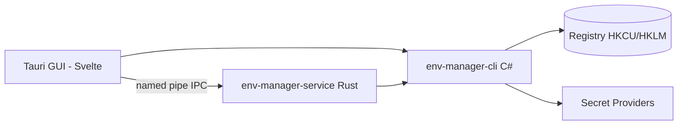

<!-- canonical: ../../README.md -->
<!-- sync: ef2a485dfffb -->

<div align="center">

<picture>
  <source media="(prefers-color-scheme: dark)" srcset="../../docs/assets/logo-dark-theme.png">
  <source media="(prefers-color-scheme: light)" srcset="../../docs/assets/logo-light-theme.png">
  
</picture>


# Env Manager

Um gerenciador de variáveis de ambiente do Windows com dois front ends — uma CLI em C# feita para scripts e agentes de IA e uma GUI em Tauri para edição interativa — sobre um mesmo conjunto de contratos de registro.

**"Adapta-se perfeitamente a qualquer ambiente."**

[](https://github.com/Xxx91n/env-manager/releases)
[](../../LICENSE)
[](#instalação)
[](#pré-requisitos)
[](#arquitetura)

[Instalação](#instalação) · [Recursos](#recursos) · [Referência da CLI](../../docs/cli-commands.md) · [Arquitetura](#arquitetura) · [Changelog](../../CHANGELOG.md)

<!-- README-I18N:START -->
**Idiomas:** [English](../../README.md) · [简体中文](README.zh_CN.md) · [日本語](README.ja.md) · [한국어](README.ko.md) · [Deutsch](README.de.md) · [Français](README.fr.md) · [Español](README.es.md) · **Português** · [Русский](README.ru.md) · [العربية](README.ar.md)
<!-- README-I18N:END -->

</div>

## Demonstrações

### GUI

| | | |
|:-:|:-:|:-:|
| <br>**Variáveis** — pesquisa, filtro por âmbito, ações por linha | <br>**Âmbito do sistema** — entradas protegidas bloqueadas | <br>**Editor de PATH** — detecção de entradas mortas e duplicadas |
| <br>**Perfis** — aplicar / iniciar / herdar | <br>**Livro de auditoria** — encadeado por hash, verificável | <br>**Gestor de serviços** — montagens de segredos |

## Recursos

- **Dois front ends** — `env-manager-cli` para scripts e CI, `env-manager.exe` (Tauri 2 + Svelte) para edição interativa. Ambos passam pelos mesmos contratos de registro.
- **Protegido por padrão** — variáveis do sistema e entradas do PATH não podem ser excluídas nem renomeadas; toda gravação é serializada por três camadas (mutex + bloqueio de gravação + verificação antes da troca).
- **Perfis** — perfis globais são aplicados ao registro; perfis de lançamento injetam um bloco de ambiente isolado em um único processo sem tocar o registro. Herança, pré-visualização de conflitos e reversão em ordem inversa.
- **8 provedores de segredos** — DPAPI, Credential Manager, SecretStore, HashiCorp Vault, SOPS, Azure Key Vault, 1Password, AWS Secrets Manager. Os verbos de segredos persistem apenas envelopes cifrados ou referências `mount:<id>` — a lacuna dos verbos genéricos `add-var`/`edit-var` pode escrever texto simples no registro; o limite de exposição de texto simples está em [Segurança](#segurança) e [docs/plaintext-sinks.md](../../docs/plaintext-sinks.md).
- **Saúde do PATH** — `path health` detecta entradas duplicadas e inválidas; `--fix` reescreve, `--dry-run` relata.
- **Livro de auditoria** — histórico somente acréscimo encadeado por hash SHA256, com reversão e exportação para recuperação de desastres.

## Para agentes de IA

```bash
env-manager-cli agents            # print the embedded agent manual
env-manager-cli agents --path     # file path of the manual (AGENTS.cli.md)
env-manager-cli agents --summary  # one-line machine-readable spec
env-manager-cli agents --json     # full command table as structured JSON
```

- [AGENTS.md](../../AGENTS.md) — instruções de nível de repositório para agentes (arquitetura, limites rígidos, testes).
- [AGENTS.cli.md](../../AGENTS.cli.md) — acompanha o binário da CLI, para que um agente descubra o contrato em tempo de execução.
- **Superfície delimitada por capacidades** — uma lista de permissões opcional (opt-in) `agentCapabilities` em `secret-providers.json` permite que implantações rejeitem chamadas paralelas de set/delete vindas de agentes.

## Segurança

> [!WARNING]
> Os builds atuais **não são assinados com código**. O Windows SmartScreen pode exibir um aviso de "aplicativo não reconhecido" no primeiro início — clique em "Mais informações" e depois em "Executar mesmo assim". Solicitamos assinatura de código gratuita para open source por meio da SignPath Foundation; assim que aprovada, todos os artefatos de release (MSI + EXE) serão assinados. Consulte a [Política de assinatura de código](../../docs/code-signing-policy.md).

Variáveis protegidas e entradas do PATH são desabilitadas antes da exclusão, com verificação exata do tipo de valor do registro na restauração. A IPC por named pipe usa sinalizadores anti-squatting e validação de entrada (máximo de 64 argumentos, limite de 32767 caracteres, rejeição de bytes nulos). Consulte [SECURITY.md](../../SECURITY.md) para relatar vulnerabilidades.

**Modelo de ameaças.** O adversário contra o qual *não* defendemos é qualquer processo em execução dentro da sua própria sessão de usuário do Windows — ele já pode chamar `profile reveal-secret`, ler o bloco de ambiente de um processo filho iniciado ou capturar os arquivos temporários transitórios que os provedores produzem. O que o design *realmente* limita: o texto cifrado DPAPI-CurrentUser é indecriptável para outro usuário ou máquina, os verbos de segredos não podem levar um segredo ao registro (à parte a lacuna dos verbos genéricos citada) e os únicos destinos *projetados* para carregar um valor secreto são os previstos e documentados na matriz de texto simples ligada abaixo.

**Limite do texto simples.** A matriz completa destino a destino — onde o texto simples pode existir, por quanto tempo e quem o limpa — está em [docs/plaintext-sinks.md](../../docs/plaintext-sinks.md); a seção Plaintext lifecycle de `docs/architecture.md` é a lista de permissões autoritativa por superfície. A zeragem de memória e a limpeza de logs são higiene na medida do possível, não garantias; `tests/canary-redaction.Tests.ps1` varre 7 destinos de saída em busca de um canary plantado, e a suíte de contratos compartilhada verifica `plaintext-never-in-envelope` nos 8 provedores.

## Instalação

### Instalador MSI

Baixe o MSI em [GitHub Releases](https://github.com/Xxx91n/env-manager/releases) e execute-o. Cria atalhos do Menu Iniciar automaticamente. Disponível em x64, x86 e ARM64.

### Portable

Baixe o ZIP portátil em [GitHub Releases](https://github.com/Xxx91n/env-manager/releases). Extraia e execute `env-manager.exe` diretamente. Não é necessária instalação.

### Somente CLI

Baixe o ZIP somente CLI para uso headless ou em scripts: `env-manager-cli.exe` mais os arquivos `.dll`. Sem GUI, sem dependência de WebView2.

### Pré-requisitos

> [!IMPORTANT]
> Os builds **Portable** e **Somente CLI** dependem do framework: exigem o **.NET 10 Desktop Runtime** na máquina de destino — baixe-o na [página oficial de download do .NET](https://dotnet.microsoft.com/download/dotnet/10.0). O **instalador MSI** não verifica nem instala o .NET — instale o runtime você mesmo antes da primeira execução.
>
> O **WebView2 Runtime** (para a GUI) vem pré-instalado no Windows 11 e está disponível para Windows 10 21H2+ pela [Microsoft](https://developer.microsoft.com/microsoft-edge/webview/).

Para ferramentas externas opcionais de provedores de segredos (SOPS, 1Password CLI, Vault CLI, AWS CLI, Azure CLI, PowerShell 7), consulte o [Guia de provedores de segredos](../../docs/secret-providers-guide.md).

### winget

> [!NOTE]
> A distribuição via winget está planejada, mas ainda não está disponível. Acompanhe as novidades via GitHub Issues.

### A partir do código-fonte

```bash
git clone https://github.com/Xxx91n/env-manager.git
cd env-manager
cd frontend && npm ci && cd ..
node scripts/build.mjs --arch x64
```

Requer .NET 10 SDK, Node.js 18+ e Rust estável com destino MSVC ou GNU. Consulte [docs/build-and-release.md](../../docs/build-and-release.md) para detalhes.

## Uso

### CLI

```bash
# List / get / set
env-manager-cli.exe list
env-manager-cli.exe get PATH
env-manager-cli.exe set JAVA_HOME "D:\jdk17" --scope system

# Create a Launch profile and launch with isolated env
env-manager-cli.exe profile create dev --type launch --target python.exe
env-manager-cli.exe profile add-secret dev API_KEY "sk-xxx"
env-manager-cli.exe profile launch dev

# PATH health
env-manager-cli.exe path health

# Backup / restore
env-manager-cli.exe backup --output backup.json
env-manager-cli.exe restore backup.json

# Disaster recovery + tamper-evident audit
env-manager-cli.exe export-state --output state.dpapi
env-manager-cli.exe audit verify --strict

# Service control
env-manager-cli.exe service status
```

Consulte [docs/cli-commands.md](../../docs/cli-commands.md) para a referência completa de comandos.

### GUI

Execute `env-manager.exe`. A GUI oferece uma lista de variáveis em tempo real com busca, filtragem por âmbito, edição inline, um editor de PATH com reordenação por arrastar e soltar, gerenciamento de perfis, seleção de provedor de segredos, painel de controle do serviço, histórico de auditoria e i18n em 10 idiomas.

## Arquitetura



- **CLI**: executável de arquivo único em C# .NET 10 — a camada de coordenação e o gateway do registro.
- **Serviço**: binário Rust independente que gerencia o ciclo de vida da montagem de segredos via IPC por named pipe.
- **GUI**: frontend Tauri 2 + Svelte 5 usando os mesmos contratos de IPC.

## Provedores de segredos

8 backends de provedores com verificação prévia de ativação — falhas aparecem como avisos âmbar inline diretamente no editor de perfis:

| Provedor | Método de autenticação | Atualização periódica | Docs |
|---|---|---|---|
| DPAPI CurrentUser | Windows DPAPI | Não (por usuário) | [Guia](../../docs/secret-providers-guide.md) |
| Windows Credential Manager | CredMan + DPAPI | Não (por usuário) | [Guia](../../docs/secret-providers-guide.md) |
| PowerShell SecretManagement | Cofre SecretStore | Não (CreatedOnly) | [Guia](../../docs/secret-providers-guide.md) |
| HashiCorp Vault KV v2 | VAULT_TOKEN / AppRole cert | Sim | [Guia](../../docs/secret-providers-guide.md) |
| SOPS | Age / PGP / KMS | Não (CreatedOnly) | [Guia](../../docs/secret-providers-guide.md) |
| Azure Key Vault | SP cert / managed identity | Sim | [Guia](../../docs/secret-providers-guide.md) |
| 1Password CLI | OP_SERVICE_ACCOUNT_TOKEN | Sim | [Guia](../../docs/secret-providers-guide.md) |
| AWS Secrets Manager | SigV4 + access keys | Sim | [Guia](../../docs/secret-providers-guide.md) |

Consulte [docs/secret-providers-guide.md](../../docs/secret-providers-guide.md) para requisitos por provedor, configuração única inicial e etapas de correção de erros de ativação.

## Modo de serviço

`env-manager-service.exe` é um binário Rust independente que gerencia o ciclo de vida da montagem de segredos via IPC por named pipe:

- **RuntimeMode**: Service (gerenciado pelo SCM, inicialização da máquina), Background (iniciado pelo usuário), Cli (gateway de uso único)
- **Loop de reconciliação**: varredura completa periódica a cada 300 s, handler idempotente por item, atraso de 30 s no primeiro ciclo
- **Livro de auditoria**: `audit-ledger.jsonl` somente acréscimo encadeado por hash, com rotação de 100 MB e detecção de adulteração
- **IPC**: sinalizador de pipe anti-squatting, limite de 65536 bytes por solicitação, protocolo JSON delimitado por novas linhas
- **Watchdog**: recuperação em duas camadas — reinício automático do SCM (modo Service) + watchdog de ping de 30 s da GUI (modo Background)

## Limitations

- Os builds atuais não são assinados com código: o SmartScreen pode exibir aviso no primeiro início (ver [Segurança](#segurança)).
- A distribuição via winget está planejada, mas ainda não disponível.
- A GUI requer o WebView2 Runtime; os builds Portable e Somente CLI requerem o .NET 10 Desktop Runtime (ver Pré-requisitos).
- Somente Windows.

## Documentação

| Documento | Conteúdo |
|---|---|
| [CHANGELOG.md](../../CHANGELOG.md) | Histórico de versões (formato keepachangelog) |
| [docs/cli-commands.md](../../docs/cli-commands.md) | Referência completa de comandos da CLI |
| [docs/architecture.md](../../docs/architecture.md) | Arquitetura em profundidade |
| [docs/plaintext-sinks.md](../../docs/plaintext-sinks.md) | Onde o texto simples de segredos pode existir |
| [docs/backup-and-profiles.md](../../docs/backup-and-profiles.md) | Backup, restauração e semântica de perfis |
| [docs/secret-providers-guide.md](../../docs/secret-providers-guide.md) | Configuração de provedores de segredos |
| [docs/build-and-release.md](../../docs/build-and-release.md) | Processo de build e release |
| [AGENTS.md](../../AGENTS.md) / [AGENTS.cli.md](../../AGENTS.cli.md) | Guias voltados para agentes |

## Mantenedores

[@Xxx91n](https://github.com/Xxx91n)

## Contribuições

Issues e PRs são bem-vindos. Leia o [AGENTS.md](../../AGENTS.md) primeiro para conhecer os limites de arquitetura e a política de testes.

## Licença

Apache-2.0 © 2026 Env Manager Contributors. Consulte [LICENSE](../../LICENSE).
