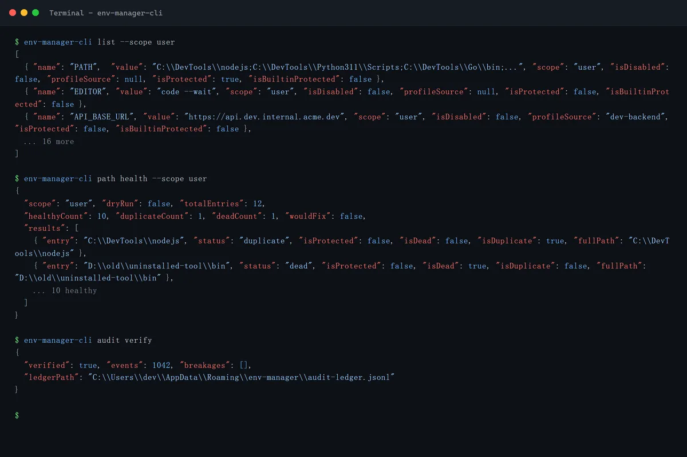
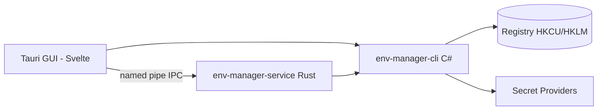

<!-- canonical: ../../README.md -->
<!-- sync: ef2a485dfffb -->

<div align="center">

<picture>
  <source media="(prefers-color-scheme: dark)" srcset="../../docs/assets/logo-dark-theme.png">
  <source media="(prefers-color-scheme: light)" srcset="../../docs/assets/logo-light-theme.png">
  
</picture>

<p align="center">
  
</p>

# Env Manager

Менеджер переменных окружения Windows с двумя интерфейсами — CLI на C#, созданный для скриптов и ИИ-агентов, и GUI на Tauri для интерактивного редактирования — поверх единого набора контрактов реестра.

**«Адаптируется безупречно к любому окружению.»**

[](https://github.com/Xxx91n/env-manager/releases)
[](../../LICENSE)
[](#установка)
[](#предварительные-требования)
[](#архитектура)

[Установка](#установка) · [Возможности](#возможности) · [Справка по CLI](../../docs/cli-commands.md) · [Архитектура](#архитектура) · [Changelog](../../CHANGELOG.md)

<!-- README-I18N:START -->
**Языки:** [English](../../README.md) · [简体中文](README.zh_CN.md) · [日本語](README.ja.md) · [한국어](README.ko.md) · [Deutsch](README.de.md) · [Français](README.fr.md) · [Español](README.es.md) · [Português](README.pt.md) · **Русский** · [العربية](README.ar.md)
<!-- README-I18N:END -->

</div>

## Демонстрация

### GUI

| | | |
|:-:|:-:|:-:|
| <br>**Переменные** — поиск, фильтр по области, действия по строкам | <br>**Область system** — защищённые записи заблокированы | <br>**Редактор PATH** — обнаружение мёртвых записей и дубликатов |
| <br>**Профили** — применить / запустить / наследовать | <br>**Журнал аудита** — хеш-цепочка, проверяемый | <br>**Диспетчер службы** — монтирование секретов |

### CLI

<p align="center">
  
</p>

| | |
|:-:|:-:|
| <br>**JSON-first вывод** — `agents --json` отдаёт полную спецификацию команд | CLI — первоклассная поверхность: 18+ команд, каждая пригодна для скриптов и потребляется в JSON. Руководство для агентов поставляется внутри бинарника — выполните `env-manager-cli agents`, чтобы его вывести. Команды только для чтения выше используют смоделированный вывод терминала; перегенерация: `node scripts/demo/capture.mjs`. |

## Возможности

- **Два интерфейса** — `env-manager-cli` для скриптов и CI, `env-manager.exe` (Tauri 2 + Svelte) для интерактивного редактирования. Оба проходят через одни и те же контракты реестра.
- **Защита по умолчанию** — системные переменные и записи PATH нельзя удалить или переименовать; каждая запись сериализуется через три уровня (mutex + блокировка записи + проверка перед заменой).
- **Профили** — глобальные профили применяются к реестру; профили запуска внедряют изолированный блок окружения в отдельный процесс, не трогая реестр. Наследование, предпросмотр конфликтов, откат в обратном порядке.
- **8 провайдеров секретов** — DPAPI, Credential Manager, SecretStore, HashiCorp Vault, SOPS, Azure Key Vault, 1Password, AWS Secrets Manager. Команды работы с секретами сохраняют только конверты с шифротекстом; граница присутствия открытого текста описана в разделе [Безопасность](#безопасность) и в [docs/plaintext-sinks.md](../../docs/plaintext-sinks.md).
- **Проверка PATH** — `path health` обнаруживает дубликаты и мёртвые записи; `--fix` переписывает, `--dry-run` отчитывается.
- **Журнал аудита** — история только на добавление (append-only), скреплённая цепочкой хэшей SHA256, с откатом и экспортом для аварийного восстановления.

## Для ИИ-агентов

```bash
env-manager-cli agents            # print the embedded agent manual
env-manager-cli agents --path     # file path of the manual (AGENTS.cli.md)
env-manager-cli agents --summary  # one-line machine-readable spec
env-manager-cli agents --json     # full command table as structured JSON
```

- [AGENTS.md](../../AGENTS.md) — инструкции уровня репозитория для агентов (архитектура, жёсткие границы, тестирование).
- [AGENTS.cli.md](../../AGENTS.cli.md) — поставляется внутри бинарника CLI, чтобы агент мог обнаружить контракт во время выполнения.
- **Поверхность, ограниченная по возможностям** — опциональный (opt-in) белый список `agentCapabilities` в `secret-providers.json` позволяет развёртываниям отклонять параллельные вызовы set/delete от агентов.

## Безопасность

> [!WARNING]
> Текущие сборки **не подписаны кодом**. Windows SmartScreen может показать предупреждение о «нераспознанном приложении» при первом запуске — нажмите «Подробнее», затем «Выполнить в любом случае». Мы подали заявку на бесплатную подпись кода для open-source через SignPath Foundation; после одобрения все артефакты релиза (MSI + EXE) будут подписаны. См. [Политика подписи кода](../../docs/code-signing-policy.md).

Защищённые переменные и записи PATH отключаются перед удалением, а при восстановлении проверяется точный тип значения в реестре. IPC через named pipe использует флаги против перехвата (anti-squatting) и валидацию ввода (максимум 64 аргумента, лимит 32767 символов, отклонение нулевых байтов). О сообщении уязвимостей см. [SECURITY.md](../../SECURITY.md).

**Модель угроз.** Противник, от которого мы *не* защищаем, — это любой процесс, запущенный внутри вашей собственной пользовательской сессии Windows: он и так может вызвать `profile reveal-secret`, прочитать блок окружения запущенного дочернего процесса или перехватить временные файлы, создаваемые провайдерами. Что дизайн действительно *ограничивает*: шифротекст DPAPI-CurrentUser нерасшифровываем для другого пользователя или машины, секреты не могут попасть в реестр, и ни одно другое хранилище, кроме предусмотренного пути reveal, не *предназначено* для переноса значения секрета.

**Граница открытого текста.** Полная матрица по каждому хранилищу — где может существовать открытый текст, как долго и кто его удаляет — находится в [docs/plaintext-sinks.md](../../docs/plaintext-sinks.md); раздел Plaintext lifecycle в `docs/architecture.md` — авторитетный белый список по каждой поверхности. Обнуление памяти и очистка логов — гигиена по возможности, а не гарантии; `tests/canary-redaction.Tests.ps1` сканирует 7 мест вывода на подложенный canary, а общий набор контрактных тестов проверяет `plaintext-never-in-envelope` для всех 8 провайдеров.

## Установка

### Установщик MSI

Скачайте MSI из [GitHub Releases](https://github.com/Xxx91n/env-manager/releases) и запустите его. Ярлыки в меню «Пуск» создаются автоматически. Доступны сборки x64, x86 и ARM64.

### Portable

Скачайте портативный ZIP из [GitHub Releases](https://github.com/Xxx91n/env-manager/releases). Распакуйте и запустите `env-manager.exe` напрямую. Установка не требуется.

### Только CLI

Скачайте ZIP только с CLI для headless-использования или скриптов: `env-manager-cli.exe` плюс файлы `.dll`. Без GUI и без зависимости от WebView2.

### Предварительные требования

> [!IMPORTANT]
> Сборки **Portable** и **Только CLI** зависят от framework: им требуется **.NET 10 Desktop Runtime** на целевой машине — скачайте его с официальной [страницы загрузки .NET](https://dotnet.microsoft.com/download/dotnet/10.0). **Установщик MSI** проверяет наличие .NET 10 при установке и предлагает его автоматически.
>
> **WebView2 Runtime** (для GUI) предустановлен в Windows 11 и доступен для Windows 10 21H2+ от [Microsoft](https://developer.microsoft.com/microsoft-edge/webview/).

По опциональным внешним инструментам провайдеров секретов (SOPS, 1Password CLI, Vault CLI, AWS CLI, Azure CLI, PowerShell 7) см. [Руководство по провайдерам секретов](../../docs/secret-providers-guide.md).

### winget

> [!NOTE]
> Распространение через winget запланировано, но пока недоступно. Следите за обновлениями через GitHub Issues.

### Из исходного кода

```bash
git clone https://github.com/Xxx91n/env-manager.git
cd env-manager
cd frontend && npm ci && cd ..
node scripts/build.mjs --arch x64
```

Требуются .NET 10 SDK, Node.js 20+ и стабильный Rust с целевой платформой MSVC. Подробности см. в [docs/build-and-release.md](../../docs/build-and-release.md).

## Использование

### CLI

```bash
# List / get / set
env-manager-cli.exe list
env-manager-cli.exe get PATH
env-manager-cli.exe set JAVA_HOME "D:\jdk17" --scope system

# Create a Launch profile and launch with isolated env
env-manager-cli.exe profile create dev --type launch --target python.exe
env-manager-cli.exe profile add-secret dev API_KEY "sk-xxx"
env-manager-cli.exe profile launch dev

# PATH health
env-manager-cli.exe path health

# Backup / restore
env-manager-cli.exe backup --output backup.json
env-manager-cli.exe restore backup.json

# Disaster recovery + tamper-evident audit
env-manager-cli.exe export-state --output state.dpapi
env-manager-cli.exe audit verify --strict

# Service control
env-manager-cli.exe service status
```

Полную справку по командам см. в [docs/cli-commands.md](../../docs/cli-commands.md).

### GUI

Запустите `env-manager.exe`. GUI предоставляет список переменных в реальном времени с поиском, фильтрацией по области, встроенным редактированием, редактором PATH с переупорядочиванием перетаскиванием, управлением профилями, выбором провайдера секретов, панелью управления службой, историей аудита и i18n на 10 языках.

## Архитектура



- **CLI**: исполняемый файл-одиночка на C# .NET 10 — уровень координации и шлюз к реестру.
- **Служба**: автономный бинарник на Rust, управляющий жизненным циклом монтирования секретов через IPC по named pipe.
- **GUI**: фронтенд на Tauri 2 + Svelte 4, использующий те же контракты IPC.

## Провайдеры секретов

8 бэкендов провайдеров с предварительной проверкой активации — ошибки отображаются встроенными янтарными баннерами прямо в редакторе профилей:

| Провайдер | Метод аутентификации | Периодическое обновление | Документы |
|---|---|---|---|
| DPAPI CurrentUser | Windows DPAPI | Нет (per-user) | [Руководство](../../docs/secret-providers-guide.md) |
| Windows Credential Manager | CredMan + DPAPI | Нет (per-user) | [Руководство](../../docs/secret-providers-guide.md) |
| PowerShell SecretManagement | SecretStore vault | По возможности | [Руководство](../../docs/secret-providers-guide.md) |
| HashiCorp Vault KV v2 | VAULT_TOKEN / AppRole cert | Да | [Руководство](../../docs/secret-providers-guide.md) |
| SOPS | Age / PGP / KMS | Да | [Руководство](../../docs/secret-providers-guide.md) |
| Azure Key Vault | SP cert / managed identity | Да | [Руководство](../../docs/secret-providers-guide.md) |
| 1Password CLI | OP_SERVICE_ACCOUNT_TOKEN | Да | [Руководство](../../docs/secret-providers-guide.md) |
| AWS Secrets Manager | SigV4 + access keys | Да | [Руководство](../../docs/secret-providers-guide.md) |

Требования по каждому провайдеру, разовую настройку и шаги исправления ошибок активации см. в [docs/secret-providers-guide.md](../../docs/secret-providers-guide.md).

## Режим службы

`env-manager-service.exe` — автономный бинарник на Rust, управляющий жизненным циклом монтирования секретов через IPC по named pipe:

- **RuntimeMode**: Service (под управлением SCM, запуск при загрузке машины), Background (запускается пользователем), Cli (одноразовый шлюз)
- **Цикл согласования**: периодическое полное сканирование каждые 300 с, идемпотентный обработчик для каждого элемента, задержка 30 с до первого прохода
- **Журнал аудита**: `audit-ledger.jsonl` только на добавление с цепочкой хэшей, ротацией при 100 МБ и обнаружением вмешательства
- **IPC**: флаг named pipe против перехвата, лимит запроса 65536 байт, протокол JSON с разделителем-переводом строки
- **Watchdog**: восстановление в два слоя — автоперезапуск SCM (режим Service) + watchdog GUI с ping каждые 30 с (режим Background)

## Limitations

- Текущие сборки не подписаны кодом: SmartScreen может показать предупреждение при первом запуске (см. [Безопасность](#безопасность)).
- Распространение через winget запланировано, но пока недоступно.
- Для GUI требуется WebView2 Runtime; сборки Portable и «Только CLI» требуют .NET 10 Desktop Runtime (см. «Предварительные требования»).
- Только Windows.

## Документация

| Документ | Содержание |
|---|---|
| [CHANGELOG.md](../../CHANGELOG.md) | История версий (формат keepachangelog) |
| [docs/cli-commands.md](../../docs/cli-commands.md) | Полная справка по командам CLI |
| [docs/architecture.md](../../docs/architecture.md) | Глубокая архитектура |
| [docs/plaintext-sinks.md](../../docs/plaintext-sinks.md) | Где может существовать открытый текст секретов |
| [docs/backup-and-profiles.md](../../docs/backup-and-profiles.md) | Резервное копирование, восстановление, семантика профилей |
| [docs/secret-providers-guide.md](../../docs/secret-providers-guide.md) | Настройка провайдеров секретов |
| [docs/build-and-release.md](../../docs/build-and-release.md) | Процесс сборки и релиза |
| [AGENTS.md](../../AGENTS.md) / [AGENTS.cli.md](../../AGENTS.cli.md) | Руководства для агентов |

## Поддержка

[@Xxx91n](https://github.com/Xxx91n)

## Вклад в проект

Приветствуются issues и PR. Сначала прочтите [AGENTS.md](../../AGENTS.md): там описаны границы архитектуры и политика тестирования.

## Лицензия

Apache-2.0 © 2026 Env Manager Contributors. См. [LICENSE](../../LICENSE).
