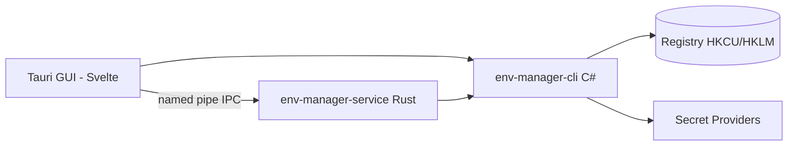

<!-- canonical: ../../README.md -->
<!-- sync: 952812b58e9c0d3cf82955667674f2f5e7c3ac5f -->

<div align="center">

<picture>
  <source media="(prefers-color-scheme: dark)" srcset="../../docs/assets/logo-dark-theme.png">
  <source media="(prefers-color-scheme: light)" srcset="../../docs/assets/logo-light-theme.png">
  
</picture>

# Env Manager

Удобный инструмент для работы с переменными окружения в Windows. Предлагает два варианта работы на выбор: консольную утилиту на C# для скриптов и ИИ-агентов, а также настольное приложение на Tauri с наглядным графическим интерфейсом. Оба варианта работают строго по единым правилам реестра.

**«Легко подстраивается под любое окружение.»**

[](https://github.com/Xxx91n/env-manager/releases)
[](../../LICENSE)
[](#установка)
[](#предварительные-требования)
[](#архитектура)

[Установка](#установка) · [Возможности](#возможности) · [Справка по CLI](../../docs/cli-commands.md) · [Архитектура](#архитектура) · [История изменений](../../CHANGELOG.md)

<!-- README-I18N:START -->
**Языки:** [English](../../README.md) · [简体中文](README.zh_CN.md) · [日本語](README.ja.md) · [한국어](README.ko.md) · [Deutsch](README.de.md) · [Français](README.fr.md) · [Español](README.es.md) · [Português](README.pt.md) · **Русский** · [العربية](README.ar.md)
<!-- README-I18N:END -->

</div>

## Демонстрация

https://github.com/user-attachments/assets/7657b508-42bb-45a8-94b7-7c1fa052a4d0

## Возможности

- **Два интерфейса на выбор** — утилита командной строки `env-manager-cli` для автоматизации и CI/CD, а также приложение `env-manager.exe` (Tauri 2 + Svelte 5) для ручного управления. Оба работают по одинаковым правилам реестра.
- **Безопасность из коробки** — системные переменные и записи PATH защищены от случайного удаления или переименования. При изменении имени или области видимости приложение сначала запишет и проверит новое значение и только потом удалит старое. Каждая запись защищена тремя замками: мьютексом Windows в CLI, блокировкой чтения-записи в оболочке на Rust и очередью записи в графическом интерфейсе.
- **Профили под любые задачи** — глобальный профиль сразу записывает свои значения в реестр Windows, а профиль запуска передаёт переменные напрямую в окружение дочернего процесса и вообще не трогает реестр. Профили могут наследовать настройки друг от друга, а программа заранее покажет возможные конфликты до их применения.
- **Девять провайдеров секретов** — DPAPI, Диспетчер учётных данных Windows, SecretStore, HashiCorp Vault, SOPS, Azure Key Vault, 1Password, AWS Secrets Manager и AWS IAM Roles Anywhere. Секреты хранятся только в зашифрованных контейнерах или по ссылкам вида `mount:<id>`. Обычные команды `add-var` и `edit-var` могут сохранять открытый текст в реестр — подробнее границы описаны в разделе [Безопасность](#безопасность) и в файле [docs/plaintext-sinks.md](../../docs/plaintext-sinks.md).
- **Порядок в PATH** — команда `path health` находит дубликаты и несуществующие пути. Флаг `--fix` наведёт порядок автоматически, а `--dry-run` просто покажет отчёт без изменений.
- **Надёжный журнал аудита** — последовательная запись истории изменений с хеш-цепочкой SHA-256, возможностью отката и выгрузкой архива на случай аварийного восстановления.

## Для ИИ-агентов

```bash
env-manager-cli agents            # показать встроенную инструкцию для агентов
env-manager-cli agents --path     # путь к файлу инструкции (AGENTS.cli.md)
env-manager-cli agents --summary  # краткая спецификация в одну строку для парсинга
env-manager-cli agents --json     # полная таблица команд в формате JSON
```

- [AGENTS.md](../../AGENTS.md) — общие инструкции для агентов на уровне репозитория (архитектура, границы системы, правила тестирования).
- [AGENTS.cli.md](../../AGENTS.cli.md) — инструкция, встроенная прямо в бинарник CLI, чтобы агент мог прочитать её на лету.

## Безопасность

> [!WARNING]
> Текущие сборки пока **не подписаны цифровой подписью**. При первом запуске Windows SmartScreen может выдать предупреждение о неизвестном издателе — нажмите «Подробнее», а затем «Выполнить в любом случае». Мы уже подали заявку на бесплатную подпись для проектов с открытым исходным кодом через SignPath Foundation. Как только заявку одобрят, все файлы выпусков (MSI и EXE) будут подписаны. Подробнее см. в [Политике подписи кода](../../docs/code-signing-policy.md).

Защищённые переменные и пути PATH перед удалением сначала отключаются, а при восстановлении программа сверяет точный тип данных реестра. Любые значения проверяются до записи в реестр. Именованный канал отклоняет попытки перехвата вторым процессом и ограничивает размер запроса до 65 536 байт. О том, как сообщить об уязвимости, читайте в [SECURITY.md](../../SECURITY.md).

**Модель угроз.** Приложение не защищает от процессов, запущенных прямо в вашем текущем сеансе Windows. Любая такая программа уже имеет доступ к вашему сеансу: она может вызвать `profile reveal-secret`, прочитать переменные запущенного дочернего процесса или перехватить недолговечные временные файлы провайдеров. Однако архитектура надёжно ограничивает область риска: зашифрованные через DPAPI CurrentUser данные не сможет расшифровать другой пользователь или на другом компьютере, специальные команды для работы с секретами никогда не записывают их в реестр (не считая стандартных команд для обычных переменных), а список всех мест, где в принципе может оказаться секрет, открыто приведён в таблице по ссылке ниже.

**Где может появляться открытый текст.** Полная таблица — в каких именно местах может появляться незашифрованный текст, как долго он там живёт и как очищается — собрана в [docs/plaintext-sinks.md](../../docs/plaintext-sinks.md). Раздел «Plaintext lifecycle» в `docs/architecture.md` служит главным и точным справочником по каждой поверхности. Затирание памяти и очистка журналов выполняются по мере возможностей системы, без абсолютных гарантий: тест `tests/canary-redaction.Tests.ps1` проверяет 7 точек вывода на утечку тестовой строки, а общий набор тестов подтверждает правило `plaintext-never-in-envelope` для восьми провайдеров; для `aws-roles-anywhere` это проверяет отдельный офлайн-тест.

## Установка

### Установщик MSI

Скачайте файл MSI со страницы [GitHub Releases](https://github.com/Xxx91n/env-manager/releases) и запустите его. Ярлыки в меню «Пуск» появятся автоматически. Доступны сборки под архитектуры x64, x86 и ARM64.

### Портативная версия (Portable)

Скачайте архив ZIP со страницы [GitHub Releases](https://github.com/Xxx91n/env-manager/releases). Распакуйте его в удобную папку и запустите `env-manager.exe`. Никакой установки не требуется.

### Только консольная утилита (CLI-Only)

Если вам нужен только инструмент для командной строки или скриптов, скачайте облегчённый архив: внутри находится `env-manager-cli.exe` со всеми нужными библиотеками `.dll`. Без графической оболочки и без необходимости ставить WebView2.

### Предварительные требования

> [!IMPORTANT]
> Версиям **Portable** и **Только CLI** для запуска требуется среда **.NET 10 Desktop Runtime** — её можно скачать с официальной [страницы загрузки .NET](https://dotnet.microsoft.com/download/dotnet/10.0). **Установщик MSI** не проверяет и не ставит .NET автоматически, поэтому установите среду заранее перед первым запуском.
>
> **Среда WebView2 Runtime** (нужна для графического интерфейса) уже встроена в Windows 11, а для Windows 10 (начиная с 21H2) её можно загрузить у [Microsoft](https://developer.microsoft.com/microsoft-edge/webview/).

Если вы планируете пользоваться внешними утилитами провайдеров секретов (SOPS, 1Password CLI, Vault CLI, AWS CLI, Azure CLI, PowerShell 7), загляните в [Руководство по провайдерам секретов](../../docs/secret-providers-guide.md).

### winget

> [!NOTE]
> Установка через winget запланирована и скоро появится. За новостями можно следить в GitHub Issues.

### Сборка из исходников

```bash
git clone https://github.com/Xxx91n/env-manager.git
cd env-manager
cd frontend && npm ci && cd ..
node scripts/build.mjs --arch x64
```

Для сборки понадобятся .NET 10 SDK, Node.js 18+ и свежий стабильный Rust с целевой платформой MSVC или GNU. Все подробности описаны в [docs/build-and-release.md](../../docs/build-and-release.md).

## Использование

### Командная строка (CLI)

```bash
# Просмотр, получение и установка значений
env-manager-cli.exe list
env-manager-cli.exe get PATH
env-manager-cli.exe set JAVA_HOME "D:\jdk17" --scope system

# Создание профиля запуска и запуск программы в изолированном окружении
env-manager-cli.exe profile create dev --type launch --target python.exe
env-manager-cli.exe profile add-secret dev API_KEY "sk-xxx"
env-manager-cli.exe profile launch dev

# Проверка и очистка путей в PATH
env-manager-cli.exe path health

# Резервная копия и восстановление
env-manager-cli.exe backup --output backup.json
env-manager-cli.exe restore backup.json

# Аварийная выгрузка состояния и проверка журнала аудита
env-manager-cli.exe export-state --output state.dpapi
env-manager-cli.exe audit verify --strict

# Проверка состояния фоновой службы
env-manager-cli.exe service status
```

Полный список всех команд и параметров доступен в [docs/cli-commands.md](../../docs/cli-commands.md).

### Графический интерфейс (GUI)

Запустите `env-manager.exe`. В окне программы доступен живой список переменных с поиском, фильтрацией по областям видимости и быстрым редактированием по месту, удобный редактор PATH с сортировкой перетаскиванием, управление профилями, выбор провайдеров секретов, управление службой, просмотр журнала аудита и поддержка 10 языков.

## Архитектура



- **CLI**: исполняемый файл на C# .NET 10. Именно он управляет логикой работы и остаётся единственным компонентом, который пишет данные в реестр.
- **Служба**: отдельный бинарник на Rust, который поддерживает актуальность подключённых секретов через именованный канал.
- **GUI**: настольное приложение на Tauri 2 + Svelte 5, использующее те же самые контракты взаимодействия.

## Провайдеры секретов

Поддерживаются девять провайдеров секретов. При выборе каждого из них приложение сразу проверяет готовность к работе, а в случае проблем показывает предупреждение прямо в окне профиля:

| Провайдер | Способ входа | Обновление по таймеру | Документация |
|---|---|---|---|
| DPAPI CurrentUser | Windows DPAPI | Нет (для текущего пользователя) | [Руководство](../../docs/secret-providers-guide.md) |
| Диспетчер учётных данных Windows | Credential Manager + DPAPI | Нет (для текущего пользователя) | [Руководство](../../docs/secret-providers-guide.md) |
| PowerShell SecretManagement | Хранилище SecretStore | Нет (`CreatedOnly`) | [Руководство](../../docs/secret-providers-guide.md) |
| HashiCorp Vault KV v2 | VAULT_TOKEN / сертификат AppRole | Да | [Руководство](../../docs/secret-providers-guide.md) |
| SOPS | Age / PGP / KMS | Нет (`CreatedOnly`) | [Руководство](../../docs/secret-providers-guide.md) |
| Azure Key Vault | Сертификат Service Principal / Managed Identity | Да | [Руководство](../../docs/secret-providers-guide.md) |
| 1Password CLI | OP_SERVICE_ACCOUNT_TOKEN | Да | [Руководство](../../docs/secret-providers-guide.md) |
| AWS Secrets Manager | Ключи доступа SigV4 | Да | [Руководство](../../docs/secret-providers-guide.md) |
| AWS IAM Roles Anywhere | Сертификат из хранилища машины в обмен на временные учётные данные | Нет, пока нет: служба не перечитывает значения `Periodic` | [Руководство](../../docs/secret-providers-guide.md) |

Подробные требования к каждому провайдеру, первичную настройку и инструкции по решению типичных ошибок смотрите в [docs/secret-providers-guide.md](../../docs/secret-providers-guide.md).

## Режим службы

Фоновая служба `env-manager-service.exe` написана на Rust, следит за актуальностью секретов и отвечает на запросы через именованный канал:

- **ServiceMode**: Служба Windows (управляется SCM, стартует при включении ПК), Фоновый режим (запускается текущим пользователем) или Режим CLI (однократный шлюз).
- **Цикл согласования (Reconcile loop)**: регулярная полная проверка каждые 300 секунд, надёжная обработка каждого элемента с защитой от повторов и начальная пауза 30 секунд перед первым запуском.
- **Журнал аудита**: защищённый файл `audit-ledger.jsonl` в режиме добавления с контролем целостности, ротацией при достижении 100 МБ и защитой от подделки.
- **IPC-канал**: защита от перехвата чужим процессом, ограничение размера запроса в 65 536 байт и общение через JSON со строками-разделителями.
- **Сторожевой таймер (Watchdog)**: двухуровневая защита от сбоев — автоперезапуск через диспетчер служб Windows (в режиме службы) плюс пинг каждые 30 секунд из графического интерфейса (в фоновом режиме).

## Документация

| Документ | О чём рассказывается |
|---|---|
| [CHANGELOG.md](../../CHANGELOG.md) | История всех версий проекта |
| [docs/cli-commands.md](../../docs/cli-commands.md) | Полный справочник команд CLI |
| [docs/architecture.md](../../docs/architecture.md) | Подробное описание архитектуры и внутреннего устройства |
| [docs/plaintext-sinks.md](../../docs/plaintext-sinks.md) | Список мест, где могут появляться незашифрованные секреты |
| [docs/backup-and-profiles.md](../../docs/backup-and-profiles.md) | Резервные копии, восстановление и логика профилей |
| [docs/secret-providers-guide.md](../../docs/secret-providers-guide.md) | Инструкция по настройке провайдеров секретов |
| [docs/build-and-release.md](../../docs/build-and-release.md) | Руководство по сборке и выпуску релизов |
| [AGENTS.md](../../AGENTS.md) / [AGENTS.cli.md](../../AGENTS.cli.md) | Памятки и инструкции для ИИ-агентов |

## Авторы

[@Xxx91n](https://github.com/Xxx91n)

## Участие в разработке

Мы всегда рады предложениям, отчётам об ошибках и пулл-реквестам. Перед началом работы загляните в [AGENTS.md](../../AGENTS.md) — там описаны архитектурные границы и правила тестирования.

## Лицензия

Проект распространяется под лицензией Apache-2.0 © 2026 Env Manager Contributors. Подробности в файле [LICENSE](../../LICENSE).
