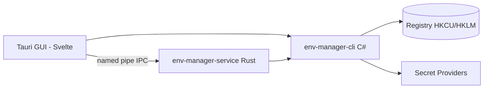

<!-- canonical: ../../README.md -->
<!-- sync: ef2a485dfffb -->

<div align="center">

<picture>
  <source media="(prefers-color-scheme: dark)" srcset="../../docs/assets/logo-dark-theme.png">
  <source media="(prefers-color-scheme: light)" srcset="../../docs/assets/logo-light-theme.png">
  
</picture>


# Env Manager

Windows 环境变量管理器，提供两个前端——为脚本和 AI agent 打造的 C# CLI，以及用于交互式编辑的 Tauri GUI——共享同一套注册表契约。

**"无缝适配每一个环境。"**

[](https://github.com/Xxx91n/env-manager/releases)
[](../../LICENSE)
[](#安装)
[](#前置要求)
[](#架构)

[安装](#安装) · [功能](#功能) · [CLI 参考](../../docs/cli-commands.md) · [架构](#架构) · [更新日志](../../CHANGELOG.md)

<!-- README-I18N:START -->
**语言:** [English](../../README.md) · **简体中文** · [日本語](README.ja.md) · [한국어](README.ko.md) · [Deutsch](README.de.md) · [Français](README.fr.md) · [Español](README.es.md) · [Português](README.pt.md) · [Русский](README.ru.md) · [العربية](README.ar.md)
<!-- README-I18N:END -->

</div>

## 展示

### GUI

| | | |
|:-:|:-:|:-:|
| <br>**变量** —— 搜索、作用域筛选、逐行操作 | <br>**System 作用域** —— 受保护条目已锁定 | <br>**PATH 编辑器** —— 失效与重复项检测 |
| <br>**配置文件** —— apply / launch / 继承 | <br>**审计账本** —— 哈希链式、可验证 | <br>**服务管理** —— 机密挂载 |

## 功能

- **双前端** —— `env-manager-cli` 面向脚本与 CI，`env-manager.exe`（Tauri 2 + Svelte）面向交互式编辑。两者都走同一套注册表契约。
- **默认受保护** —— 系统变量和 PATH 条目不可删除或改名；每次写入都经三层串行化（互斥锁 + 写锁 + 换前验证）。
- **配置文件** —— Global 配置文件应用到注册表；Launch 配置文件向单个进程注入隔离的环境块，不触碰注册表。支持继承、冲突预览、逆序回滚。
- **8 种机密提供者** —— DPAPI、Credential Manager、SecretStore、HashiCorp Vault、SOPS、Azure Key Vault、1Password、AWS Secrets Manager。secret 动词仅持久化密文信封或 `mount:<id>` 引用——通用 `add-var`/`edit-var` 缺口仍可能把明文写入注册表；明文暴露边界见[安全](#安全)和 [docs/plaintext-sinks.md](../../docs/plaintext-sinks.md)。
- **PATH 健康检查** —— `path health` 检测重复和失效条目；`--fix` 重写，`--dry-run` 仅报告。
- **审计账本** —— 追加式、SHA256 哈希链历史，支持回滚与容灾恢复导出。

## AI Agent 专区

```bash
env-manager-cli agents            # print the embedded agent manual
env-manager-cli agents --path     # file path of the manual (AGENTS.cli.md)
env-manager-cli agents --summary  # one-line machine-readable spec
env-manager-cli agents --json     # full command table as structured JSON
```

- [AGENTS.md](../../AGENTS.md) —— 仓库级 agent 指南（架构、硬边界、测试）。
- [AGENTS.cli.md](../../AGENTS.cli.md) —— 随 CLI 二进制分发，agent 可在运行时发现契约。
- **能力范围限定的 agent 接口** —— `secret-providers.json` 上可选启用的 `agentCapabilities` 白名单让部署方可以拒绝 agent 的并行 set/delete 调用。

## 安全

> [!WARNING]
> 当前构建**未经代码签名**。Windows SmartScreen 可能在首次启动时显示“无法识别的应用”警告——点击“更多信息”然后选择“仍要运行”。我们已通过 SignPath Foundation 申请免费的开源代码签名；获批后，所有发布产物（MSI + EXE）都将签名。参见[代码签名政策](../../docs/code-signing-policy.md)。

受保护的环境变量和 PATH 条目在删除前会被禁用，恢复时进行精确的注册表值类型验证。命名管道 IPC 使用防劫持标志和输入验证（最大 64 参数，32767 字符上限，拒绝空字节）。漏洞报告请参见 [SECURITY.md](../../SECURITY.md)。

**威胁模型。** 本设计*不*设防的对手是运行在你自己 Windows 用户会话内的任何进程——它本就可以调用 `profile reveal-secret`、读取被启动子进程的环境块、或截获提供者产生的临时文件。本设计*真正*约束的是：DPAPI-CurrentUser 密文对其他用户、其他机器不可解密；secret 命令不会把机密落入注册表（前述通用命令缺口除外）；除明文边界矩阵中记录在案的设计性 sink 外，没有任何 sink *旨在*承载机密值。

**明文边界。** 完整的逐 sink 矩阵——明文可能存在于何处、存续多久、由谁清理——见 [docs/plaintext-sinks.md](../../docs/plaintext-sinks.md)；`docs/architecture.md` 的 Plaintext lifecycle 一节是逐表面的权威允许清单。内存清零与日志清洗是尽力而为的卫生措施而非保证；`tests/canary-redaction.Tests.ps1` 对 7 个输出 sink 植入 canary 扫描，共享契约套件对全部 8 个提供者断言 `plaintext-never-in-envelope`。

## 安装

### MSI 安装包

从 [GitHub Releases](https://github.com/Xxx91n/env-manager/releases) 下载 MSI 并运行。自动创建开始菜单快捷方式。提供 x64、x86、ARM64 版本。

### 便携版

从 [GitHub Releases](https://github.com/Xxx91n/env-manager/releases) 下载便携版 ZIP。解压后直接运行 `env-manager.exe`，无需安装。

### 仅 CLI

下载 CLI-only ZIP 用于无头或脚本场景：`env-manager-cli.exe` 加 `.dll` 文件。无 GUI，不依赖 WebView2。

### 前置要求

> [!IMPORTANT]
> **便携版**和**仅 CLI** 构建为框架依赖部署：目标机器需要 **.NET 10 Desktop Runtime**——请从官方 [.NET 下载页](https://dotnet.microsoft.com/download/dotnet/10.0)获取。**MSI 安装包**不检测也不安装 .NET——请在首次启动前自行安装运行时。
>
> **WebView2 运行时**（GUI 所需）已预装于 Windows 11，Windows 10 21H2+ 可从 [Microsoft](https://developer.microsoft.com/microsoft-edge/webview/)获取。

可选的外部机密提供者工具（SOPS、1Password CLI、Vault CLI、AWS CLI、Azure CLI、PowerShell 7），请参阅[机密提供者指南](../../docs/secret-providers-guide.md)。

### winget

> [!NOTE]
> winget 分发已计划但尚未上线。请通过 GitHub Issues 关注更新。

### 从源码构建

```bash
git clone https://github.com/Xxx91n/env-manager.git
cd env-manager
cd frontend && npm ci && cd ..
node scripts/build.mjs --arch x64
```

需要 .NET 10 SDK、Node.js 18+、Rust 稳定版（MSVC 或 GNU 目标）。详见 [docs/build-and-release.md](../../docs/build-and-release.md)。

## 用法

### CLI

```bash
# List / get / set
env-manager-cli.exe list
env-manager-cli.exe get PATH
env-manager-cli.exe set JAVA_HOME "D:\jdk17" --scope system

# Create a Launch profile and launch with isolated env
env-manager-cli.exe profile create dev --type launch --target python.exe
env-manager-cli.exe profile add-secret dev API_KEY "sk-xxx"
env-manager-cli.exe profile launch dev

# PATH health
env-manager-cli.exe path health

# Backup / restore
env-manager-cli.exe backup --output backup.json
env-manager-cli.exe restore backup.json

# Disaster recovery + tamper-evident audit
env-manager-cli.exe export-state --output state.dpapi
env-manager-cli.exe audit verify --strict

# Service control
env-manager-cli.exe service status
```

完整命令参考请见 [docs/cli-commands.md](../../docs/cli-commands.md)。

### GUI

运行 `env-manager.exe`。GUI 提供实时变量列表（搜索、范围筛选、内联编辑）、支持拖拽排序的 PATH 编辑器、配置文件管理、机密提供者选择、服务控制面板、审计历史和 10 语言国际化。

## 架构



- **CLI**：C# .NET 10 单文件可执行程序——协调层与注册表网关。
- **服务**：独立 Rust 二进制，通过命名管道 IPC 管理机密挂载生命周期。
- **GUI**：Tauri 2 + Svelte 5 前端，使用同一套 IPC 契约。

## 机密提供者

8 种提供者后端，均带激活预检——失败时在配置文件编辑器中直接显示内联琥珀色横幅：

| 提供者 | 认证方式 | 定期刷新 | 文档 |
|---|---|---|---|
| DPAPI CurrentUser | Windows DPAPI | 否（用户绑定） | [指南](../../docs/secret-providers-guide.md) |
| Windows Credential Manager | CredMan + DPAPI | 否（用户绑定） | [指南](../../docs/secret-providers-guide.md) |
| PowerShell SecretManagement | SecretStore 保险库 | 否（CreatedOnly）| [指南](../../docs/secret-providers-guide.md) |
| HashiCorp Vault KV v2 | VAULT_TOKEN / AppRole 证书 | 是 | [指南](../../docs/secret-providers-guide.md) |
| SOPS | Age / PGP / KMS | 否（CreatedOnly）| [指南](../../docs/secret-providers-guide.md) |
| Azure Key Vault | SP 证书 / 托管标识 | 是 | [指南](../../docs/secret-providers-guide.md) |
| 1Password CLI | OP_SERVICE_ACCOUNT_TOKEN | 是 | [指南](../../docs/secret-providers-guide.md) |
| AWS Secrets Manager | SigV4 + 访问密钥 | 是 | [指南](../../docs/secret-providers-guide.md) |

逐提供者的前置要求、一次性配置和激活错误修复步骤，请参阅 [docs/secret-providers-guide.md](../../docs/secret-providers-guide.md)。

## 服务模式

`env-manager-service.exe` 是独立 Rust 二进制，通过命名管道 IPC 管理机密挂载生命周期：

- **ServiceMode**：Service（SCM 管理，开机启动）、Background（用户启动）、Cli（一次性网关）
- **协调循环**：300s 周期全量扫描，幂等逐项处理，30s 首次 tick 延迟
- **审计账本**：追加式哈希链 `audit-ledger.jsonl`，100MB 轮转，防篡改检测
- **IPC**：防劫持管道标志，65536 字节请求上限，换行分隔 JSON 协议
- **看门狗**：双层恢复——SCM 自动重启（Service 模式）+ GUI 30s ping 看门狗（Background 模式）

## 已知限制（Limitations）

- 当前构建未经代码签名 — 首次启动可能触发 SmartScreen 警告（见上方「安全」一节）。
- winget 分发尚未上线。
- GUI 需要 WebView2 Runtime；便携版与仅 CLI 构建需要 .NET 10 Desktop Runtime（见「前置要求」）。
- 仅支持 Windows。

## 文档

| 文档 | 内容 |
|---|---|
| [CHANGELOG.md](../../CHANGELOG.md) | 版本历史（keepachangelog 格式） |
| [docs/cli-commands.md](../../docs/cli-commands.md) | 完整 CLI 命令参考 |
| [docs/architecture.md](../../docs/architecture.md) | 深度架构 |
| [docs/plaintext-sinks.md](../../docs/plaintext-sinks.md) | 机密明文可能存在的位置 |
| [docs/backup-and-profiles.md](../../docs/backup-and-profiles.md) | 备份、还原、配置文件语义 |
| [docs/secret-providers-guide.md](../../docs/secret-providers-guide.md) | 机密提供者设置 |
| [docs/build-and-release.md](../../docs/build-and-release.md) | 构建和发布流程 |
| [AGENTS.md](../../AGENTS.md) / [AGENTS.cli.md](../../AGENTS.cli.md) | 面向 agent 的指南 |

## 维护者

[@Xxx91n](https://github.com/Xxx91n)

## 贡献

欢迎提交 Issue 和 PR。请先阅读 [AGENTS.md](../../AGENTS.md) 了解架构边界和测试政策。

## 许可证

Apache-2.0 © 2026 Env Manager 贡献者。详见 [LICENSE](../../LICENSE)。
