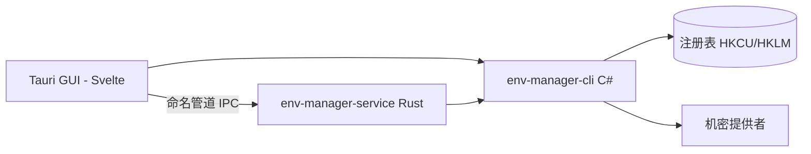

<!-- canonical: ../../README.md -->
<!-- sync: 7ef28678ebbb -->

<div align="center">

<picture>
  <source media="(prefers-color-scheme: dark)" srcset="../../docs/assets/logo-dark-theme.png">
  <source media="(prefers-color-scheme: light)" srcset="../../docs/assets/logo-light-theme.png">
  
</picture>

# Env Manager

一个好用的 Windows 环境变量管理工具。自带两套界面：专门给自动化脚本和 AI 智能体调用的 C# 命令行工具，以及适合日常点按操作的 Tauri 桌面客户端。无论用哪套界面，底层读写注册表的规则完全一致。

**“轻松搞定各种环境。”**

[](https://github.com/Xxx91n/env-manager/releases)
[](../../LICENSE)
[](#安装)
[](#前置要求)
[](#架构)

[安装](#安装) · [功能](#功能) · [CLI 参考](../../docs/cli-commands.md) · [架构](#架构) · [更新日志](../../CHANGELOG.md)

<!-- README-I18N:START -->
**语言:** [English](../../README.md) · **简体中文** · [日本語](README.ja.md) · [한국어](README.ko.md) · [Deutsch](README.de.md) · [Français](README.fr.md) · [Español](README.es.md) · [Português](README.pt.md) · [Русский](README.ru.md) · [العربية](README.ar.md)
<!-- README-I18N:END -->

</div>

## 展示

https://github.com/user-attachments/assets/7657b508-42bb-45a8-94b7-7c1fa052a4d0

## 功能

- **两套界面随心选** —— `env-manager-cli` 适合跑脚本和自动化 CI，`env-manager.exe`（基于 Tauri 2 + Svelte）方便日常直观点击操作。无论用哪一个，底层注册表操作规则都完全一致。
- **自带防误删保护** —— 系统关键变量和 PATH 条目禁止删除或重命名。改名或调整作用域时，工具会先写入并核验新值，确认无误后再清理旧项。每次写入都会同时获取三把锁：CLI 端的 Windows 互斥锁、Rust 外壳的读写锁，以及 GUI 内部的写入队列。
- **配置管理** —— 全局配置会在应用时把变量写进注册表；启动配置则只给新启动的子进程注入专属环境变量，绝不碰注册表。配置之间支持相互继承，应用前还会提前预览潜在的变量冲突。
- **支持 9 种机密提供者** —— 涵盖 DPAPI、Credential Manager、SecretStore、HashiCorp Vault、SOPS、Azure Key Vault、1Password、AWS Secrets Manager 和 AWS IAM Roles Anywhere。机密内容保存为加密信封或以 `mount:<id>` 形式按挂载引用。需要留意的是，通用的 `add-var` 和 `edit-var` 命令仍然可能将明文写进注册表；具体安全边界请看[安全](#安全)说明与 [docs/plaintext-sinks.md](../../docs/plaintext-sinks.md)。
- **PATH 健康体检** —— 运行 `path health` 就能快速揪出重复路径和已经失效的死路径；加上 `--fix` 自动清理整理，加上 `--dry-run` 仅查看报告不修改。
- **防篡改审计账本** —— 采用只增不改的 SHA256 哈希链记录每一次变更，支持一键回滚操作和导出容灾备份。

## AI 智能体专区

```bash
env-manager-cli agents            # 打印内置的智能体操作手册
env-manager-cli agents --path     # 输出手册所在文件路径 (AGENTS.cli.md)
env-manager-cli agents --summary  # 机器可读的单行规范说明
env-manager-cli agents --json     # 以标准 JSON 输出全部命令列表
```

- [AGENTS.md](../../AGENTS.md) —— 仓库级别的智能体规范（涵盖整体架构、硬性边界与测试要求）。
- [AGENTS.cli.md](../../AGENTS.cli.md) —— 随 CLI 二进制程序分发，方便智能体在运行时直接查阅交互契约。

## 安全

> [!WARNING]
> 当前构建版本**暂未进行代码签名**。首次启动时 Windows SmartScreen 可能会弹出“未知应用”的拦截提示——点击“更多信息”，再选择“仍要运行”即可。我们已经通过 SignPath Foundation 申请了免费的开源代码签名；审核通过后，后续发布的所有安装包（MSI 与 EXE）都将带上正式签名。详情可查看[代码签名政策](../../docs/code-signing-policy.md)。

受保护的系统变量与 PATH 条目在删除前会被置为禁用，恢复备份时会严格检查具体的注册表值类型。所有变量值在写入注册表前都会经过格式校验；命名管道只允许单一创建者并防止抢占，同时将单次请求上限严格限制为 65536 字节。漏洞报告流程请参见 [SECURITY.md](../../SECURITY.md)。

**威胁模型。** 本项目无法防范在你当前 Windows 用户会话内运行的恶意程序。因为同属一个用户会话的程序本来就能直接调用 `profile reveal-secret`、读取子进程的环境变量块，或者抓取机密提供者生成的短暂临时文件。不过本工具在设计上最大程度缩小了风险面：通过 DPAPI CurrentUser 加密的密文在其他用户账户或换到其他电脑上都无法解密；专属的机密命令不会把机密落入注册表（上面提到的通用变量添加命令除外）；除了下方表格明确记录的位置外，没有任何其他地方会保存机密。

**明文边界。** 完整的明文数据存放位置、存活时长以及清理机制，请查阅 [docs/plaintext-sinks.md](../../docs/plaintext-sinks.md)。`docs/architecture.md` 中的 Plaintext lifecycle 一节是对各个交互面的权威记录。内存数据清零和日志脱敏属于尽力而为的安全防护措施，并非绝对保证：`tests/canary-redaction.Tests.ps1` 会对 7 处输出位置进行金丝雀扫描验证，共享契约测试也会对全部 9 种机密提供者校验 `plaintext-never-in-envelope`。

## 安装

### MSI 安装包

直接去 [GitHub Releases](https://github.com/Xxx91n/env-manager/releases) 下载 MSI 安装包运行即可，安装时会自动生成开始菜单快捷方式。支持 x64、x86 和 ARM64 架构。

### 便携免安装版

在 [GitHub Releases](https://github.com/Xxx91n/env-manager/releases) 下载绿色便携版 ZIP 压缩包，解压后双击运行 `env-manager.exe`，无需任何安装步骤。

### 纯 CLI 版本

如果只在无桌面环境或自动化脚本中使用，可以下载纯 CLI 压缩包：里面仅包含 `env-manager-cli.exe` 及相关 `.dll` 文件，不带图形界面，也完全不需要 WebView2。

### 前置要求

> [!IMPORTANT]
> **便携版**与**纯 CLI 版本**采用框架依赖方式分发：机器上需要先安装 **.NET 10 Desktop Runtime**——可以前往官方 [.NET 下载页面](https://dotnet.microsoft.com/download/dotnet/10.0)获取。**MSI 安装包**本身不会自动下载或安装 .NET，首次启动前请先自行装好运行时。
>
> **WebView2 运行时**（GUI 桌面端所需）在 Windows 11 上已经内置，Windows 10 21H2 及以上版本可前往 [Microsoft 官网](https://developer.microsoft.com/microsoft-edge/webview/)下载安装。

关于可选的第三方机密提供者工具（如 SOPS、1Password CLI、Vault CLI、AWS CLI、Azure CLI、PowerShell 7），请参考[机密提供者指南](../../docs/secret-providers-guide.md)。

### winget

> [!NOTE]
> winget 软件包管理分发正在规划中，目前暂未上线。可以通过 GitHub Issues 关注后续进展。

### 从源码编译

```bash
git clone https://github.com/Xxx91n/env-manager.git
cd env-manager
cd frontend && npm ci && cd ..
node scripts/build.mjs --arch x64
```

编译环境需要 .NET 10 SDK、Node.js 18+ 以及 Rust 稳定版（搭配 MSVC 或 GNU 工具链）。详细说明请查阅 [docs/build-and-release.md](../../docs/build-and-release.md)。

## 用法

### 命令行 CLI

```bash
# 查看、获取与设置变量
env-manager-cli.exe list
env-manager-cli.exe get PATH
env-manager-cli.exe set JAVA_HOME "D:\jdk17" --scope system

# 创建启动配置并在独立环境中启动程序
env-manager-cli.exe profile create dev --type launch --target python.exe
env-manager-cli.exe profile add-secret dev API_KEY "sk-xxx"
env-manager-cli.exe profile launch dev

# 检查 PATH 健康状况
env-manager-cli.exe path health

# 备份与还原
env-manager-cli.exe backup --output backup.json
env-manager-cli.exe restore backup.json

# 导出容灾状态与校验防篡改审计
env-manager-cli.exe export-state --output state.dpapi
env-manager-cli.exe audit verify --strict

# 管理后台服务
env-manager-cli.exe service status
```

完整命令手册请参考 [docs/cli-commands.md](../../docs/cli-commands.md)。

### 桌面图形界面 GUI

双击运行 `env-manager.exe`。图形界面支持搜索、按作用域筛选和行内直接编辑环境变量，自带可拖拽重新排序的 PATH 编辑器，支持配置管理、切换机密提供者、管理后台服务以及查阅审计账本，界面提供 10 种语言切换。

## 架构



- **CLI**：基于 C# .NET 10 构建的可执行文件，负责统筹业务调度，并且是全系统唯一真正写入注册表的模块。
- **Service**：独立的 Rust 服务程序，通过命名管道通信，负责在后台让机密挂载持续保持最新状态。
- **GUI**：基于 Tauri 2 + Svelte 5 开发的桌面图形前端，共用同一套 IPC 契约。

## 机密提供者

支持 9 种机密提供者，每次切换时都会进行可用性检查。如果检查没通过，配置编辑器里会弹出醒目的黄色提示条：

| 提供者 | 认证方式 | 定时刷新 | 文档 |
|---|---|---|---|
| DPAPI CurrentUser | Windows DPAPI | 否（当前用户绑定） | [配置指南](../../docs/secret-providers-guide.md) |
| Windows Credential Manager | Credential Manager + DPAPI | 否（当前用户绑定） | [配置指南](../../docs/secret-providers-guide.md) |
| PowerShell SecretManagement | SecretStore 保险库 | 否（`CreatedOnly`） | [配置指南](../../docs/secret-providers-guide.md) |
| HashiCorp Vault KV v2 | VAULT_TOKEN / AppRole 证书 | 是 | [配置指南](../../docs/secret-providers-guide.md) |
| SOPS | Age / PGP / KMS | 否（`CreatedOnly`） | [配置指南](../../docs/secret-providers-guide.md) |
| Azure Key Vault | 服务主体证书 / 托管标识 | 是 | [配置指南](../../docs/secret-providers-guide.md) |
| 1Password CLI | OP_SERVICE_ACCOUNT_TOKEN | 是 | [配置指南](../../docs/secret-providers-guide.md) |
| AWS Secrets Manager | SigV4 + 访问密钥 | 是 | [配置指南](../../docs/secret-providers-guide.md) |
| AWS IAM Roles Anywhere | 用机器证书库里的证书换取临时凭据 | 是 | [配置指南](../../docs/secret-providers-guide.md) |

每种机密提供者的前置环境、初始配置步骤以及常见报错解决方法，请查阅 [docs/secret-providers-guide.md](../../docs/secret-providers-guide.md)。

## 服务模式

`env-manager-service.exe` 是一个独立的 Rust 二进制程序，通过命名管道响应请求，在后台保持机密挂载有效可用：

- **运行模式**：Service（由 Windows SCM 服务控制管理器托管，开机自启）、Background（用户前台启动的后台进程）、Cli（单次执行网关）
- **调和循环**：每 300 秒进行一次周期性全量扫描，单项处理支持幂等，首次检查延时 30 秒触发
- **审计账本**：采用只增不改的哈希链格式 `audit-ledger.jsonl`，单个文件满 100MB 自动轮换，支持篡改检测
- **进程间通信 (IPC)**：设置防抢占管道标志，限制请求大小最大 65536 字节，通信基于换行分隔的 JSON 协议
- **看门狗守护**：双层自愈机制 —— SCM 自动重启（Service 模式）+ GUI 每 30 秒心跳探测（Background 模式）

## 文档

| 文档 | 内容 |
|---|---|
| [CHANGELOG.md](../../CHANGELOG.md) | 版本变更记录（遵循 keepachangelog 规范） |
| [docs/cli-commands.md](../../docs/cli-commands.md) | 完整的 CLI 命令行参考手册 |
| [docs/architecture.md](../../docs/architecture.md) | 深入架构原理解析 |
| [docs/plaintext-sinks.md](../../docs/plaintext-sinks.md) | 机密明文可能出现的位置清单 |
| [docs/backup-and-profiles.md](../../docs/backup-and-profiles.md) | 备份、还原与配置语义说明 |
| [docs/secret-providers-guide.md](../../docs/secret-providers-guide.md) | 各类机密提供者配置指南 |
| [docs/build-and-release.md](../../docs/build-and-release.md) | 项目构建与版本发布流程 |
| [AGENTS.md](../../AGENTS.md) / [AGENTS.cli.md](../../AGENTS.cli.md) | 面向 AI 智能体的开发指南 |

## 维护者

[@Xxx91n](https://github.com/Xxx91n)

## 参与贡献

非常欢迎提交 Issue 和 PR！动工前请先阅读 [AGENTS.md](../../AGENTS.md)，了解项目的架构边界与测试规范。

## 许可证

Apache-2.0 © 2026 Env Manager 贡献者。详见 [LICENSE](../../LICENSE)。
